# Chandrayaan-2 IIRS: phase 1 research and baselines

This repository supports the first phase of **Cross-Domain Transfer of Hyperspectral Foundation Models for Lunar Mineral and Water-Ice Mapping**. The current scope is **M1 data acquisition and gap analysis, M2 calibration and preprocessing, and M3 classical and from-scratch baselines**. Earth-to-Moon foundation-model transfer starts only after these three modules pass their quality gates.

For tasks, deliverables, and pass criteria, see [the M1–M3 implementation plan](docs/m1_m3_plan.md). For the project workflow and Codex setup, read [SETUP.md](SETUP.md).

For a plain-language walkthrough of the goal, evidence, workflow, terms, and limits, see the [research guide](research_guide/README.md).

The complete execution roadmap is described below. M1 is mostly complete, M2 has a one-scene physical pilot, and M3 has exploratory baselines on proxy geologic labels. HyperFree and HyperSIGMA have been run as frozen feature extractors in an exploratory, pre-gate M4 study. They have not been fine-tuned, and no lunar-readiness claim is made.

**Latest pilot results (2026-10-10):** The radiance-unit gate now has a physical answer. The label unit is correct for all three local products (`m65` stores mW; both `d18` products store µW), and the guide's general mW statement does not hold for `d18`. E1G2 apparent reflectance (median 0.098 at 1.5 µm) and brightness temperature (median 327.8 K) are physically plausible. Temperature tracks independent SLDEM2015 terrain illumination (r = 0.877; held-out R² = 0.78). A first M3 unsupervised spectral-unit baseline is recorded; its geographic stability gate fails. The exploratory 2.9 µm parameter fails its quality gate, and no hydration claim is made. Temperatures also agree with LRO Diviner at the same local time (IIRS minus Diviner bolometric +5.0 K median, latitude-profile r = 0.81). On a frozen geographic split with proxy USGS geologic labels, per-pixel baselines reach macro F1 0.46 to 0.50, a random forest on 64-pixel context spectra reaches 0.63, and a frozen HyperSIGMA linear probe reaches 0.67. Spatial context explains most of the HyperSIGMA lead, so a benefit from Earth pretraining is not yet demonstrated. See [M2 and M3 pilot results](#m2-and-m3-pilot-results-10-october-2026) and [M3 supervised baselines and exploratory M4 transfer](#m3-supervised-baselines-and-exploratory-m4-transfer-10-october-2026).

**Earlier M1 follow-up (2026-10-10):** Exa review found three published alternatives: IIRS–M³ spectra normalized to unity at 810 nm provide a spectral-shape check only; Apollo 16 plus RELAB spectrum 62231 provides a published empirical-line absolute-reflectance route for a separate scene; and comparison with Diviner temperatures matched by ground control points and local acquisition time checks derived temperature. None resolves current-scene Level-1 units or masks. P1 reached an access block: ODE returned the M³ candidate label and file inventory, but its 2.7 GB reflectance cube and source location image link to the JPL Imaging Node, where strict TLS verification fails. Exa found a documented USGS PDS4 bundle route, but its current path returns 404; NASA Open Data has no downloadable resources. Actual valid-pixel overlap remains unmeasured; the [ODE metadata and file inventory](results/phase-1/m1-gate-followup-20261010/m3_candidate_ode_metadata.json) are saved. See the [follow-up module](results/phase-1/m1-gate-followup-20261010/summary.md). The guide/label unit conflict, saturation/fill rules, independent scale validation, and reflectance gates remain open; no new metric or reflectance product was produced.

## M2 and M3 pilot results (10 October 2026)

ISSDC has not answered the unit and mask questions, so this pilot tests the data against physics and independent lunar references instead. All results come from the 2026 E1G2 strip (`20260227T1239538758`, about 5.5°W–3.5°W, 6.5°S–26.9°N, local morning, solar zenith 57–62°) unless stated. They are **provisional pilot products**. None is a validated corrected-reflectance product, a mineral map, or a hydration result.

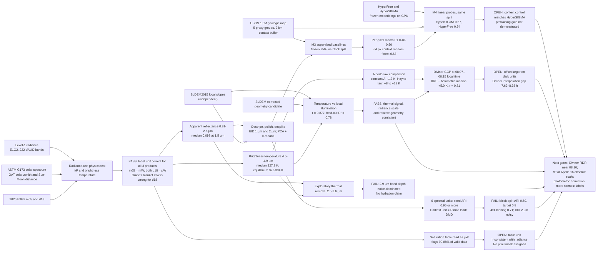

**Radiance-unit physics test (pass).** I/F was computed under both unit readings with the ASTM G173 solar spectrum and per-line OAT geometry, and brightness temperature was computed for E1G2. E1G2 I/F at 1.5 µm is 0.052 with the label's µW and 51.5 with mW. Brightness temperature is 328 K with µW and 1,207 K with mW. The 2020 `m65` product is plausible only as mW, which is its label unit, and the 2020 `d18` product only as µW, which is its label unit. The label unit is therefore correct for all three products. See the [summary](results/phase-1/m2-radiance-unit-physics/summary.md), [E1G2 values](results/phase-1/m2-radiance-unit-physics/metrics/e1g2_iof_by_band_under_unit_hypotheses.csv), and [E3G2 values](results/phase-1/m2-radiance-unit-physics/metrics/e3g2_iof_by_band_under_unit_hypotheses.csv).

**Apparent reflectance (provisional).** I/F divided by cos(i) over 0.81 to 2.6 µm, with a finite-and-positive data mask that keeps 99.61% of pixels. The median at 1.5 µm is 0.098 (p05 to p95: 0.068 to 0.150), and the dark-to-bright contrast is about 1.9 times. Spectra are red-sloped. Steps at 1.16, 1.30, 1.83, 1.99 and 3.4 µm appear in every pixel class and are probably instrument artifacts. There is no photometric correction or absolute-scale validation yet. See the [summary](results/phase-1/m2-apparent-reflectance/summary.md) and [spectra values](results/phase-1/m2-apparent-reflectance/metrics/e1g2_apparent_reflectance_spectra.csv).

**Brightness temperature (physically consistent).** Planck inversion of the 4504 to 4875 nm bands with emissivity 0.95, after removing the reflected component. The median is 327.8 K (p05 to p95: 304.7 to 342.0 K). The offset from radiative equilibrium depends on the albedo law: -1.3 K for a constant albedo of 0.12, and +8 to +18 K for the incidence-dependent law of Hayne et al. (2017). Changing the reflected-term assumption shifts the median by only -0.74 K. See the [summary](results/phase-1/m2-thermal-brightness/summary.md), [latitude values](results/phase-1/m2-thermal-brightness/metrics/e1g2_temperature_by_latitude.csv), and [albedo-model values](results/phase-1/m2-thermal-brightness/metrics/e1g2_temperature_vs_albedo_models.csv).

**Diviner temperature check (consistent at bin level).** Diviner Global Cumulative Product bolometric and channel 3 temperatures (Williams et al. 2017) were pooled per 1° latitude over 354.5 to 356.5°E and interpolated to the IIRS local time (8.12 to 8.24 h). IIRS minus Diviner bolometric is +5.0 K median (interquartile range +3.4 to +7.1 K) over 33 bins, +3.2 K with emissivity 1, and the latitude profiles correlate at r = 0.81. Surface roughness predicts an excess of 0 to about +12 K at 4.7 µm. The offset is larger on dark units, and the cause is open. Diviner is a 2009 to 2015 climatology, not a simultaneous observation, and the local-time bins bracket the IIRS time from 7.62 to 8.38 h. See the [summary](results/phase-1/m2-diviner-temperature/summary.md) and [values](results/phase-1/m2-diviner-temperature/metrics/e1g2_iirs_vs_diviner_by_latitude.csv).

**Independent topographic validation (pass).** Local cos(i) from SLDEM2015 slopes and the per-line sun direction was compared with IIRS temperature. The correlation is r = 0.877 over 3.03 million pixels. A linear fit on even 500-line blocks predicts odd blocks with R² = 0.784. The median residual from equilibrium is -1.7 K. This is a joint physical consistency test of the thermal signal, the radiance scale and the relative geometry. See the [summary](results/phase-1/m2-topographic-validation/summary.md) and [values](results/phase-1/m2-topographic-validation/metrics/e1g2_topographic_validation_summary.json).

**Exploratory thermal removal (fail).** Subtracting εB(T) over 2.45 to 3.65 µm removes the thermal rise (the median at 3.6 µm falls from 0.83 to about 0.33). The 2.9 µm band depth has a median of 0.045 with p05 to p95 of -0.15 to 0.17, so it is dominated by noise. No hydration claim is made. See the [removal values](results/phase-1/m2-thermal-brightness/metrics/e1g2_thermal_removal_spectrum.csv).

**M3 spectral units, unsupervised reference (partial).** Column flat field, scene polishing and despiking were applied, followed by 1 µm and 2 µm integrated band depth, PCA and k-means (k = 3 to 8), with seed and geographic block-split stability tests. Six units are seed-stable (ARI at least 0.95), and the darkest unit, with the deepest 1 µm band, coincides with the Rimae Bode dark mantle deposit. The block-split ARI is 0.60 or less per pixel and 0.71 with 4 x 4 pixel binning, below the 0.8 target. The 1 µm and 2 µm band depths correlate at only r = 0.02. See the [summary](results/phase-1/m3-spectral-units/summary.md), [model-selection values](results/phase-1/m3-spectral-units/metrics/e1g2_kmeans_model_selection.csv), and [binned-stability values](results/phase-1/m3-spectral-units/metrics/e1g2_binned_stability.csv).

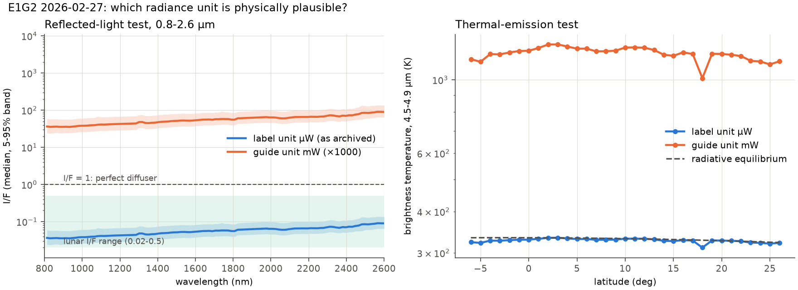

**Figure: radiance-unit physical test (E1G2).** *What it shows:* whether the stored E1G2 values are µW (as the label says) or mW (as the guide says), tested against physics. *How to read it:* in the left panel, each line is the median I/F per wavelength, with a shaded 5–95% band, under one unit reading. The green band marks the range real lunar surfaces fall in, and the dashed line at 1 is a perfect reflector. A unit reading is plausible only if its line falls inside the green band. In the right panel, each line is brightness temperature by latitude under one reading. The dashed line is the radiative-equilibrium temperature. A plausible reading follows the dashed line. Only the blue µW line passes both tests; the orange mW line is about 1000 times too bright and about 1200 K hot. *Values:* [CSV](results/phase-1/m2-radiance-unit-physics/metrics/e1g2_iof_by_band_under_unit_hypotheses.csv).

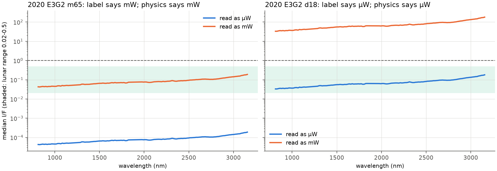

**Figure: radiance-unit physical test (2020 E3G2).** *What it shows:* the same reflected-light test for the two 2020 products, whose labels declare different units. *How to read it:* each panel is one product. The blue line reads the stored values as µW and the orange line as mW. The panel title states the label unit and the unit that physics supports. The correct reading is the line inside the green lunar range. `m65` passes only as mW and `d18` only as µW, and both agree with their labels. *Values:* [CSV](results/phase-1/m2-radiance-unit-physics/metrics/e3g2_iof_by_band_under_unit_hypotheses.csv).

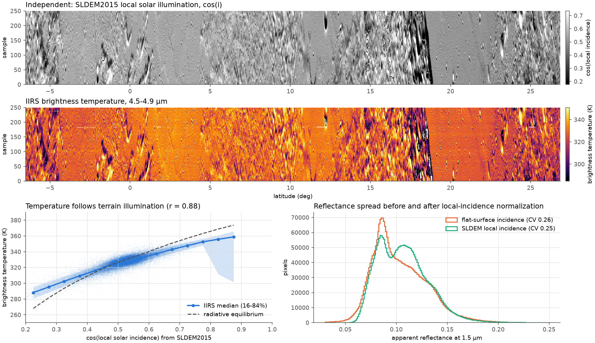

**Figure: independent topographic validation.** *What it shows:* whether IIRS temperature follows the sunlight each slope receives, computed independently from the SLDEM2015 elevation model. *How to read it:* the top strip is the sunlight each slope receives, as cos of the local solar incidence (bright = facing the Sun). The second strip is the IIRS brightness temperature (yellow = hot). In both strips latitude runs left to right and the 18 km wide strip is stretched vertically. If the measurement is real, the two strips show the same pattern. The lower-left panel plots temperature against cos(i). Faint dots are pixels, the blue line is the median with a 16–84% band, and the dashed line is the equilibrium model. A rising trend (r = 0.877) means temperature follows illumination. The lower-right panel compares histograms of 1.5 µm reflectance before (orange) and after (green) correcting for slope. Two separate peaks after correction mean that dark and bright terrain become easier to separate. *Values:* [JSON](results/phase-1/m2-topographic-validation/metrics/e1g2_topographic_validation_summary.json), [binned CSV](results/phase-1/m2-topographic-validation/metrics/e1g2_bt_vs_local_cos_incidence.csv).

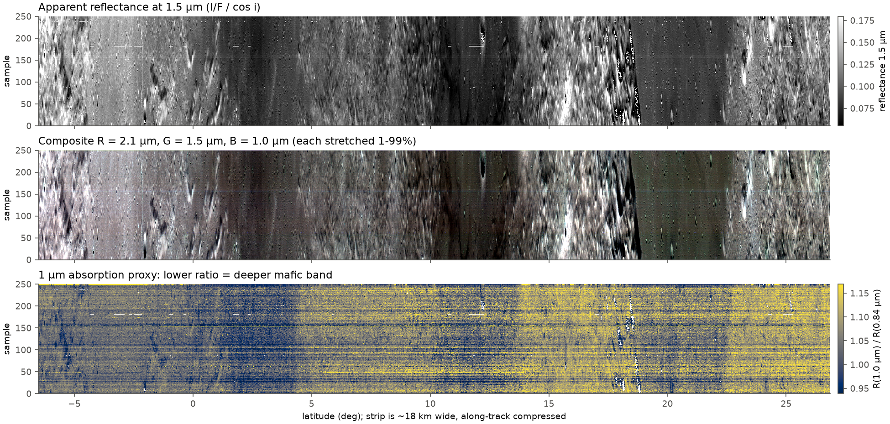

**Figure: apparent-reflectance strip maps.** *What it shows:* the first reflectance product along the whole E1G2 strip. *How to read it:* latitude runs left to right, from 6.5°S to 26.9°N. The vertical axis is the 250 detector samples across the roughly 18 km wide strip, stretched for visibility.
- **Top:** reflectance at 1.5 µm. Dark areas are mare and pyroclastic deposits; bright areas are highlands and slopes.
- **Middle:** a false-colour composite (red 2.1 µm, green 1.5 µm, blue 1.0 µm). Colour differences mean spectral differences, not mineral names.
- **Bottom:** the 1.0/0.84 µm ratio, which mostly measures spectral slope. Thin horizontal lines are detector-column striping, not geology.

White specks are pixels that failed the data mask. *Values:* [spectra CSV](results/phase-1/m2-apparent-reflectance/metrics/e1g2_apparent_reflectance_spectra.csv).

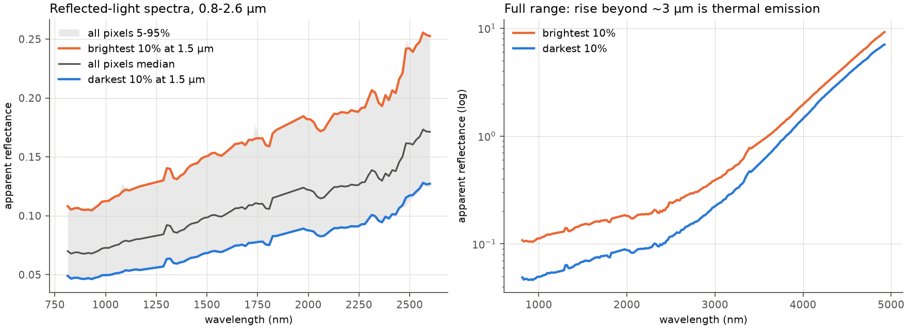

**Figure: apparent-reflectance spectra.** *What it shows:* typical spectra of the darkest and brightest 10% of pixels (at 1.5 µm) and of the whole scene. *How to read it:* the left panel covers 0.8 to 2.6 µm on a linear scale. The grey band is the 5–95% spread of all pixels. The orange and blue lines are bright and dark terrain. Their vertical gap is the albedo contrast, and the upward slope is the usual lunar "reddening". Small steps at the same wavelengths in every line are instrument artifacts. The right panel covers the full range on a log scale. The steep rise beyond about 3 µm is heat (thermal emission) from the surface, not reflected light. *Values:* [CSV](results/phase-1/m2-apparent-reflectance/metrics/e1g2_apparent_reflectance_spectra.csv).

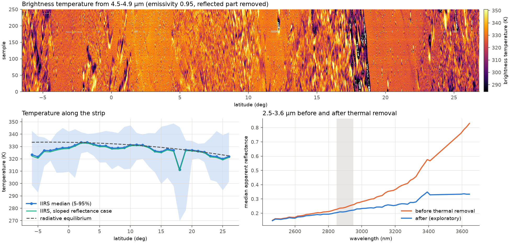

**Figure: brightness temperature and exploratory thermal removal.** *What it shows:* surface temperature derived from the 4.5 to 4.9 µm bands, and an attempt to remove heat emission near 3 µm. *How to read it:* the top strip is temperature along the strip, with latitude left to right (yellow = hot, purple = cool). Sun-facing slopes are hot and shaded slopes cool. The lower-left panel shows median temperature per 1° of latitude, with a 5–95% band, against the equilibrium model (dashed). The dip at 18°N falls on the steep Montes Apenninus. The lower-right panel shows median reflectance from 2.5 to 3.6 µm before (orange) and after (blue) removing the heat signal. The grey bar marks the 2.9 µm window used for the hydration parameter. A flat blue line means the heat signal was mostly removed. This correction is exploratory and gives no hydration result. *Values:* [latitude CSV](results/phase-1/m2-thermal-brightness/metrics/e1g2_temperature_by_latitude.csv), [removal CSV](results/phase-1/m2-thermal-brightness/metrics/e1g2_thermal_removal_spectrum.csv).

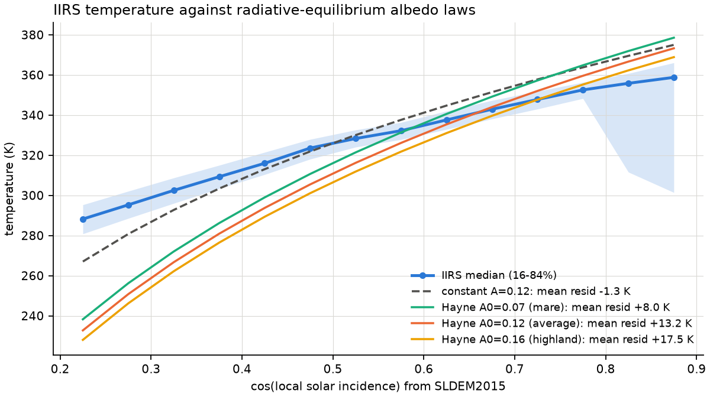

**Figure: albedo-law comparison.** *What it shows:* how close IIRS temperature is to theory under different assumptions about how much sunlight the surface reflects (albedo). *How to read it:* the x axis is the sunlight each slope receives (SLDEM cos(i)). The blue line with a band is the measured IIRS median. Each other line is a radiative-equilibrium model: a constant albedo (dashed) and the Hayne et al. (2017) incidence-dependent law for three base albedos. The legend gives each model's mean offset from IIRS. The closer the lines, the better the agreement. IIRS sits within about ±15 K of all models, so absolute temperature carries that uncertainty. *Values:* [CSV](results/phase-1/m2-thermal-brightness/metrics/e1g2_temperature_vs_albedo_models.csv).

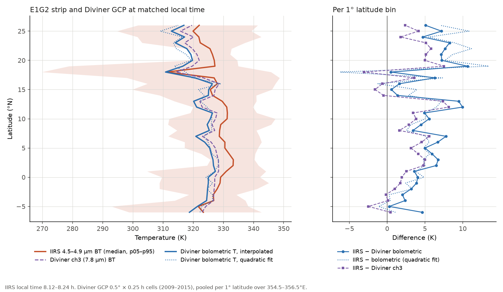

**Figure: IIRS against LRO Diviner.** *What it shows:* an independent check of IIRS temperature against the LRO Diviner thermal radiometer at the same lunar local time (about 08:10). *How to read it:* the left panel has latitude on the vertical axis and temperature on the horizontal. The red line is IIRS (median, with a shaded 5–95% band). The blue lines are Diviner bolometric temperature, by interpolation (solid) and by quadratic fit (dotted). The purple dashed line is Diviner 7.8 µm. Lines that move together mean the two instruments see the same pattern (r = 0.81). The right panel shows the difference IIRS minus Diviner per 1° bin. Points right of zero mean IIRS is warmer, typically by about 5 K, which surface roughness can explain. *Values:* [CSV](results/phase-1/m2-diviner-temperature/metrics/e1g2_iirs_vs_diviner_by_latitude.csv).

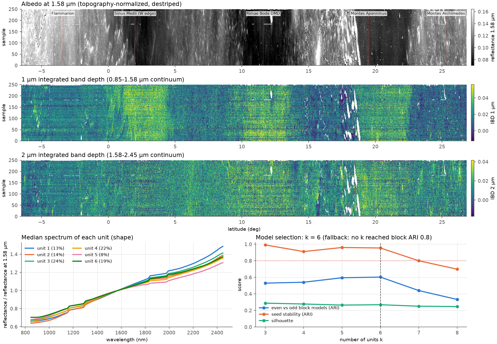

**Figure: spectral parameters and unit spectra.** *What it shows:* mineral-sensitive maps along the strip and the average spectrum of each unsupervised spectral unit. *How to read it:* the three strips have latitude left to right and red dotted lines at named features.
- **Top strip:** reflectance at 1.58 µm (albedo).
- **Second strip:** the 1 µm integrated band depth. Brighter yellow means a stronger iron-bearing (mafic or glass) absorption.
- **Third strip:** the 2 µm band depth, which is noisier.

In the lower-left panel, each line is one unit's median spectrum, divided by its value at 1.58 µm so only the shape is compared. Steeper or more curved lines are spectrally distinct units. In the lower-right panel, the curves score each number of units k: geographic stability (blue), seed stability (orange) and silhouette (green). The red dotted line is the 0.8 stability target, and the dashed line is the chosen k. *Values:* [model selection CSV](results/phase-1/m3-spectral-units/metrics/e1g2_kmeans_model_selection.csv), [unit spectra CSV](results/phase-1/m3-spectral-units/metrics/e1g2_spectral_unit_median_spectra.csv).

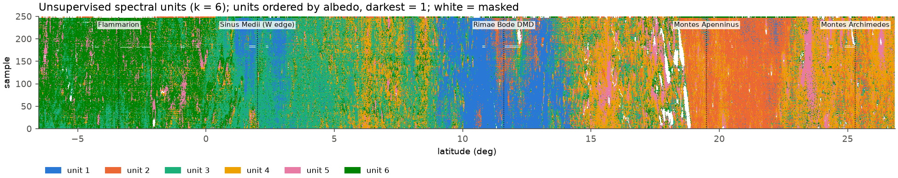

**Figure: unsupervised spectral-unit map.** *What it shows:* where each of the six k-means spectral units lies along the strip. *How to read it:* latitude runs left to right. Each colour is one unit, numbered from darkest (unit 1) to brightest. Dotted lines mark named features from published coordinates. Contiguous colour blocks are spectrally coherent terrain. Unit 1 (blue) concentrates at the Rimae Bode dark mantle deposit and near Sinus Medii. Units are spectral classes, not mineral labels, and white pixels are masked. *Values:* [unit summary CSV](results/phase-1/m3-spectral-units/metrics/e1g2_spectral_unit_summary.csv).

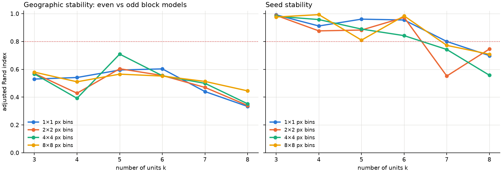

**Figure: binned stability re-test.** *What it shows:* whether averaging pixels into larger bins makes the spectral units more stable across different parts of the strip. *How to read it:* the x axis is the number of units k, and each colour is a bin size (1 x 1 to 8 x 8 pixels). The left panel shows how well models trained on alternate halves of the strip agree (adjusted Rand index). The right panel shows agreement across random restarts. The red dotted line is the 0.8 target. Points above it would pass. Binning raises the best geographic agreement to 0.71 (4 x 4), still below target. *Values:* [CSV](results/phase-1/m3-spectral-units/metrics/e1g2_binned_stability.csv).

**Reproduce:** run `scripts/build_e1g2_working_cube.py`, then `run_e1g2_m2_physical_pilot.py`, `run_e1g2_topographic_validation.py`, `run_e1g2_m3_spectral_units.py`, and `run_e3g2_radiance_unit_physics.py`. The exact `uv run` commands are in each module's notes. Large intermediates go to the ignored `data/derived/e1g2/`. Code baseline commit is `304c5e8`; script SHA-256 values are recorded in the module notes.

## M3 supervised baselines and exploratory M4 transfer (10 October 2026)

These results are exploratory. The labels are proxy groups from the USGS Unified Geologic Map of the Moon at 1:5,000,000, not reviewed ground truth, and all scores come from one scene. M4 normally starts only after M3 passes its quality gates. It was run early, as a pre-gate study, on the same labels, split and metrics as M3.

**Proxy geologic labels.** The map polygons were rasterized onto every IIRS pixel through the provisional SLDEM-corrected geometry. Fourteen map units fall in the strip. They form five coarse groups: basin material 47.5%, mare basalt 27.5%, highland or terra 13.9%, dark mantle 6.1%, and crater material 5.0%. The dark mantle polygon (Rimae Bode, about 8.9 to 13.3°N) sits where the darkest unsupervised spectral unit sits. Shifting the map by 1, 2 or 5 km changes 11.2%, 21.2% or 41.8% of unit labels, so a 2 km contact buffer is applied: a pixel is used only if every pixel within 25 pixels has the same label. See the [module notes](results/phase-1/m3-geologic-labels/notes.md), [group values](results/phase-1/m3-geologic-labels/metrics/e1g2_geologic_group_classes.csv), and [boundary sensitivity](results/phase-1/m3-geologic-labels/metrics/e1g2_geologic_boundary_sensitivity.csv).

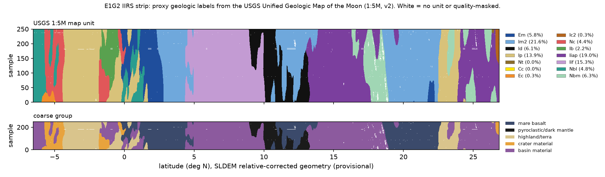

**Figure: proxy geologic labels along the strip.** *What it shows:* the USGS 1:5M geologic map units transferred onto every IIRS pixel. These are the labels used to train and score the M3 and M4 models. *How to read it:* latitude runs left to right. The top strip shows the 14 map units, and the legend gives their share of pixels. The bottom strip shows the five coarse groups used as classes: mare basalt, dark mantle, highland or terra, crater material and basin material. Boundaries are only as precise as a 1:5M map, which is why a 2 km buffer is removed around them before scoring. White pixels have no unit or failed the data mask. *Values:* [group CSV](results/phase-1/m3-geologic-labels/metrics/e1g2_geologic_group_classes.csv), [boundary sensitivity CSV](results/phase-1/m3-geologic-labels/metrics/e1g2_geologic_boundary_sensitivity.csv).

**Frozen split and metrics.** The split was fixed before any score was computed. The 12,210 lines are cut into 250-line blocks in the repeating order train, train, validation, test, and 25 lines at each block edge are dropped as guards. At most 20,000 training pixels per class are used. Validation blocks are used only for early stopping. Scores are macro F1 and balanced accuracy on all test pixels, with 95% intervals from 1,000 resamples of the test blocks. The test set has 144,974 mare, 10,209 dark mantle, 60,514 highland, 10,790 crater and 236,387 basin pixels.

**M3 supervised baselines.** The majority class scores macro F1 0.10. The physical baseline, four band parameters with a nearest-centroid classifier, scores 0.40 (95% interval 0.31 to 0.51). Logistic regression on the first 20 principal components of the spectra scores 0.46 (0.34 to 0.56). A random forest on the spectra scores 0.50 (0.35 to 0.62). A one-dimensional spectral CNN trained from scratch on the GPU scores 0.49 (0.35 to 0.61), so extra model capacity does not help at the pixel level. See the [module summary](results/phase-1/m3-supervised-baselines/summary.md) and [values](results/phase-1/m3-supervised-baselines/metrics/e1g2_benchmark_m3.csv).

**Spatial-context control.** The same classical methods were run on spectra averaged over a 64 x 64 pixel window, the tile size HyperSIGMA sees, with no pretraining. Band parameters rise to 0.48, logistic regression to 0.58 (0.43 to 0.69), and the random forest to 0.63 (0.47 to 0.71). Spatial averaging gives the largest single gain because the labels are large polygons and per-pixel spectra are noisy. See the [context values](results/phase-1/m3-supervised-baselines/metrics/e1g2_benchmark_ctx.csv).

**M4 frozen linear probes.** HyperFree-b and the HyperSIGMA ViT-B encoders were downloaded from the authors' Hugging Face pages (Apache-2.0 weights) and run as frozen feature extractors. HyperFree uses its wavelength-indexed input with all 83 bands. HyperSIGMA input is interpolated to 100 bands over 845 to 2460 nm. Embeddings for the whole strip took 1 to 2 minutes per model on the GPU. A single linear layer was then trained on the same split. HyperFree scores 0.54 (0.39 to 0.63). The HyperSIGMA spatial encoder scores 0.67 (0.52 to 0.76), the highest result. The HyperSIGMA spectral encoder, which gives one vector per 64-pixel tile, scores 0.57 (0.40 to 0.69). See the [model inventory](results/phase-2/m4-transfer/model_inventory.md), [module summary](results/phase-2/m4-transfer/summary.md), and [values](results/phase-2/m4-transfer/metrics/e1g2_benchmark_m4.csv).

**Leakage control.** HyperSIGMA tiles (64 pixels) are wider than the 25-line guard, so every method was rerun with a 64-line guard. No score changed by more than 0.04: HyperSIGMA spatial stays at 0.67 and the context random forest reaches 0.66. See the [64-line guard values](results/phase-2/m4-transfer/metrics/e1g2_benchmark_m3_ctx_m4_guard64.csv).

**Interpretation.** The frozen Earth models carry useful lunar information and beat the per-pixel spectral baselines. A classical random forest that sees the same 64-pixel neighbourhood comes within the confidence interval of HyperSIGMA, however, so a benefit from Earth pretraining is not demonstrated on these labels. HyperFree's per-pixel margin of 0.04 is within probe-training variance, since an earlier CPU run of the same probe scored 0.48. Zero-shot classification and fine-tuning have not been run. The GPU runs need `torch==2.5.1`, because newer default wheels target CUDA 13 and fall back to the CPU on this machine's CUDA 12.5 driver.

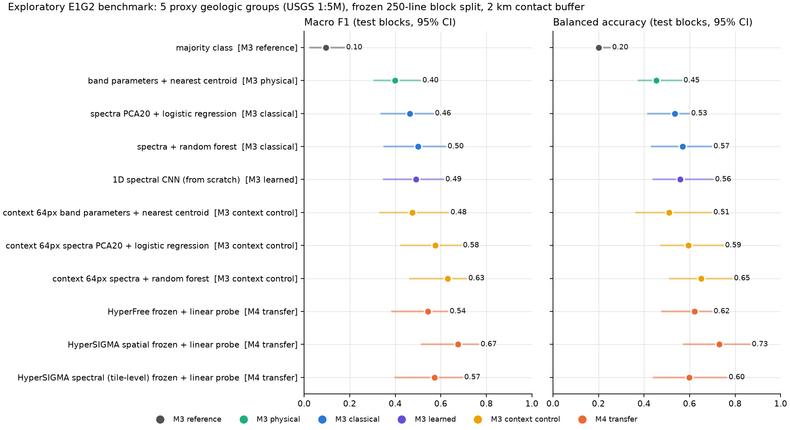

**Figure: exploratory M3 and M4 benchmark.** *What it shows:* how well each method predicts the five proxy geologic groups on held-out parts of the strip. *How to read it:* each row is one method, coloured by family: reference, physical, classical, learned, context control, and M4 transfer. The dot is the score on the test blocks and the horizontal bar is its 95% confidence interval. The left panel is macro F1 and the right panel is balanced accuracy; both are 0 to 1, and higher is better. Methods whose bars overlap are not reliably different. HyperSIGMA (0.67) and the 64-pixel context random forest (0.63) overlap, so the pretraining benefit is not demonstrated. The same figure is saved in the [M3 module](results/phase-1/m3-supervised-baselines/figures/e1g2_m3_m4_benchmark.png). *Values:* [M3 CSV](results/phase-1/m3-supervised-baselines/metrics/e1g2_benchmark_m3.csv), [context CSV](results/phase-1/m3-supervised-baselines/metrics/e1g2_benchmark_ctx.csv), [M4 CSV](results/phase-2/m4-transfer/metrics/e1g2_benchmark_m4.csv).

## M1 results at a glance

M1 records which observations and products we have, checks their metadata and file integrity, and tests whether the data are ready for later physical processing. It does not create reflectance or detect minerals, hydration, or ice.

#### Decode the product names

| Term | Meaning in this project |
| --- | --- |
| **IIRS** | Imaging Infrared Spectrometer, a Chandrayaan-2 instrument that records a spectrum at each image location. |
| **E1G2** | Instrument operating mode from the XML label: exposure setting **E1** and gain setting **G2**. Exposure and gain affect the signal acquisition. The filename suffix `d18` is a receiving-station code. It does not mean E1G2. |
| **E3G2** | Exposure setting **E3** with gain setting **G2**. The two 2020 pilot pairs use this mode. |
| **NRI / NCI** | Filename product codes used here for IIRS raw (`nri`) and calibrated (`nci`) products. The XML label gives the authoritative processing level and units. |
| **Raw count** | The detector's recorded digital value before physical radiance calibration. A raw count is not radiance or reflectance. |
| **Calibrated radiance** | Instrument signal converted to a physical radiance unit. Our calibrated products are Level 1 radiance, not surface reflectance. |
| **LUT** | Look-up table. The gain and offset coefficients convert dark-subtracted counts to an intermediate radiance stage. Appendix F documents later destriping and post-processing before Level 1. |
| **Band / band-pixel** | A spectral band is one wavelength channel. A band-pixel is one spatial sample in one band. Counts summed across bands are not counts of unique surface locations. |
| **PDS4 label, QUB, CRC, MD5** | The PDS4 XML label describes the product. QUB is the binary image cube. ZIP CRC and label MD5 checks test file integrity. They do not prove scientific calibration accuracy. |
| **Saturation / fill mask** | A per-pixel flag for measurements that cannot be trusted due to saturation or missing/invalid data. We have not created this mask because the table's declared units are clear but their operational application conflicts with the paired observations, and no cube fill value is declared. |

#### Work completed, output, and interpretation

| M1 work | What we did | Result | Supporting evidence and status |
| --- | --- | --- | --- |
| Inventory and product documentation | Reviewed three matched raw/calibrated pairs: two 2020 E3G2 observations and one 2026 E1G2 observation. Read their labels and the IIRS archive/SIS. | The E1G2 pair has observation ID `20260227T1239538758`. Its labels report exposure E1, gain G2, orbit, dimensions, wavelengths, and radiance units. | [E1G2 record](results/phase-1/m1-e1g2-scene/summary.md), [data dictionary](results/phase-1/m1-inventory/data_dictionary.md). **Inventory recorded.** |
| File integrity and pair matching | Checked ZIP CRCs, compared raw/calibrated label fields, and streamed each QUB to check its label MD5. | The E1G2 pair matches on observation and instrument metadata. Both archive and cube integrity checks pass. These checks show that the files are intact and paired. They do not prove that calibration is scientifically accurate. | [E1G2 findings](results/phase-1/m1-e1g2-scene/findings.md). **Passed for this pair.** |
| Mode suitability | Read band-validity flags and compared E3G2 with E1G2. | E3G2 valid bands stop at 3155.9 nm, so these strips lack valid 4–5 µm channels needed by the selected longwave thermal method. E1G2 bands 226–248 are valid from 4504.1 to 4874.9 nm. | [Band-validity figure](results/phase-1/m1-inventory/figures/band_validity_by_mode.svg), [source table](results/phase-1/m1-inventory/metrics/band_validity_by_mode.csv). E1G2 is a **candidate mode**, not yet an approved processing input. |
| 2020 calibrated-cube scan | Counted finite, zero, negative, and positive values in both E3G2 calibrated cubes. | All scanned values are finite. Across valid bands, `m65` has 2,809 zero and 26 negative band-pixels. `d18` has 3,059 zero and 26 negative band-pixels. Sampled median radiance ranges overlap after we apply each label's unit. The counts do not show whether zeros or negatives mean fill. | [2020 per-band CSV](results/phase-1/m1-inventory/metrics/pilot_radiance_quality_by_band.csv), [scan figure](results/phase-1/m1-inventory/figures/pilot_radiance_quality_by_band.png). **Quality scan complete. Pixel meanings remain open.** |
| E1G2 full-cube scan | Streamed all 256 calibrated bands and the matching raw-count cube from the ZIPs. | The calibrated cube has 781,440,000 finite values. On its 222 mode-valid bands, it has 4,829 exact zeros and 42,081 negative band-pixels. These are band-pixel counts. They do not count unique spatial pixels, and they are not classified as fill. | [E1G2 per-band CSV](results/phase-1/m1-e1g2-scene/metrics/e1g2_radiance_by_band.csv), [analysis script](scripts/analyze_iirs_e1g2_scene.py). **Scan complete.** |
| E1G2 radiance-scale cross-check | Applied the E1G2 gain/offset LUT to sampled raw counts. Compared its output with calibrated values converted from µW to mW. | Across valid bands, median calibrated/LUT ratio is **1.00375** and median per-band correlation is **0.922**. For valid longwave bands 226–248, these values are **0.9952** and **0.899**. The LUT-stage and Level-1 values are numerically close in this comparison. Appendix F documents destriping and radiance post-processing after the LUT, so this is not a complete reconstruction or an independent calibration test. | [E1G2 plot, center panel](results/phase-1/m1-e1g2-scene/figures/e1g2_radiance_and_footprint.png), [per-band values](results/phase-1/m1-e1g2-scene/metrics/e1g2_radiance_by_band.csv). **Stage comparison recorded. Independent validation remains open.** |
| E3G2 paired raw–LUT–calibrated audit | Applied the E3G2 multiplicative factor and offset to fixed-grid raw counts, then compared LUT-stage values with both matched Level-1 cubes after converting units to mW; documented downstream steps were omitted. | Median per-band Level-1/LUT-stage ratios are **0.000200** (`m65`) and **0.0001999** (`d18`); median per-band correlations are **0.898** and **0.924**. Only one raw count per scene reaches `Dynamic_Range`. The V6 guide says destriping and radiance post-processing after the LUT cause differences from direct LUT calculations. This is an incomplete stage comparison; it does not quantify the local ratio or validate calibration. | [E3G2 audit](results/phase-1/m1-e3g2-lineage-check/summary.md), [per-band CSV](results/phase-1/m1-e3g2-lineage-check/metrics/e3g2_raw_lut_calibrated_by_band.csv), [figure](results/phase-1/m1-e3g2-lineage-check/figures/e3g2_raw_lut_calibrated_diagnostics.png). **Do not treat LUT output as validated Level 1 calibration.** |
| Saturation and fill rules | Compared calibrated radiance with the saturation table and raw counts with its dynamic-range field; checked the public PRADAN FAQ, ISRO processing description, and 2025 LPSC recalibration abstract. | The table XML explicitly declares µW for saturation radiance and counts for dynamic range. Under those declared units, **676,834,500 / 677,655,000** valid-band values (**99.878921%**) meet or exceed the threshold, while no raw count reaches `dynamic_range`. A counterfactual mW interpretation yields 12 radiance exceedances but is not supported by the table label. The public descriptions do not define Level-1 pixel-mask or fill rules. The LPSC method uses the fields in a separate raw-count recalibration, not as an archived Level-1 mask. The calibrated cube label gives no fill constant. | [E1G2 per-band CSV](results/phase-1/m1-e1g2-scene/metrics/e1g2_radiance_by_band.csv), [detailed findings](results/phase-1/m1-e1g2-scene/findings.md), [literature review](results/phase-1/m1-literature/findings.md). **Open gate. Do not apply these comparisons as a mask.** |
| Footprint check | Read the calibrated product's sparse geometry table and plotted its points by scan line. | The 250-sample × 12,210-line image has **1,476 points across 246 sampled scan lines**, with six sample positions per scan line, from about **5.47°W to 3.50°W** and **6.53°S to 26.86°N**. It is not per-pixel geometry. Registration accuracy remains unvalidated. | [E1G2 geometry plot, right panel](results/phase-1/m1-e1g2-scene/figures/e1g2_radiance_and_footprint.png), [summary](results/phase-1/m1-e1g2-scene/summary.md). **Coarse coverage checked. Full-resolution geometry remains open.** |
| Full-resolution relative registration | Matched band 40 to an SLDEM2015 hillshade rendered using the scene-level sun angles; selected the sun-azimuth direction using training matches only. | With nodata-intersecting patches excluded, 34 held-out ties across five columns and four blocks have median residual **0.375 px**, p95 **1.487 px**, and RMSE **0.699 px**. All predeclared relative-registration candidate limits pass. Residuals measure held-out fit consistency, not absolute position error. | [Module summary](results/phase-1/m1-sldem-hillshade/summary.md), [tie CSV](results/phase-1/m1-sldem-hillshade/metrics/iirs_sldem_hillshade_ties.csv), [summary JSON](results/phase-1/m1-sldem-hillshade/metrics/iirs_sldem_hillshade_summary.json), [figure](results/phase-1/m1-sldem-hillshade/figures/iirs_sldem_hillshade_tie_residuals.svg). **Relative candidate rule passes; absolute geolocation remains provisional.** |
| SLDEM relative correction candidate | Applied the training-fitted affine offset field to a derived copy of the 1,476-node E1G2 sparse geometry grid; reproduced held-out residuals from the untouched 34 held-out ties. | Median absolute candidate shifts are about **98.8 m east-west** and **37.3 m north-south**. Held-out residual median is **0.375 px**, p95 **1.487 px**, RMSE **0.699 px**. This is relative image consistency against a DEM-derived hillshade, not absolute geolocation accuracy. | [Candidate record](results/phase-1/m1-sldem-correction-candidate/summary.md), [candidate coordinates and shifts](results/phase-1/m1-sldem-correction-candidate/metrics/iirs_sldem_relative_geometry_candidate.csv), [figure](results/phase-1/m1-sldem-correction-candidate/figures/iirs_sldem_relative_geometry_candidate.svg). **Separate derived candidate only; original geometry and cube are unchanged. Absolute validation remains open.** |
| Literature and gap review | Reviewed IIRS thermal/reflectance papers and compared their needs with available modes and products. | E1G2 is the next thermal-pilot candidate because it has valid longwave bands. Temperature uncertainty matters to 3 µm interpretation, but no local temperature or reflectance result exists yet. | [Literature summary](results/phase-1/m1-literature/summary.md), [gap matrix](docs/gap_matrix.md). **Targeted review recorded. It is not systematic.** |

**M1 status:** The M1 records cover product inventory, pair checks, mode review, cube scans, literature review, and local relative-registration diagnostics. M1 is still in progress. The saturation-table units are explicitly declared in the XML, but the table fields do not agree with the paired raw/calibrated values; public sources did not resolve pixel-mask use or cube fill rules. The SLDEM hillshade tie grid passes the predeclared relative-registration limits, and its training-fitted offset field has been applied to a separate sparse-geometry candidate. Absolute geolocation remains provisional because the ties are not surveyed controls and use the original sparse geometry as their starting map. Independent radiance validation, valid M³ pixel overlap, and more geographically independent observations remain open. On 10 October 2026, a physical test settled the numerical unit scale for the three local products, and provisional M2 and M3 pilot products were recorded; see [M2 and M3 pilot results](#m2-and-m3-pilot-results-10-october-2026). No validated corrected-reflectance product or supervised M3 score exists yet.

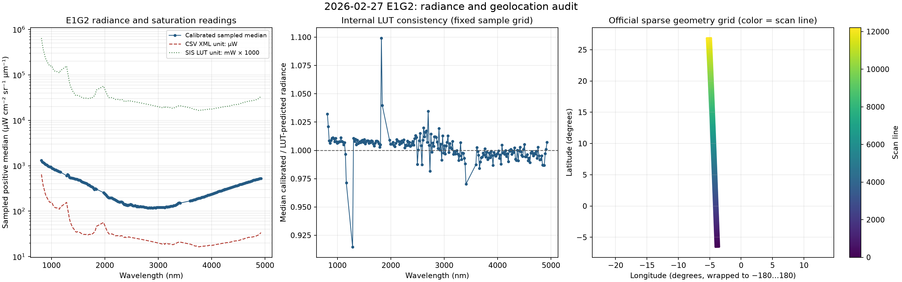

**Figure: E1G2 radiance, LUT comparison, and geometry audit.** *What it shows:* three checks on the 2026 E1G2 calibrated product: radiance level, agreement with the LUT, and footprint. *How to read it:* the left panel plots the sampled median radiance per wavelength against the saturation-table threshold read in its declared unit. The threshold sits below the data, which is the unresolved saturation mismatch. The centre panel plots the median ratio of calibrated to LUT-predicted radiance per band. Values near 1 mean the calibrated product follows the LUT. The right panel plots the sparse geometry points (longitude against latitude), coloured by scan line, which shows the strip's coverage. The panel titles inside the image come from the original audit. *Values:* [CSV](results/phase-1/m1-e1g2-scene/metrics/e1g2_radiance_by_band.csv).

## Current state (8 October 2026)

The repository contains two raw/calibrated pairs from 2020-02-08, a verified raw/calibrated E1G2 pair from 2026-02-27, and the IIRS `iir.zip` archive under ignored `data/pradan/`. All seven ZIP archives pass integrity checks. The new pair's labels match on identity and both embedded cube MD5 values match. Its calibrated values agree closely with the LUT only after applying the label's µW-to-mW conversion, while the supplied guide states calibrated products use mW. This guide/label unit conflict was later resolved on physical grounds (10 October 2026): the label unit is correct for all three products. The saturation-table unit fields are explicit, but their observed mismatch against paired values, pixel-mask use, cube fill semantics, and absolute geolocation remain open. Relative registration to an SLDEM2015 hillshade meets the current candidate limits, with tie residuals of 0.375 px median and 1.487 px p95 on a fresh held-out set; it does not establish absolute geolocation accuracy. The earlier 2020 radiance scan supports those products' unit prefixes provisionally. Physical calibration, an analysis-ready reflectance dataset, reviewed labels, trained models, and measured baseline scores do not exist yet. The earlier four-scene raw inventory remains as a historical manifest in the M1 results directory, but those old products were removed from `data/` before this pilot selection.

| Initial 2020 pilot observation (UTC, archive suffix) | Raw and calibrated cube, lines × samples × bands | Approximate latitude range from label corners | Local state |
| --- | ---: | ---: | --- |
| 2020-02-08 00:57, `m65` | 10,925 × 250 × 256 | 31.4°S–1.5°S | ZIP and extracted; raw plus calibrated |
| 2020-02-08 12:45, `d18` | 10,927 × 250 × 256 | 31.6°S–1.7°S | ZIP and extracted; raw plus calibrated |

**E1G2 pair verified:** PRADAN provided `ch2_iir_nri_20260227T1239538758_d_img_d18.zip` and `ch2_iir_nci_20260227T1239538758_d_img_d18.zip`. Both labels confirm exposure `e1`, gain `g2`, the same observation time, job ID, orbit, dimensions, and wavelengths. ZIP CRC and embedded QUB MD5 checks pass. The calibrated label declares `µW/cm**2/sr/µm`, while the supplied V6 guide says calibrated units are mW. A fixed-grid comparison is near unity only after applying the label's unit conversion; it does not resolve the conflict or independently validate radiance. Geometry and mask checks also remain open. See the [E1G2 acquisition record](results/phase-1/m1-e1g2-scene/summary.md) and [M1 gate follow-up](results/phase-1/m1-gate-followup-20261010/summary.md).

### Pilot strip browse images

These previews show the two observations selected for analysis. Each uses the PNG from its calibrated product's `browse/calibrated/` directory. The source label calls it a **count-calibrated, subsampled browse image**. Its checksum matches the label. The spectral analysis will use the corresponding calibrated `.qub` radiance cube after the M2 quality gate, not pixel values from these display images.

| `m65` observation, 00:57 UTC | `d18` observation, 12:45 UTC |
| --- | --- |
| 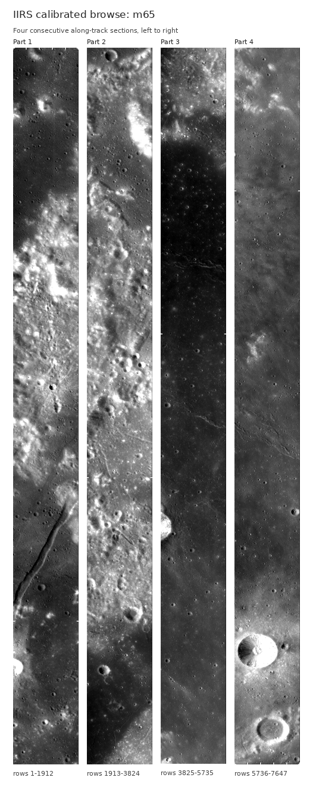 | 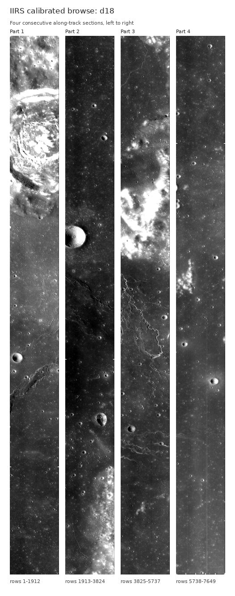 |

**Figure: browse coverage of the two 2020 E3G2 pilot strips.** *What it shows:* the subsampled browse images supplied with the two calibrated products, for visual orientation. *How to read it:* each image is one strip, cut into four consecutive quarters placed side by side. Read each column top to bottom, then move to the next column to the right. Bright features are crater rims and sunlit slopes. These are display images, not georeferenced maps, reflectance, or detections. The [preview script](scripts/build_iirs_strip_previews.py) and [M1 notes](results/phase-1/m1-inventory/notes.md) record how they were made.

The labels list 256 band centers from **712.3 to 5009.7 nm** for the active pilot files. ISRO describes the nominal instrument range as approximately 0.8–5.0 µm; use each product's actual band centers and widths. Raw labels specify `UnsignedLSB2` detector counts. Calibrated labels specify `IEEE754LSBSingle` values, with units that must be read per product: `mW/cm**2/sr/µm` for the `m65` pilot and `µW/cm**2/sr/µm` for the `d18` pilot. The PDS4 XML label remains authoritative for type, axes, wavelength, units, size, and checksum. Both active pilot footprints are low latitude and are **not polar**. The previous four-scene raw inventory is retained as historical evidence in the M1 results directory.

### What the IIRS archive established

The supplied `iir.zip` passed ZIP integrity checks. Its March 2026 SIS (V17) describes calibrated Level 1 **radiance** produced by dark subtraction, lookup-table correction, destriping, and later radiance adjustments. Thermal and photometric correction belong to the separate Level 2 reflectance process. The ZIP also contains lookup tables, saturation tables, solar flux, and a band-validity workbook; the separate guide PDF is not inside it, but the user supplied V6 guide text for review. SIS Appendix H (pp. 115–126) explicitly says only `VALID` bands are valid; `SATURATION`, `OSF`, and `INVALID` bands must be treated as invalid. It defines OSF as lower-confidence radiance and says invalid spectral regions are updated from neighboring bands except bands 1–5. These are band-level rules, not per-pixel masks. The saturation XML declares its units, but neither the SIS nor supplied guide text resolves the observed threshold mismatch or cube fill rule. The archive SHA-256 and product details are in the [M1 data dictionary](results/phase-1/m1-inventory/data_dictionary.md).

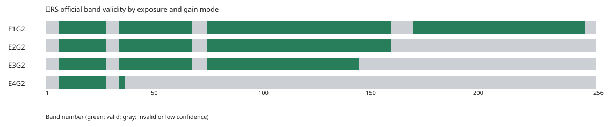

**Figure: IIRS band validity by exposure and gain mode.** *What it shows:* which of the 256 IIRS bands may be used for each instrument mode, according to SIS Appendix H. *How to read it:* each row is a mode (E1G2 to E4G2), and the horizontal axis is band number 1 to 256. Green cells are `VALID`; grey cells are invalid, low-confidence (OSF) or saturation regions. A mode can be used for thermal work only if it has green cells near bands 226 to 248 (4.5 to 4.9 µm). E1G2 does, and E3G2 does not. *Values:* [CSV](results/phase-1/m1-inventory/metrics/band_validity_by_mode.csv), [script](scripts/plot_iirs_band_validity.py), [code audit](results/phase-1/m1-processing-code-audit/summary.md).

### Pilot radiance quality scan

We scanned every value in both calibrated cubes across all 256 bands. The scan counted finite, zero, negative, and positive values exactly. It also compared the E3G2 saturation thresholds under two unit interpretations. Positive-pixel quantiles use a fixed grid that samples every 32nd line and every fifth sample.

| Calibrated scene | Pixels per band | Valid E3G2 bands | Exact zeros across valid band-pixels | Negative values across valid band-pixels | Sampled median range after declared unit conversion (mW/cm²/sr/µm) |
| --- | ---: | ---: | ---: | ---: | ---: |
| `m65` | 2,731,250 | 127 | 2,809 | 26 | 0.115–1.547 |
| `d18` | 2,731,750 | 127 | 3,059 | 26 | 0.104–1.199 |

All cube values were finite. The zero and negative counts are summed across valid bands, so they are band-pixel counts, not counts of unique pixels. The scan does not establish that zero or negative values mean fill or saturation. The comparable sampled median ranges support the `mW` unit in the `m65` label and the `µW` unit in the `d18` label as a plausible conversion. This comparison does not independently validate radiometric calibration.

The saturation-table XML declares its threshold values in `µW/cm²/sr/µm`; its `Dynamic_Range` field is in counts. Applying these declared units to the paired calibrated data flags nearly all valid-band radiance values at or above threshold, while raw counts do not reach the dynamic-range values. The counterfactual mW comparison in the figure is diagnostic only and is not supported by the table XML. The unresolved issue is how these fields are intended to define saturation and a per-pixel mask. The comparisons are not masks.

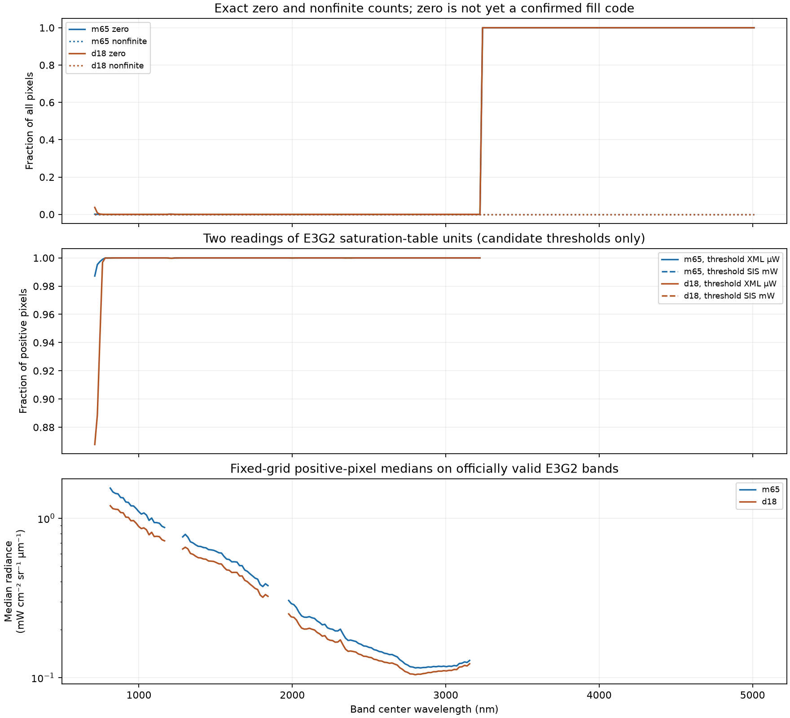

**Figure: calibrated pilot radiance quality by band (2020 E3G2).** *What it shows:* basic quality counts for both 2020 calibrated cubes, band by band. *How to read it:* the x axis is wavelength in every panel, with one line per product. The top panel shows the fraction of exact zeros and non-finite values; low values mean few suspect pixels. The middle panel shows the fraction of pixels above the saturation threshold under two unit readings. A reading that flags almost everything cannot be a true saturation limit. The bottom panel shows the median radiance on valid bands. Similar curves for both products mean their declared units give comparable values. *Values:* [CSV](results/phase-1/m1-inventory/metrics/pilot_radiance_quality_by_band.csv), [script](scripts/analyze_iirs_radiance_pilot.py), [findings](results/phase-1/m1-inventory/findings.md).

### E3G2 raw-to-LUT-to-calibrated comparison

We compared both 2020 paired scenes on all 127 E3G2-valid bands. Applying the LUT formula to fixed-grid raw counts gives median archived-Level-1/LUT-stage ratios near **0.0002** in both scenes after converting the `m65` and `d18` products to mW as their labels specify. Per-band correlations are 0.898 and 0.924. The V6 guide places destriping and radiance post-processing after the LUT and says these steps cause differences from a direct LUT calculation. This confirms that the audit compares different processing stages, but the guide does not quantify the local ratio or reproduce the downstream processing. No scale factor was added and no mask was made.

Update 10 October 2026: the E2G2, E3G2 and E4G2 LUT tables hold factors near 1 with count-like offsets, while the E1G2 table holds absolute gains near 0.0028 mW/cm²/sr/µm per count. E1G2 uses a 1 ms exposure and these E3G2 products use 10 ms. A per-band least-squares fit shows that Level 1 equals the E3G2 LUT stage multiplied by the E1G2 gain divided by 10, with a median fitted-to-predicted ratio of 0.944 for both products (p05 to p95: 0.50 to 0.97; median correlation 0.90 and 0.92). This explains most of the 0.0002 ratio. It is an inference from the data, and the low-ratio tail of bands is unexplained. See the [scaling values](results/phase-1/m1-e3g2-lineage-check/metrics/e3g2_lut_exposure_scaling_test.csv) and [script](scripts/test_e3g2_lut_exposure_scaling.py).

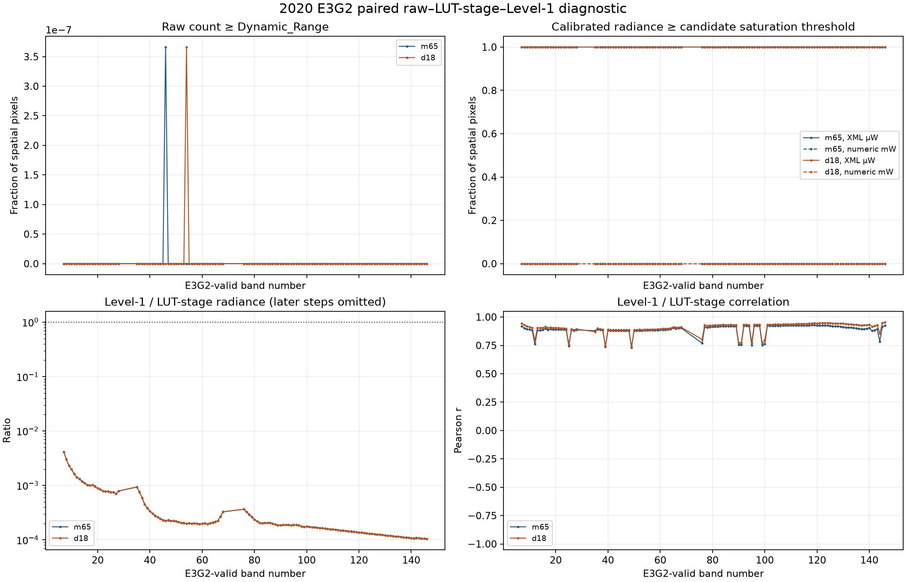

**Figure: paired E3G2 raw, LUT and Level-1 diagnostic.** *What it shows:* how the 2020 E3G2 raw counts, the literal LUT conversion, and the archived Level-1 radiance relate band by band. *How to read it:* every panel has E3G2-valid band number on the x axis and one line per product (`m65`, `d18`).
- **Top left:** the fraction of raw counts at or above `Dynamic_Range`. Near zero means almost no detector saturation.
- **Top right:** the fraction of calibrated values above the saturation threshold under two unit readings.
- **Bottom left:** the ratio of Level 1 to the literal LUT stage on a log axis. Values near 0.0002 are the gap explained in the exposure-scaling test below.
- **Bottom right:** the correlation between the two stages. High values mean they vary together.

*Values:* [CSV](results/phase-1/m1-e3g2-lineage-check/metrics/e3g2_raw_lut_calibrated_by_band.csv), [JSON](results/phase-1/m1-e3g2-lineage-check/metrics/e3g2_raw_lut_calibrated_summary.json), [script](scripts/audit_e3g2_raw_lut_calibrated_pairs.py).

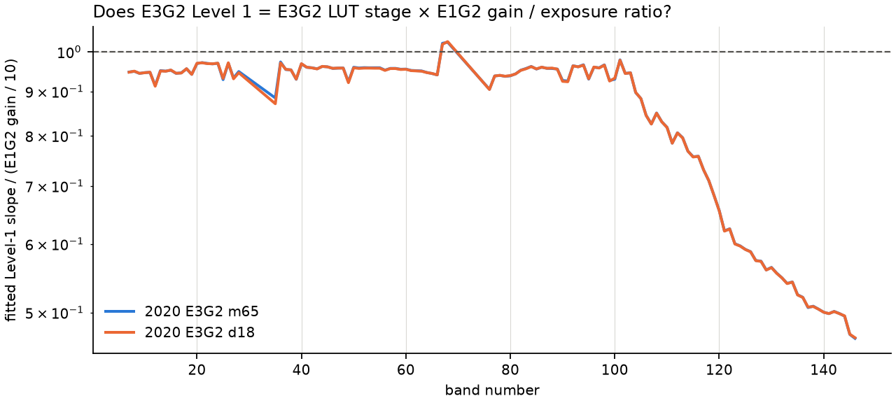

**Figure: E3G2 exposure-scaling test.** *What it shows:* whether the E3G2 Level-1 scale equals the E3G2 LUT stage times the E1G2 gain divided by the exposure ratio of 10. *How to read it:* the x axis is band number and the log y axis is the fitted Level-1 slope divided by that prediction, with one line per product. A value of 1 (dashed line) means the hypothesis fits that band exactly. Most bands sit near 0.94. Bands well below the line are the unexplained tail. *Values:* [CSV](results/phase-1/m1-e3g2-lineage-check/metrics/e3g2_lut_exposure_scaling_test.csv), [JSON](results/phase-1/m1-e3g2-lineage-check/metrics/e3g2_lut_exposure_scaling_summary.json).

### E1G2 radiance and footprint audit

The full 2026 E1G2 cube scan found finite values throughout the 781,440,000-value cube. The 222 mode-valid bands have 4,829 exact zeros and 42,081 negative band-pixels; neither is classified as fill. Fixed-grid sampled positive medians range from 118.218 to 1,305.46 µW/cm²/sr/µm.

The E1G2 lookup table (LUT) provides an intermediate radiance stage. The SIS says its LUT formula yields mW/cm²/sr/µm, while the product label declares µW/cm²/sr/µm. On a fixed grid, after converting the product values from µW to mW, the median calibrated/LUT ratio is **1.00375** and median per-band correlation is **0.922**. For valid bands 226–248, the median ratio is 0.9952 and median correlation is 0.899. The close values are an internal stage comparison, not a complete reconstruction or independent radiometric validation.

The calibrated label and saturation-table XML both declare µW/cm²/sr/µm. Applying the table thresholds as labeled puts **676,834,500 of 677,655,000 values (99.878921%)** on valid bands at or above threshold. The counterfactual mW calculation yields 12 exceedances, but it is not supported by the table label. No paired raw counts reach the table's `dynamic_range` field on valid bands. The mismatch and operational application remain unresolved, and none of these comparisons defines a mask. The cube label also contains no declared missing-value constant.

We repeated the comparison on a small, fixed-line sample spread across the strip: 16 scan lines × 250 samples × 222 valid bands (888,000 band-pixel observations). The declared radiance threshold flagged **868,507 values (97.8048%)**, and no sampled raw count reached `Dynamic_Range`. The per-band median ratio against the LUT ranged from 0.9060 to 1.0960, even though the median of per-band ratios was 1.00139. The sample reproduces the mismatch, while showing that one aggregate LUT ratio hides band-to-band variation. This is exploratory evidence only; it does not define a mask or fill rule.

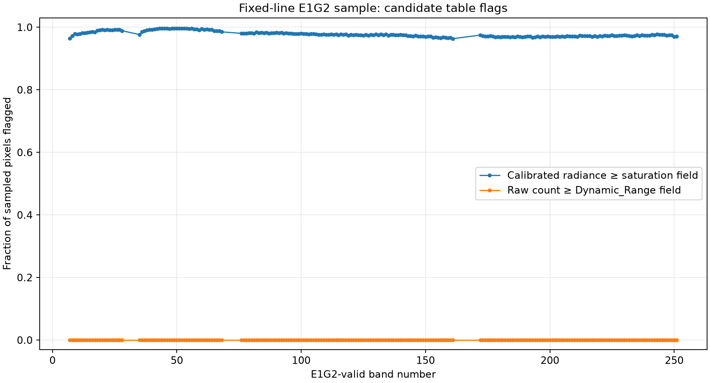

**Figure: E1G2 sample candidate flags by band.** *What it shows:* on 16 fixed scan lines, how often calibrated radiance exceeds the saturation table and how often raw counts reach `Dynamic_Range`. *How to read it:* the x axis is E1G2-valid band number and the y axis is the fraction of sampled pixels flagged. A curve near 1 means the threshold flags nearly every pixel, which a real saturation limit should not do. A curve near 0 means almost none are flagged. The radiance curve sits near 1 while the raw-count curve sits at 0, so the two fields conflict. These are comparisons, not a mask. *Values:* [CSV](results/phase-1/m1-saturation-sample/metrics/e1g2_saturation_sample_by_band.csv), [JSON](results/phase-1/m1-saturation-sample/metrics/e1g2_saturation_sample_summary.json), [script](scripts/probe_iirs_saturation_sample.py).

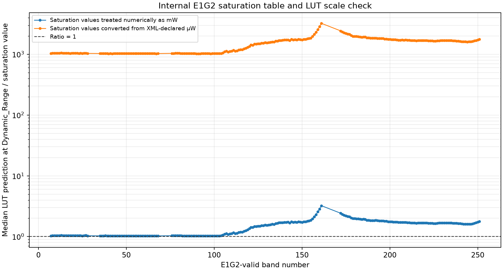

**Figure: E1G2 table-to-LUT comparison.** *What it shows:* for each E1G2 band, the radiance the LUT predicts at the `Dynamic_Range` count, divided by the table's saturation value. *How to read it:* the x axis is band number and the log y axis is the ratio. The dashed line marks a ratio of 1, where both table fields describe the same limit in the same unit. The blue line reads the saturation values as mW and sits near 1 up to about band 105, then rises to about 2 to 3. The orange line uses the declared µW and sits about 1000 times higher. The mW reading is therefore closer, but neither reading fits every band. *Values:* [CSV](results/phase-1/m1-saturation-sample/metrics/iirs_saturation_lut_table_check_by_mode.csv).

We also checked whether each mode's saturation field is on the same scale as its gain/offset LUT evaluated at `Dynamic_Range`. If saturation numbers are treated counterfactually as mW, the median LUT/saturation ratio is **1.559** for E1G2 but **5,118** for E3G2. Both mode-specific saturation XML labels declare µW. This does not support one simple unit correction across modes. The E1G2 scale is closer under the counterfactual reading, but it is still not an interpretation or masking rule.

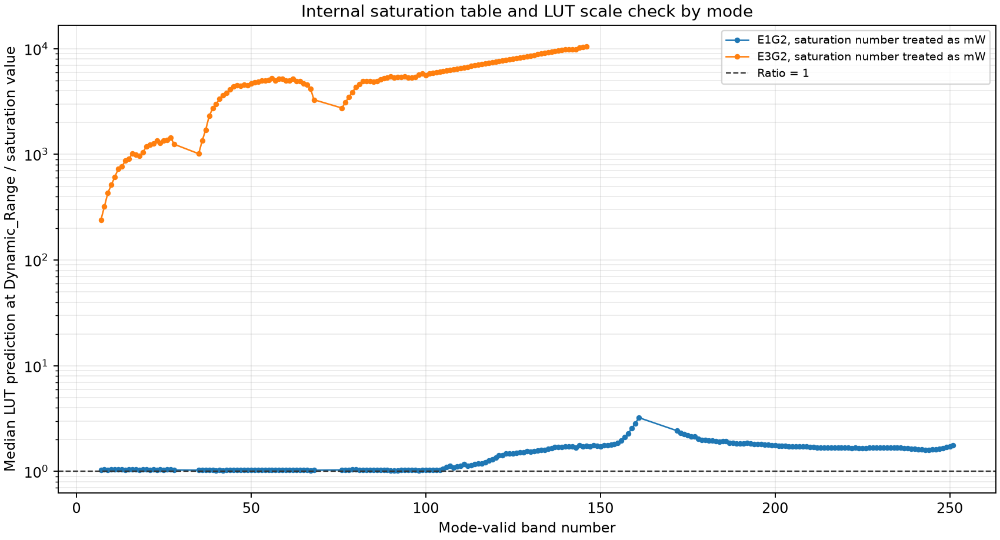

**Figure: mode-specific table-to-LUT comparison.** *What it shows:* the same ratio as above for E1G2 and E3G2 together. *How to read it:* each colour is a mode. The y axis (LUT at `Dynamic_Range` divided by the saturation value, with the saturation value read as mW for comparison only) is on a log scale. E1G2 sits near 1.6 and E3G2 near 5,000, so a single unit correction cannot fix both modes. *Values:* [CSV](results/phase-1/m1-saturation-sample/metrics/iirs_saturation_lut_table_check_by_mode.csv), [JSON](results/phase-1/m1-saturation-sample/metrics/iirs_saturation_lut_table_check_summary.json), [script](scripts/check_iirs_saturation_table_vs_lut.py).

The calibrated geometry table declares 1,476 coordinate records with longitude, latitude, pixel, and line fields. The 250-sample × 12,210-line image has six geometry samples at each of 246 scan-line positions spanning lines 0–12,209. It spans about 5.47°W–3.50°W and 6.53°S–26.86°N. It confirms a low-latitude strip, not per-pixel geometry; registration accuracy remains unvalidated. The reproducible [per-band CSV](results/phase-1/m1-e1g2-scene/metrics/e1g2_radiance_by_band.csv) and [analysis script](scripts/analyze_iirs_e1g2_scene.py) preserve exact counts and sampled quantiles.

### Literature check on saturation and fill rules

The 2020 IIRS instrument paper describes laboratory tests that relate detector counts to radiance. The tests include saturation radiance. Laferriere and Bramson (2025) use the ISRO LUT, saturation radiance, and CCD dynamic range to convert linearized raw counts to radiance. They report differences from ISRO Level 1. They attribute some differences to omitted order-sorting-filter adjustments and keystone correction. The abstract does not define a Level-1 saturation mask or fill values. The papers we reviewed do not resolve the local mismatch. See the [M1 literature findings](results/phase-1/m1-literature/findings.md) and [research notes](results/phase-1/m1-literature/notes.md).

### M1 workflow, results, and remaining gates

The chart follows the M1 evidence from product selection to the decisions that control later processing. It shows the 2020 E3G2 scan and the separate 2026 E1G2 audit, with each numerical result tied to its interpretation and next gate.

```mermaid
flowchart LR
    A["Three matched raw/calibrated pairs<br/>Two 2020 E3G2 and one 2026 E1G2"] --> B["Read PDS4 labels<br/>Match time, orbit, mode, axes, and bands"]
    C["IIRS archive iir.zip<br/>SIS, LUT, band validity, saturation tables"] --> D["SIS Appendix H: retain VALID bands only<br/>222 E1G2; 127 E3G2"]
    D --> D2["Band-level rule confirmed<br/>Per-pixel fill/saturation mask still open"]
    D2 --> Q
    B --> E["Check ZIP CRC and QUB MD5"]
    E --> F["E1G2 pair passes identity and integrity<br/>20260227T1239538758"]
    D --> G["Review exposure/gain mode validity"]

    G --> H["2020 E3G2<br/>127 valid bands; no valid 4–5 µm bands"]
    H --> I["Scan two calibrated cubes<br/>All values finite<br/>Zeros: 2809 and 3059<br/>Negatives: 26 and 26 band-pixels"]
    I --> J["Save 2020 per-band CSV and quality plot"]
    I --> I2["Compare both E3G2 raw/LUT/calibrated pairs"]
    I2 --> I3["Only 1 Dynamic_Range hit per scene<br/>XML µW threshold flags ~99.9988%"]
    I2 --> I4["Median Level-1/LUT-stage ratio ~0.0002<br/>Correlation ~0.90; downstream steps omitted"]
    I3 --> I5["Threshold mask unresolved"]
    I4 --> I6["Guide documents downstream cause<br/>Exact ratio not reproduced"]
    I5 --> W
    I6 --> W

    LT["Published IIRS thermal method uses E1G2"] --> K["2026 E1G2<br/>222 valid bands<br/>Bands 226–248 span 4504.1–4874.9 nm"]
    G --> K
    F --> L["Stream paired raw counts and calibrated cube<br/>Scan 781,440,000 calibrated values"]
    K --> L
    L --> M["All calibrated values finite<br/>Valid-band zeros: 4,829<br/>Valid-band negatives: 42,081"]
    L --> N["Apply gain/offset LUT<br/>Convert calibrated µW values to mW"]
    N --> O["Median ratio: 1.00375<br/>Median per-band correlation: 0.922"]
    O --> P["Across valid bands: median ratio 1.00375<br/>Median per-band correlation 0.922"]
    P --> P2["Near-unity only after label unit conversion<br/>Guide/label unit conflict remains open"]

    L --> Q["Compare saturation and raw dynamic-range fields"]
    LP["2025 LPSC abstract<br/>Uses LUT, saturation radiance, and CCD range for raw-count recalibration"] --> Q
    OF["Public PRADAN FAQ and ISRO processing description checked<br/>No Level-1 mask or fill rule found"] --> Q
    Q --> R["Valid bands: 99.878921% meet threshold as labeled<br/>Counterfactual mW: 12 exceed<br/>Raw counts at/above dynamic_range: 0"]
    R --> S["Declared units known; field application and fill rule unresolved<br/>Do not create a pixel mask"]
    S --> S2["Published alternatives identified<br/>No source resolves local mask or unit conflict"]
    S2 --> M3X["PDS M3 access sites<br/>Measure actual valid-pixel overlap"]
    S2 --> AP16["Apollo 16 + RELAB 62231<br/>Separate-scene absolute reflectance route"]
    S2 --> DIV["Diviner matched by GCP and local time<br/>Temperature check only, after E1G2 gates"]
    M3X --> SHAPE["M3 comparison normalized at 810 nm<br/>Spectral shape only, not absolute scale"]
    R --> Q2["Fixed-line sample: 888,000 band-pixels<br/>97.8048% radiance flags; 0 raw-count flags"]
    Q2 --> Q3["Median per-band LUT ratio: 1.00139<br/>Per-band ratios: 0.906–1.096"]
    Q3 --> S
    C --> Q4["Compare LUT at Dynamic_Range with saturation table"]
    Q4 --> Q5["Counterfactual mW ratios<br/>E1G2 1.559; E3G2 5,118<br/>No single correction supported"]
    Q5 --> S

    L --> T["Inspect sparse calibrated geometry"]
    T --> U["1,476 points across 246 scan lines<br/>5.47°W–3.50°W<br/>6.53°S–26.86°N"]
    U --> V["Low-latitude strip only<br/>Sparse grid; register against independent reference"]
    V --> V1["SLDEM relative tie grid passes candidate criteria<br/>34 held-out ties; median 0.375 px"]
    V1 --> V2["Apply training fit to separate sparse geometry candidate<br/>Held-out residuals reproduced"]
    V2 --> V3["Absolute geolocation remains open<br/>Independent controls or correction product needed"]

    M --> W["Save per-band CSV, audit figure, and findings"]
    Q3 --> W
    Q5 --> W
    P2 --> W
    P2 --> PU["Physical unit test, 10 Oct<br/>Label unit correct for all 3 products<br/>See M2 pilot chart"]
    PU --> Y
    S --> W
    S2 --> W
    M3X --> W
    AP16 --> W
    DIV --> W
    SHAPE --> W
    V --> W
    V3 --> W
    J --> W
    W --> X["M1 outputs: verified inventory, QA evidence, and gap review"]
    X --> Y["M2 gate: resolve masks, independent radiance validation, and absolute geometry"]
    Y --> Z["Then validate thermal correction and reflectance"]
    LT --> Z
    Z --> AA["M3 gate: add independent tracks, reviewed labels, and fixed split"]
    U --> AB["WAC crop acquired<br/>824 x 10230 px, 100 m/px"]
    DEM["SLDEM2015 north/south tiles<br/>512 pixels/degree"] --> HS["Render hillshade at scene sun angles<br/>choose azimuth by training NCC only"]
    U --> HS
    HS --> HG["34 held-out ties<br/>median 0.375 px; p95 1.487 px<br/>relative candidate limits pass"]
    HG --> ABS["Absolute geolocation provisional<br/>sparse starting geometry; no surveyed controls"]
    ABS --> Y
    AB --> AB2["Initial geowarp plus 23 training image ties"]
    AB2 --> AC["8 held-out ties in 2 blocks<br/>RMSE 0.781 IIRS pixel equivalents"]
    AC --> AC2["Full-resolution band 40<br/>30 train, 12 held-out ties in 3 blocks"]
    AC2 --> AC3["Held-out RMSE 2.757 IIRS pixels<br/>p95 5.317 pixels; geometry gate open"]
    AC3 --> AC4["2D subpixel grid<br/>41 train; 17 held-out across 5 columns and blocks"]
    AC4 --> AC5["Median 2.236 px; p95 6.343 px<br/>WAC relative candidate limits fail"]
    Z --> AD["ODE returned selected M3 label and file list<br/>RFL 2.7 GB; source LOC identified"]
    AD --> AD2["JPL binary host fails strict TLS here<br/>USGS mirror path returns 404"]
    AD2 --> AD3["P1 blocked: no cube or LOC<br/>Valid-pixel overlap unknown"]
    AD3 --> AD4["Compare reflectance shape only<br/>After IIRS gates pass"]
```

The SIS confirms mode-specific band-level validity: only bands tagged `VALID` may be used as valid measurements. A review of public CH2IIRS thermal code found no explicit per-pixel fill or saturation mask in the inspected paths, so it offers a method reference but does not close that gate. The E3G2 and E1G2 audits did not produce reflectance or a saturation mask. The V6 guide documents destriping and radiance post-processing after LUT correction and attributes direct LUT-to-Level-1 differences to those steps; the exact E3G2 ratio has not been reproduced. The guide says calibrated radiance is in mW, while the matched E1G2 label says µW. This unit conflict, the saturation and fill semantics, and independent radiance validation remain open. Keep thermal correction gated until these and geometry checks pass. The published Verma et al. method uses the extended IIRS spectrum for surface-temperature retrieval and thermal-emission removal ([paper](https://doi.org/10.1016/j.icarus.2022.115075)).

### Independent reference-data path

The E1G2 footprint has a spatial reference in the [LROC WAC global morphologic map](https://data.lroc.im-ldi.com/lroc/view_rdr_product/WAC_GLOBAL_O000N0000_100M), listed at 100 m/pixel. A footprint-sized crop has been assembled from 164 TIFF tiles using byte-range requests: 824 x 10,230 grayscale pixels with a 20 km margin. The acquisition transferred 10,747,904 raster bytes from the 1.62 GB pyramid. The ignored raster is `data/reference/lroc_wac_e1g2/e1g2_wac_crop.pgm`; its [source/version and georeferencing metadata](results/phase-1/m1-reference-data/wac_crop_metadata.json) and [acquisition script](scripts/fetch_wac_reference_crop.py) are recorded. The E1G2 image is 250 samples x 12,210 lines; its geometry table has six coordinate samples at each of 246 scan-line positions. At browse scale, gradient matching used 23 training patches and 8 held-out patches across two blocks. RMSE was **0.781 IIRS cube-pixel equivalents** (57.4 WAC projected map metres); p95 was 1.075 pixels (78.0 projected map metres). See the [browse summary JSON](results/phase-1/m1-reference-data/metrics/iirs_wac_registration_browse_summary.json), [per-patch CSV](results/phase-1/m1-reference-data/metrics/iirs_wac_registration_browse_ties.csv), and [residual plot](results/phase-1/m1-reference-data/figures/iirs_wac_registration_browse_residuals.svg).

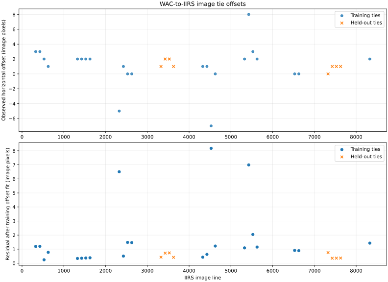

**Figure: browse-scale WAC registration residuals.** *What it shows:* how well small IIRS browse-image patches line up with the LRO WAC mosaic after a training-fitted offset. *How to read it:* the x axis is IIRS image line, from the start to the end of the strip. One panel shows the measured horizontal offset per tie, and the other the residual left after the fitted correction. Training ties and held-out ties use different markers. Held-out residuals near zero mean the correction generalizes. *Values:* [CSV](results/phase-1/m1-reference-data/metrics/iirs_wac_registration_browse_ties.csv).

The full-resolution check used E1G2 band 40 at 1,369.6 nm, marked valid in the mode table and display-stretched only for morphology matching. It used 30 training ties and 12 held-out ties across three blocks. Held-out RMSE was **2.757 IIRS pixels** (198.2 WAC projected map metres); p95 was 5.317 pixels (382.7 projected map metres). Review of the [tie CSV](results/phase-1/m1-reference-data/metrics/iirs_wac_registration_band040_1369nm_ties.csv) found held-out NCC scores of 0.206–0.320 (median 0.258), but five of 12 residuals exceed 2 pixels and two exceed 3 pixels; NCC does not reliably distinguish large residuals. See the [full-resolution summary JSON](results/phase-1/m1-reference-data/metrics/iirs_wac_registration_band040_1369nm_summary.json) and [residual plot](results/phase-1/m1-reference-data/figures/iirs_wac_registration_band040_1369nm_residuals.svg). The band image was generated by [extract_iirs_registration_band.py](scripts/extract_iirs_registration_band.py).

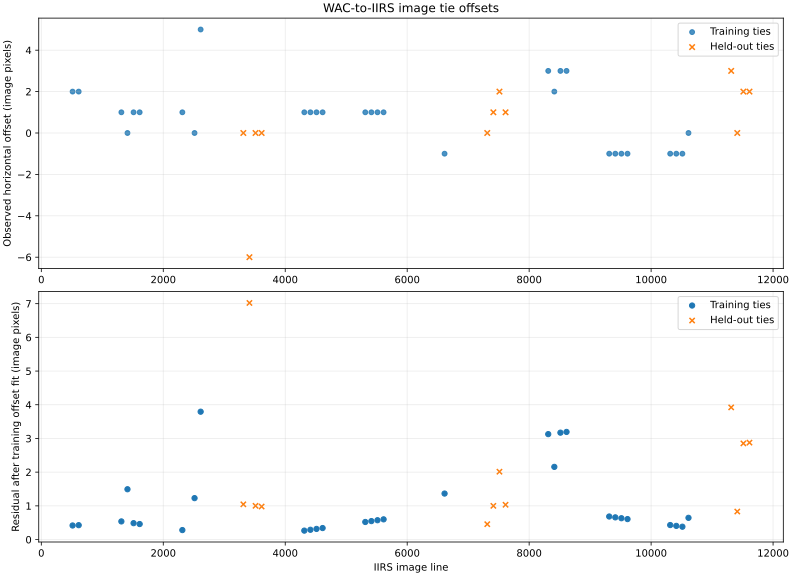

**Figure: full-resolution band 40 WAC registration residuals.** *What it shows:* the same tie test at full resolution using band 40 (1,369.6 nm). *How to read it:* the layout matches the browse figure. Larger and more scattered held-out residuals (median above 2 px) show that the WAC morphology match is not precise enough at full resolution. *Values:* [CSV](results/phase-1/m1-reference-data/metrics/iirs_wac_registration_band040_1369nm_ties.csv).

A new [2D subpixel grid diagnostic](results/phase-1/m1-wac-2d-grid/summary.md) used 245 candidate windows across five sample columns. A score threshold selected from training ties retained 41 training and 17 held-out matches across five spatial blocks. The held-out median residual was **2.236 pixels**, p95 **6.343 pixels**, and RMSE **3.572 pixels**. The predeclared candidate limits fail. The [tie values](results/phase-1/m1-wac-2d-grid/metrics/iirs_wac_2d_grid_ties.csv), [summary JSON](results/phase-1/m1-wac-2d-grid/metrics/iirs_wac_2d_grid_summary.json), and [figure](results/phase-1/m1-wac-2d-grid/figures/iirs_wac_2d_grid_residuals.svg) show that cross-track coverage is now represented, but residuals remain too large. Do not tune against this holdout. The WAC ties remain relative image matches, not surveyed controls, and do not validate radiometry.

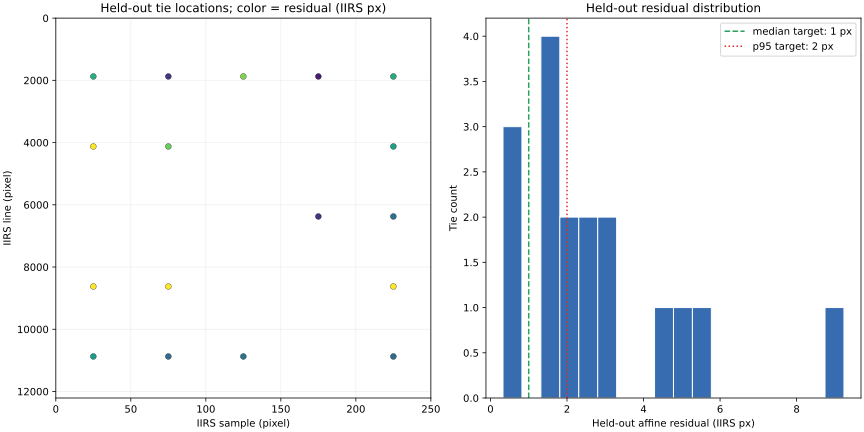

**Figure: two-dimensional WAC tie-grid residuals.** *What it shows:* held-out registration errors for a grid of ties across the full strip width. *How to read it:* one panel maps the held-out tie locations (sample against line), coloured by residual size. The other is a histogram of residuals, with vertical lines at the 1 px median target and the 2 px p95 target. Most of the histogram should sit left of both lines for a pass. Here it does not, so the WAC route failed (median 2.24 px, p95 6.34 px). *Values:* [CSV](results/phase-1/m1-wac-2d-grid/metrics/iirs_wac_2d_grid_ties.csv).

The next registration used north/south tiles from [SLDEM2015](https://pgda.gsfc.nasa.gov/products/54) and rendered terrain shading at the IIRS label's scene-level sun elevation and azimuth. The azimuth direction was selected from training matches only. After excluding reference patches that touch DEM nodata or its gradient boundary, 34 held-out ties remain across five columns and four line blocks. Their median residual is **0.375 IIRS px**, p95 **1.487 px**, and RMSE **0.699 px**; all predeclared relative-registration candidate limits pass. See the [module summary](results/phase-1/m1-sldem-hillshade/summary.md), [tie CSV](results/phase-1/m1-sldem-hillshade/metrics/iirs_sldem_hillshade_ties.csv), [summary JSON](results/phase-1/m1-sldem-hillshade/metrics/iirs_sldem_hillshade_summary.json), and [figure](results/phase-1/m1-sldem-hillshade/figures/iirs_sldem_hillshade_tie_residuals.svg). The training-fitted offset field has also been applied to a separate [sparse geometry candidate](results/phase-1/m1-sldem-correction-candidate/summary.md); the 34 held-out residuals reproduce within `1e-5` pixel. This supports relative registration consistency, not absolute position accuracy. The source geometry and IIRS product remain unchanged; independent controls or a separately corrected product are still needed.

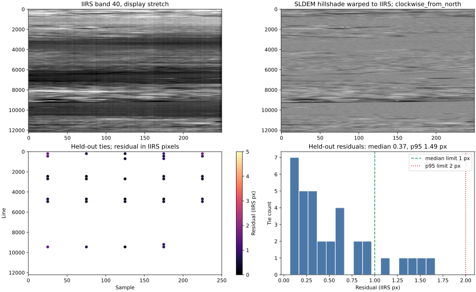

**Figure: SLDEM hillshade registration.** *What it shows:* IIRS band 40 matched to a shaded-relief image computed from SLDEM2015 with the same Sun direction. *How to read it:* the image panels show the IIRS band and the warped hillshade side by side; similar shadows mean the match is meaningful. The tie map shows held-out tie positions coloured by residual in IIRS pixels. The histogram shows residuals against the 1 px median and 2 px p95 limits. Most held-out residuals fall below 1 px (median 0.37, p95 1.49), so this route passes. *Values:* [CSV](results/phase-1/m1-sldem-hillshade/metrics/iirs_sldem_hillshade_ties.csv), [JSON](results/phase-1/m1-sldem-hillshade/metrics/iirs_sldem_hillshade_summary.json).

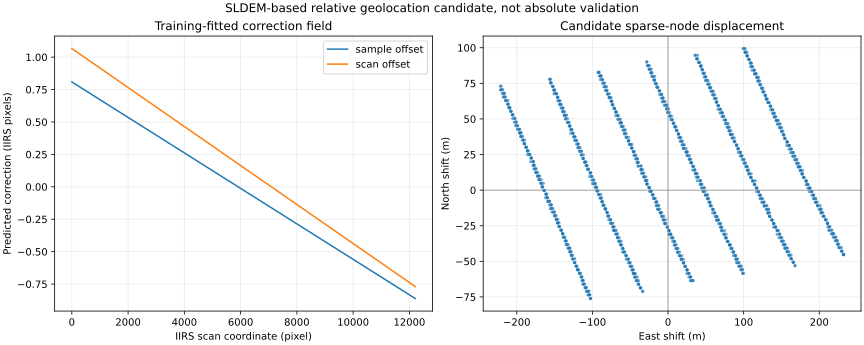

**Figure: SLDEM relative geometry correction candidate.** *What it shows:* the position correction that the SLDEM fit implies at each sparse geometry node. *How to read it:* one panel shows the predicted sample and scan offsets (IIRS pixels) along the scan coordinate. The other shows each node's shift east and north in metres. Smooth, small shifts (about 100 m east, 40 m north) indicate a consistent offset rather than noise. This is a relative correction, not an absolute validation. *Values:* [CSV](results/phase-1/m1-sldem-correction-candidate/metrics/iirs_sldem_relative_geometry_candidate.csv).

The [PDS M³ Level-2 archive](https://pds.nasa.gov/ds-view/pds/viewProfile.jsp?dsid=CH1-ORB-L-M3-4-L2-REFLECTANCE-V1.0) provides pixel-located reflectance products. A [PDS ODE REST footprint-intersection query](https://oderest.rsl.wustl.edu/) returned five candidate labels from orbit 1080, observed on 2009-02-05/06. Their labels report thermal correction applied, 85 bands, and a special-pixel value of -999.0. See the [candidate metadata](results/phase-1/m1-reference-data/m3_overlap_candidates.csv) and [label review](results/phase-1/m1-reference-data/m3_label_review.csv). A sparse-grid screen places 1,033 of 1,476 IIRS geometry points (69.99%) inside candidate `M3G20090206T010833_V01_L2`, the highest of the five. The [values](results/phase-1/m1-reference-data/metrics/m3_control_grid_overlap.csv) and [SVG figure](results/phase-1/m1-reference-data/figures/m3_control_grid_overlap.svg) are a candidate-ranking diagnostic, not a common valid-pixel fraction. The analysis is reproducible with [analyze_m3_control_grid_overlap.py](scripts/analyze_m3_control_grid_overlap.py); the ODE footprint query uses [query_m3_overlap.py](scripts/query_m3_overlap.py). ODE returned the selected candidate label/file inventory, including a 304 x 27,796 x 85 float32 RFL product and its referenced V03 pixel-location image; see the [P1 metadata](results/phase-1/m1-gate-followup-20261010/m3_candidate_ode_metadata.json). Binary retrieval is still blocked because the JPL Imaging Node certificate fails local TLS verification, so actual valid-pixel overlap is unmeasured. Compare spectra only after IIRS masks, radiance validation, geometry, and reflectance correction pass. Account for wavelength response, spatial support, and observation geometry. No M³ image cube or reflectance comparison is available yet.

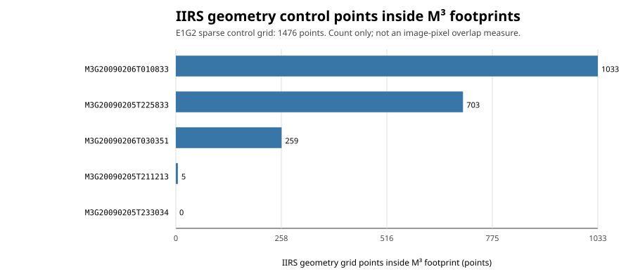 The provisional WAC tie residuals do not establish absolute geolocation accuracy. See the [M1 reference-data record](results/phase-1/m1-reference-data/summary.md).

**Figure: M³ candidate overlap with the IIRS control grid.** *What it shows:* how many of the 1,476 IIRS sparse geometry points fall inside each of the five candidate M³ reflectance footprints. *How to read it:* each bar is one M³ observation, and a longer bar means more overlap. `M3G20090206T010833` covers the most points (1,033) and is the preferred reference. Bar length counts grid points only; it is not the number of shared valid pixels. *Values:* [CSV](results/phase-1/m1-reference-data/metrics/m3_control_grid_overlap.csv).

### What IIRS papers tell us to do next

| Paper | Evidence relevant to this project | Use and limit |
| --- | --- | --- |
| [Verma et al. (2022), Icarus](https://doi.org/10.1016/j.icarus.2022.115075) | The study used E1G2 Level 1 radiance and the 2.5–5 µm range for thermal correction. | Acquire an E1G2 pair. Audit its assumptions and masks before reproducing the method. |
| [Chauhan et al. (2025), Meteoritics & Planetary Science](https://doi.org/10.1111/maps.70037) | Describes thermal correction, apparent reflectance, empirical-line adjustment, standard geometry, an output range of 0.8–3.3 µm, and comparison with same-region M³. | Use as the main Level-2 processing reference. It does not remove the need to validate our own data and masks. |
| [Gou et al. (2026), Advances in Space Research](https://doi.org/10.1016/j.asr.2026.06.090) | Reports more stable temperature estimates at 4504–4875 nm. Its sensitivity example gives a 14.39% reflectance difference at 3156 nm for a 4 K temperature difference. | Preserve the E1G2 longwave bands and propagate temperature uncertainty into 3 µm reflectance. This result is from the paper, not our cubes. |
| [Bose et al. (2024), Advances in Space Research](https://doi.org/10.1016/j.asr.2023.12.019) | Studies IIRS photometric correction over 0.8–2.0 µm and compares the derived reflectance with M³. | Informs the shortwave photometric step. It does not validate thermal correction near 3 µm. |
| [Chauhan et al. (2021), Current Science](https://doi.org/10.18520/cs/v121/i3/391-401) | Reports a physics-based thermal correction using co-located temperature measurements. | A possible independent comparison. It does not show that E3G2 alone supports longwave temperature fitting. |

The live [PRADAN Browse and Download route](https://pradan.issdc.gov.in/ch2/protected/payload.xhtml) redirects unauthenticated visitors to sign-in; the scene table and IIRS filters require an authorized session. That session was used to select and verify the E1G2 pair listed above. Remaining M1 work is to resolve threshold and pixel-mask semantics, validate full-resolution geometry and radiance scale against an independent reference, and add independent tracks before thermal processing or M3 scoring. The [initial gap matrix](docs/gap_matrix.md), [literature findings](results/phase-1/m1-literature/findings.md), and [M1 task plan](tasks/task_plan.md) track these gates. The matrix is an initial targeted review, not a systematic review or a novelty claim.

## Scientific scope and constraints

- **M1:** Build a documented, diverse IIRS corpus. Obtain the matching calibrated product when available and record its processing level and units. Collect a small set of overlapping Chandrayaan-1 M³ Level-2 reflectance scenes and a geologic reference layer for comparison. Track observation, orbit, footprint, incidence/emission/phase geometry, product version, and checksums.
- **M2:** Turn calibrated radiance into validated reflectance. Follow the product guide and the published IIRS Level-2 processing chain: quality masking, thermal-emission correction beyond approximately 2.5 µm, solar normalization, and lunar photometric correction. Record every correction and its uncertainty. Compare with calibrated/Level-2 products and overlapping M³ spectra where possible. A learned denoiser is optional and must be assessed against an untouched validation set.
- **M3:** Establish reproducible physical and machine-learning references on the **same held-out observations**: diagnostic mineral band parameters or spectral-library matching, a classical 3 µm continuum-depth index, unsupervised clustering, and a modest spectral-spatial CNN trained from random initialization. Report metrics only where independent labels exist; clustering and hydration-index maps without ground truth are descriptive, not accuracy results.

Two proposal assumptions need an explicit feasibility gate. First, the [USGS unified geologic map](https://astrogeology.usgs.gov/search/map/Moon/Geology/Unified_Geologic_Map_of_the_Moon_GIS_v2/) provides **geologic units at 1:5,000,000**, not pixel-level mineral abundances; unit polygons may supply coarse labels after boundary exclusion and manual review. Second, a 3 µm reflectance feature in a permanently shadowed region requires enough **indirect light** and signal to noise to measure it. M³ has demonstrated this under specific conditions, but the current IIRS scenes are not polar and do not establish IIRS feasibility there. A 3 µm absorption alone must not be called a water-ice detection.

## Full research roadmap

The project is deliberately staged. Each stage must pass its scientific gate before the next stage can produce a defensible result.

### Phase 1: IIRS foundations, M1–M3

This is the current phase.

**M1, acquisition and inventory** establishes exactly what each IIRS product contains. We parse the PDS4 labels, verify dimensions, byte counts, archive and extracted checksums, wavelengths, geometry, footprints, and processing levels. The active set now has two verified 2020 pairs and one verified 2026 E1G2 pair, plus the archive/SIS, a data dictionary, and an initial literature gap matrix. Independent radiance-scale validation and mask validation, geometry review, a scene-coverage report, and independent tracks remain open. The current strips do not support a polar or independent generalization claim, so additional tracks and provinces must be selected before the final split is frozen.

**M2, calibration and preprocessing** converts a calibrated product, or a documented raw-to-calibrated chain, into analysis-ready reflectance. It includes invalid and saturated-pixel masks, thermal-emission correction beyond approximately 2.5 µm, solar normalization, and lunar photometric correction. A pilot scene is validated first using representative spectra, quality fractions, correction residuals, and cross-instrument comparisons. Large-scale processing starts only after the pilot quality gate passes.

**M3, baselines and evaluation** freezes reviewed labels and orbit or province splits. It runs diagnostic mineral spectral methods, a thermally corrected 3 µm index where the signal supports it, unsupervised clustering, and a small CNN trained from random initialization. Held-out accuracy, macro-F1, balanced accuracy, IoU, class support, uncertainty, and failure cases are reported only when the labels support those metrics.

### Phase 2: Earth-to-Moon foundation-model transfer, M4

M4 begins only after M1–M3 pass. Its purpose is to measure how much general hyperspectral representation learned from Earth survives on lunar IIRS data.

The two planned comparison backbones are:

- **HyperFree:** the channel-adaptive Earth hyperspectral foundation model.
- **HyperSIGMA:** the two-stream spectral and spatial Earth hyperspectral foundation model.

For each backbone, the same corrected IIRS inputs, labels, masks, and held-out split are used in three conditions:

1. **Frozen zero-shot transfer:** use the released encoder without lunar training and classify against projected laboratory reference spectra or nearest-centroid prototypes.
2. **Linear probe:** keep the encoder frozen and train only a small lunar task head.
3. **Controlled fine-tuning:** allow encoder adaptation under a fixed training budget and the same evaluation protocol.

Because IIRS wavelengths and band spacing do not exactly match the Earth pretraining sensors, M4 first uses a continuous wavelength-aware adapter. It evaluates a comparable SWIR range before testing the extended 0.8–5.0 µm range. The backbone checkpoint, license, preprocessing, adapter version, split, seed, and code revision are recorded for every run.

M4 outputs a quantified Earth-to-Moon transfer gap, not a claim that either model is already lunar-ready.

An exploratory, pre-gate M4 run was made on 10 October 2026 with frozen linear probes on proxy USGS labels. HyperSIGMA spatial reached macro F1 0.67 and HyperFree 0.54, while a context-matched classical control reached 0.63. Zero-shot transfer and controlled fine-tuning remain to be run after the M3 gate passes. See [M3 supervised baselines and exploratory M4 transfer](#m3-supervised-baselines-and-exploratory-m4-transfer-10-october-2026).

### Phase 2: Lunar self-supervised adaptation, M5

M5 continues pretraining the selected backbone on unlabeled calibrated IIRS patches. The main objective masks spectral tokens and reconstructs them. Ablations test spectral derivative consistency and band-ratio consistency so that adaptation does not smooth away narrow mineral or hydration absorptions. The adapted encoder is then evaluated with the same few-shot and held-out protocol as M4.

### Phase 2: Downstream scientific tasks, M6

M6 applies the validated representations to reviewed mineral classes or abundance proxies and to a thermally corrected apparent hydroxyl or water-equivalent 3 µm absorption index. Polar water-ice interpretation remains conditional on indirect-light signal, thermal stability, independent references, and uncertainty checks. A 3 µm anomaly is not reported as definitive water ice without those checks.

### Phase 2: Reporting and release, M7

M7 consolidates ablations, limitations, reproducibility checks, checkpoints, processed products, figures, and code. It records which quality gates passed or failed and separates measured results from unresolved research questions.

## Research results and evidence storage

Every phase and module has a concise record under [`results/`](results/). Each module contains a summary, findings, and notes. When a metric or graph is computed, its source values are saved as CSV or JSON in `metrics/`, and the corresponding PNG or SVG is saved in `figures/`. The summary records the data version, split, units, code revision, generation command, and figure path. If no metric or graph exists, the result remains a text record and no artificial plot is created. See the [results protocol](docs/results_protocol.md).

## Data handling

1. Retain the original ZIP archives and XML labels as immutable inputs. Record SHA-256 for each ZIP and verify each extracted `.qub` against the label's MD5 and byte count.
2. Read the extracted `data/extracted/*/data/{raw,calibrated}/.../*.xml` label before opening a cube. The active pilot raw products are `(bands=256, lines=10925 or 10927, samples=250)` little-endian unsigned 16-bit; the calibrated products are IEEE 32-bit floating point. Stream or memory-map large cubes; do not load the whole archive into memory for a quick look.
3. Keep raw counts, calibrated radiance, corrected reflectance, masks, and model-ready tiles in distinct directories. Store wavelengths, units, coordinate convention, source product IDs, correction versions, and split IDs with every derived artifact.
4. Split by orbital track and geologic province before fitting normalization, selecting thresholds, or tuning models. The two low-latitude pilot strips are insufficient for a defensible independent transfer benchmark; acquire more distinct scenes before claiming generalization.

## Primary sources

- [ISRO PRADAN Chandrayaan-2 archive](https://pradan.issdc.gov.in/ch2/) and [IIRS product FAQ](https://pradan.issdc.gov.in/ch2/faq.xhtml): instrument overview, raw/calibrated product types, XML labels, and location of the IIRS archive and user guides (`Other Downloads` → `iir.zip`).
- [ISRO Chandrayaan-2 science page](https://www.isro.gov.in/Chandrayaan2_science.html): IIRS observation and hydration objectives.
- [Chauhan et al., 2025, Level-2 IIRS reflectance processing](https://onlinelibrary.wiley.com/doi/abs/10.1111/maps.70037): thermal correction, apparent reflectance, and spectral correction. Use the full paper and product guide when implementing numerical details.
- [IIRS photometric correction study](https://www.sciencedirect.com/science/article/pii/S0273117723009754): lunar photometric normalization and comparison with M³.
- [NASA PDS M³ Level-2 reflectance archive](https://pds.nasa.gov/ds-view/pds/viewProfile.jsp?dsid=CH1-ORB-L-M3-4-L2-REFLECTANCE-V1.0): cross-instrument comparison data.
- [USGS Unified Geologic Map of the Moon](https://astrogeology.usgs.gov/search/map/Moon/Geology/Unified_Geologic_Map_of_the_Moon_GIS_v2/) and [USGS Spectral Library v7](https://www.usgs.gov/labs/spectroscopy-lab/usgs-spectral-library): coarse geologic context and candidate mineral reference spectra.
- [Li et al., 2018, polar surface ice from M³](https://pmc.ncbi.nlm.nih.gov/articles/PMC6130389/): demonstrates the need to account for indirect illumination in permanently shadowed terrain.

Research and inventory are documented here; the methods and results will be added as they are implemented and validated.
