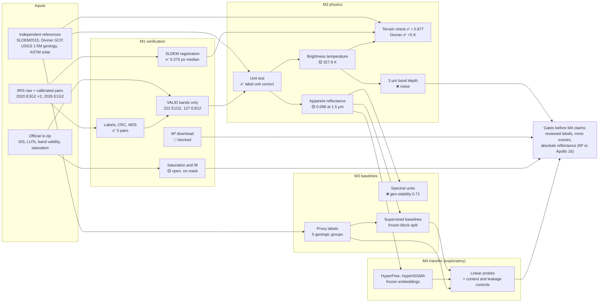

# Chandrayaan-2 IIRS: lunar hyperspectral foundations (M1–M4)

This repository supports **Cross-Domain Transfer of Hyperspectral Foundation Models for Lunar Mineral and Water-Ice Mapping**. It works with Chandrayaan-2 Imaging Infrared Spectrometer (IIRS) data. The stages are:

1. **M1:** verify the products.
2. **M2:** turn radiance into physically checked reflectance and temperature.
3. **M3:** build reference baselines.
4. **M4:** test whether Earth hyperspectral foundation models (HyperFree, HyperSIGMA) transfer to the Moon.

> **Evidence rule.** Raw counts, calibrated radiance, apparent reflectance, and scientific labels are separate products. Every number below links to saved values (CSV/JSON) and a figure under [`results/`](results/). Results marked **provisional** or **exploratory** are not validated science products. No mineral, hydration, or water-ice result is claimed.

Related documents: [M1–M3 implementation plan](docs/m1_m3_plan.md) · [setup](SETUP.md) · [plain-language research guide](research_guide/README.md) · [results protocol](docs/results_protocol.md) · [gap matrix](docs/gap_matrix.md)

## Contents

1. [Status at a glance](#1-status-at-a-glance)
2. [Headline results](#2-headline-results)
3. [Workflow](#3-workflow)
4. [Data and references used](#4-data-and-references-used)
5. [M1: product verification](#5-m1-product-verification)
6. [M2: radiance, reflectance, and temperature](#6-m2-radiance-reflectance-and-temperature)
7. [M3: labels and baselines](#7-m3-labels-and-baselines)
8. [M4: Earth-to-Moon transfer (exploratory)](#8-m4-earth-to-moon-transfer-exploratory)
9. [Open gates and next actions](#9-open-gates-and-next-actions)
10. [Reproduce](#10-reproduce)
11. [Glossary](#11-glossary)
12. [Roadmap M1–M7](#12-roadmap-m1m7)
13. [Data handling and evidence storage](#13-data-handling-and-evidence-storage)
14. [Primary sources](#14-primary-sources)
15. [Archive: detailed M1 evidence chart](#15-archive-detailed-m1-evidence-chart)

## 1. Status at a glance

Updated 10 October 2026. Legend: ✅ pass or done · 🟡 partial or provisional · ❌ failed gate · 🔴 blocked · ⛔ not started.

| Phase | Module | Status | Key result | Record |
|---|---|---|---|---|
| M1 | Inventory, integrity, band validity | ✅ | 3 matched raw/calibrated pairs verified (CRC, MD5, labels) | [summary](results/phase-1/m1-inventory/summary.md) |
| M1 | E1G2 scene audit | ✅ | LUT stage vs Level 1: median ratio 1.004 | [summary](results/phase-1/m1-e1g2-scene/summary.md) |
| M1 | E3G2 LUT lineage | 🟡 | ~5000× gap explained by exposure scaling (median ratio 0.944) | [summary](results/phase-1/m1-e3g2-lineage-check/summary.md) |
| M1 | Saturation and fill rules | 🟡 | Table unit inconsistent with valid radiance; no mask assigned | [summary](results/phase-1/m1-saturation-sample/summary.md) |
| M1 | Geometry: WAC grid | ❌ | p95 residual 6.3 px | [summary](results/phase-1/m1-wac-2d-grid/summary.md) |
| M1 | Geometry: SLDEM hillshade | ✅ | Held-out median 0.375 px, p95 1.49 px | [summary](results/phase-1/m1-sldem-hillshade/summary.md) |
| M1 | M³ reference download | 🔴 | JPL TLS failure; USGS mirror 404 | [summary](results/phase-1/m1-gate-followup-20261010/summary.md) |
| M2 | Radiance-unit physics test | ✅ | Label unit correct for all 3 products | [summary](results/phase-1/m2-radiance-unit-physics/summary.md) |
| M2 | Apparent reflectance | 🟡 | Median 0.098 at 1.5 µm | [summary](results/phase-1/m2-apparent-reflectance/summary.md) |
| M2 | Brightness temperature | 🟡 | Median 327.8 K | [summary](results/phase-1/m2-thermal-brightness/summary.md) |
| M2 | Topographic validation (SLDEM) | ✅ | r = 0.877, held-out R² = 0.78 | [summary](results/phase-1/m2-topographic-validation/summary.md) |
| M2 | Diviner temperature check | ✅ | IIRS − Diviner +5.0 K median, profile r = 0.81 | [summary](results/phase-1/m2-diviner-temperature/summary.md) |
| M2 | 3 µm thermal removal | ❌ | 2.9 µm band depth noise-dominated | [summary](results/phase-1/m2-thermal-brightness/summary.md) |
| M3 | Proxy geologic labels | 🟡 | 5 groups from USGS 1:5M map | [summary](results/phase-1/m3-geologic-labels/notes.md) |
| M3 | Unsupervised spectral units | 🟡 | Seed-stable; geographic stability 0.71 (target 0.8) | [summary](results/phase-1/m3-spectral-units/summary.md) |
| M3 | Supervised baselines | 🟡 | Macro F1 0.40–0.50 per pixel; 0.63 with 64 px context (majority 0.10) | [summary](results/phase-1/m3-supervised-baselines/summary.md) |
| M4 | Foundation-model setup | ✅ | HyperFree and HyperSIGMA run on GPU | [inventory](results/phase-2/m4-transfer/model_inventory.md) |
| M4 | Frozen linear probes | 🟡 | HyperSIGMA 0.67, HyperFree 0.54; matches the context control (0.63) | [summary](results/phase-2/m4-transfer/summary.md) |
| M4–M6 | Fine-tuning, self-supervised adaptation, science | ⛔ | Waiting on reviewed labels and more scenes | [roadmap](#12-roadmap-m1m7) |

## 2. Headline results

1. **The radiance-unit question is answered by physics.** The guide says mW and two labels say µW. Reading each product with its label unit gives realistic lunar brightness (I/F ≈ 0.05) and temperature (≈ 328 K). The other reading gives impossible values (I/F ≈ 50, 1,207 K). 2020 `m65` stores mW; both `d18` products store µW.
2. **IIRS temperatures are physically real.** They track independent SLDEM2015 terrain illumination (r = 0.877, held-out R² = 0.78). They agree with LRO Diviner at the same local time within +5 K (median), with a latitude profile correlation of r = 0.81.
3. **The first IIRS apparent reflectance is plausible.** The median is 0.098 at 1.5 µm, and mare and highland differ by about 1.9×.
4. **Spectral units match known geology.** The darkest unit, which has the strongest 1 µm band, coincides with the Rimae Bode pyroclastic deposit in the independent USGS map.
5. **Baselines and Earth foundation models both learn the map units, but pretraining adds no clear gain yet.** On a frozen geographic split with proxy USGS labels: per-pixel classical baselines reach macro F1 0.46–0.50 (majority 0.10). Frozen HyperSIGMA reaches **0.67**. A random forest on 64-pixel context spectra reaches **0.63**, with overlapping confidence intervals. Spatial context explains most of HyperSIGMA's lead (exploratory, pre-gate).
6. **Held gates.** The 3 µm hydration parameter is noise-dominated (no claim). Saturation and fill semantics remain unresolved. The M³ cross-check is blocked by downloads.

## 3. Workflow

## 4. Data and references used

| Item | What | Role | Local path (ignored) |
|---|---|---|---|
| IIRS 2026-02-27 E1G2 `d18` | Raw + calibrated, 12,210 × 250 × 256, 712–5010 nm, 5.5°W–3.5°W, 6.5°S–26.9°N | Main analysis scene | `data/pradan/e1g2_candidate_20260227T1239538758/` |
| IIRS 2020-02-08 E3G2 `m65`, `d18` | Raw + calibrated, about 10,925 × 250 × 256, 31°S–1.5°S | Audit and unit test | `data/extracted/` |
| Official `iir.zip` | SIS V17, LUTs, saturation tables, band validity | Product rules | `data/pradan/iir.zip` |
| SLDEM2015 | 512 px/deg DEM tiles | Registration and terrain illumination | `data/reference/sldem2015_e1g2/` |
| LRO Diviner GCP v002 | 0.5°, 0.25 h local-time temperatures, 2009–2015 | Independent temperature check | `data/reference/diviner/` |
| USGS Unified Geologic Map v2 | 1:5M units (Fortezzo et al. 2020) | Proxy labels | `data/reference/usgs_unified_geology/` |
| ASTM G173-03 AM0 | Solar irradiance 280–4000 nm (pvlib) | I/F and reflectance | `data/reference/solar/` |
| HyperFree-b, HyperSIGMA ViT-B | Earth hyperspectral foundation models | M4 transfer | `data/models/` |

## 5. M1: product verification

### 5.1 Inventory and band validity ✅

Labels, ZIP CRCs, and embedded cube MD5s pass for all three pairs. SIS Appendix H says only `VALID` bands may be used. E1G2 keeps 222 bands, including 4504–4875 nm for thermal work. E3G2 keeps 127 bands and has no valid 4–5 µm band.

*Band validity by mode (green = `VALID`). Values: [CSV](results/phase-1/m1-inventory/metrics/band_validity_by_mode.csv). Audit of external code: [record](results/phase-1/m1-processing-code-audit/summary.md).*

### 5.2 Radiance quality scans ✅

All calibrated values are finite. On valid bands, the 2020 cubes have 2,809 and 3,059 exact zeros and 26 negatives each. The E1G2 cube has 4,829 zeros and 42,081 negative band-pixels. These are not classified as fill.

| 2020 E3G2 scans | E1G2 audit |
|---|---|
|  |  |

*Left: zeros, threshold comparisons, and medians ([CSV](results/phase-1/m1-inventory/metrics/pilot_radiance_quality_by_band.csv)). Right: E1G2 medians, LUT ratio (median 1.004, correlation 0.922), and sparse geometry ([CSV](results/phase-1/m1-e1g2-scene/metrics/e1g2_radiance_by_band.csv)).*

### 5.3 LUT lineage: the E3G2 "5000×" gap 🟡

Applying the E3G2 LUT literally gave Level-1/LUT ratios near 0.0002. The E2/E3/E4 LUT tables hold factors near 1, not absolute gains. E1G2 holds absolute gains, and E3 uses a 10 ms exposure against 1 ms for E1. Level 1 ≈ E3G2 LUT stage × (E1G2 gain ÷ 10), with a median fitted-to-predicted ratio of **0.944** for both products. A tail of bands (p05 0.50) is unexplained.

| Original audit | Exposure-scaling test |
|---|---|
|  |  |

*Values: [audit CSV](results/phase-1/m1-e3g2-lineage-check/metrics/e3g2_raw_lut_calibrated_by_band.csv), [scaling CSV](results/phase-1/m1-e3g2-lineage-check/metrics/e3g2_lut_exposure_scaling_test.csv).*

### 5.4 Saturation and fill rules 🟡 open

Read in its declared µW, the saturation table flags 99.88% of physically valid E1G2 radiance. Read as mW, it flags 12 values. No raw count reaches `Dynamic_Range`. The E3G2 table behaves differently, so no single correction fits. **No pixel mask is assigned.** A data-driven finite-and-positive mask keeps 99.61% of pixels.

| Fixed-line sample | Table vs LUT by mode |
|---|---|
|  |  |

*Values: [sample CSV](results/phase-1/m1-saturation-sample/metrics/e1g2_saturation_sample_by_band.csv), [table check CSV](results/phase-1/m1-saturation-sample/metrics/iirs_saturation_lut_table_check_by_mode.csv).*

### 5.5 Geometry registration ✅ relative, absolute open

The WAC morphology grid failed (median 2.24 px, p95 6.34 px). An illumination-matched SLDEM2015 hillshade passed every predeclared relative-registration criterion on 34 held-out ties: median **0.375 px**, p95 **1.49 px**, RMSE 0.70 px. The fitted offset field was applied to a separate copy of the geometry table. The source product is unchanged.

| WAC grid (failed) | SLDEM hillshade (passed) | Corrected geometry candidate |
|---|---|---|
|  |  |  |

*Values: [WAC ties](results/phase-1/m1-wac-2d-grid/metrics/iirs_wac_2d_grid_ties.csv), [SLDEM ties](results/phase-1/m1-sldem-hillshade/metrics/iirs_sldem_hillshade_ties.csv), [candidate coordinates](results/phase-1/m1-sldem-correction-candidate/metrics/iirs_sldem_relative_geometry_candidate.csv).*

### 5.6 M³ reference data 🔴 blocked

ODE lists five M³ Level-2 candidates. `M3G20090206T010833` contains 70% of the sparse IIRS geometry nodes. Its 2.7 GB reflectance cube and location file are on the JPL host, which fails TLS validation here, and the USGS mirror path returns 404.

*Values: [overlap CSV](results/phase-1/m1-reference-data/metrics/m3_control_grid_overlap.csv), [ODE metadata](results/phase-1/m1-gate-followup-20261010/m3_candidate_ode_metadata.json).*

## 6. M2: radiance, reflectance, and temperature

All M2 results use the E1G2 strip (local morning, about 08:10, solar zenith 57–62°). Products are **provisional**: there is no photometric correction and no absolute reflectance validation.

### 6.1 Radiance-unit physics test ✅

| Product | Label unit | I/F at 1.5 µm if µW | if mW | Physically plausible |
|---|---|---|---|---|
| 2026 E1G2 `d18` | µW | 0.052 | 51.5 | µW ✅ |
| 2020 E3G2 `m65` | mW | 0.00007 | 0.065 | mW ✅ |
| 2020 E3G2 `d18` | µW | 0.056 | 55.7 | µW ✅ |

| E1G2: reflected light and thermal emission | 2020 E3G2: reflected light |
|---|---|
|  |  |

*Values: [E1G2 CSV](results/phase-1/m2-radiance-unit-physics/metrics/e1g2_iof_by_band_under_unit_hypotheses.csv), [E3G2 CSV](results/phase-1/m2-radiance-unit-physics/metrics/e3g2_iof_by_band_under_unit_hypotheses.csv).*

### 6.2 Apparent reflectance 🟡

I/F ÷ cos(i), with the ASTM G173 solar spectrum. The median at 1.5 µm is **0.098** (p05–p95 0.068–0.150), and dark-to-bright contrast is about 1.9×. Spectra are red-sloped. Steps at 1.16, 1.30, 1.83, 1.99, and 3.4 µm appear in every pixel class and are likely instrument artifacts.

*Latitude runs along x; the 18 km strip is stretched across-track. Values: [spectra CSV](results/phase-1/m2-apparent-reflectance/metrics/e1g2_apparent_reflectance_spectra.csv).*

### 6.3 Brightness temperature 🟡

Planck inversion of 4504–4875 nm with emissivity 0.95, after removing the reflected component (about 6% of the signal). The median is **327.8 K** (p05–p95 304.7–342.0 K). The offset from radiative equilibrium depends on the albedo law: −1.3 K for constant albedo, +8 to +18 K for the Hayne et al. (2017) law.

| Temperature map and exploratory 3 µm thermal removal | Albedo-law comparison |
|---|---|
|  |  |

*The 2.9 µm band depth (median 0.045, p05–p95 −0.15 to 0.17) is noise-dominated: ❌, no hydration claim. Values: [latitude CSV](results/phase-1/m2-thermal-brightness/metrics/e1g2_temperature_by_latitude.csv), [albedo models](results/phase-1/m2-thermal-brightness/metrics/e1g2_temperature_vs_albedo_models.csv).*

### 6.4 Independent temperature checks ✅

**Terrain illumination (SLDEM2015).** IIRS temperature follows the local sun angle on each slope: r = **0.877**. A fit on even 500-line blocks predicts odd blocks with R² = **0.784**. This supports the radiance scale, the thermal signal, and the relative geometry together.

**LRO Diviner.** Using the Global Cumulative Product at matched local time (08:07–08:15), IIRS − Diviner bolometric is **+5.0 K** median (IQR +3.4 to +7.1 K) over 33 latitude bins, with profile r = **0.81**. Surface roughness predicts 0 to +12 K for a 4.7 µm measurement. The offset is larger on dark units; the cause is open.

| SLDEM terrain illumination | Diviner at matched local time |
|---|---|
|  |  |

*Values: [terrain JSON](results/phase-1/m2-topographic-validation/metrics/e1g2_topographic_validation_summary.json), [Diviner CSV](results/phase-1/m2-diviner-temperature/metrics/e1g2_iirs_vs_diviner_by_latitude.csv). Diviner is a 2009–2015 climatology at 0.5° bins, not a simultaneous observation.*

## 7. M3: labels and baselines

### 7.1 Proxy geologic labels 🟡

The USGS Unified Geologic Map (1:5M) was rasterized onto every IIRS pixel. It has 14 units in 5 groups: basin 47.5%, mare 27.5%, highland/terra 13.9%, dark mantle 6.1%, and crater 5.0%. Shifting the map by 2 km changes 21% of unit labels, so a **2 km contact buffer** is applied before training or scoring. These are proxy labels, not reviewed ground truth.

*Values: [group classes](results/phase-1/m3-geologic-labels/metrics/e1g2_geologic_group_classes.csv), [boundary sensitivity](results/phase-1/m3-geologic-labels/metrics/e1g2_geologic_boundary_sensitivity.csv).*

### 7.2 Unsupervised spectral units 🟡

Processing: topography-normalized, destriped, polished, and despiked reflectance (845–2460 nm). Then 1 µm and 2 µm integrated band depth, PCA, and k-means. Six units are seed-stable (ARI ≥ 0.95), and the darkest coincides with the Rimae Bode deposit. **Geographic stability fails:** the best even/odd block ARI is 0.60 per pixel and 0.71 with 4×4 binning, against a target of 0.8.

| Spectral-unit map | Binned stability re-test |
|---|---|
|  |  |

*Values: [model selection](results/phase-1/m3-spectral-units/metrics/e1g2_kmeans_model_selection.csv), [binned stability](results/phase-1/m3-spectral-units/metrics/e1g2_binned_stability.csv).*

### 7.3 Supervised baselines (exploratory) 🟡

Five baselines were trained on one **frozen geographic split** of the strip. Lines are cut into 250-line blocks in the order train, train, val, test, with 25-line guards and a 2 km contact buffer. Metrics are macro F1 and balanced accuracy, with 95% intervals from 1,000 resamples of test blocks. Three **context controls** use the same methods on spectra averaged over a 64 × 64 px window. Widening the guard to 64 lines changes no method by more than 0.04, so there is no sign of split leakage.

| Method | Family | Macro F1 [95% CI] | Balanced acc. |
|---|---|---|---|
| Majority class | reference | 0.10 [0.03, 0.17] | 0.20 |
| Band parameters + nearest centroid | physical | 0.40 [0.31, 0.51] | 0.45 |
| Spectra PCA20 + logistic regression | classical | 0.46 [0.34, 0.56] | 0.53 |
| Spectra + random forest | classical | 0.50 [0.35, 0.62] | 0.57 |
| 1D spectral CNN, from scratch (GPU) | learned | 0.49 [0.35, 0.61] | 0.56 |
| 64 px context + logistic regression | context control | 0.58 [0.43, 0.69] | 0.59 |
| 64 px context + random forest | context control | **0.63** [0.47, 0.71] | 0.65 |

*Values: [M3 CSV](results/phase-1/m3-supervised-baselines/metrics/e1g2_benchmark_m3.csv), [context CSV](results/phase-1/m3-supervised-baselines/metrics/e1g2_benchmark_ctx.csv), [64-line guard CSV](results/phase-2/m4-transfer/metrics/e1g2_benchmark_m3_ctx_m4_guard64.csv). Record: [summary](results/phase-1/m3-supervised-baselines/summary.md). Labels are 1:5M proxy units in one scene; differences below about 0.1 are within the intervals.*

## 8. M4: Earth-to-Moon transfer (exploratory)

> M4 normally starts only after M3 passes its gates. For the October review it was run early as an **exploratory, pre-gate** study on the same proxy labels and split. Results measure transfer on coarse map units in one scene. They are not lunar-readiness claims.

### 8.1 Models

| | HyperFree | HyperSIGMA |
|---|---|---|
| Paper | Li et al., CVPR 2025 | Wang et al., IEEE TPAMI 2025 |
| Weights | `HyperFree-b.pth` (ViT-B), Apache-2.0 | spatial + spectral ViT-B, Apache-2.0 |
| Pretraining | AVIRIS, 400–2500 nm | Hyperion radiance + GF-5 DN |
| Wavelength handling | Native (wavelength-indexed weights); all 83 IIRS bands used | Interpolated to 100 bands, 845–2460 nm |
| Embedding | 768-d per pixel | 768-d spatial (per pixel); spectral (per 64 px tile) |
| Caveats | Tile normalized by its maximum | Spectral encoder is band-order blind; never saw reflectance |

*Full inventory with hashes and licences: [model inventory](results/phase-2/m4-transfer/model_inventory.md).*

### 8.2 Linear probes and controls

Frozen embeddings for the whole strip (768-d) took 1–2 minutes per model on the GPU. A single linear layer was trained on the **same split, labels, and metrics** as M3.

| Method | Macro F1 [95% CI] | Balanced acc. | Macro F1, 64-line guard |
|---|---|---|---|
| HyperFree frozen + linear probe | 0.54 [0.39, 0.63] | 0.62 | 0.52 |
| HyperSIGMA spatial frozen + linear probe | **0.67** [0.52, 0.76] | 0.73 | 0.67 |
| HyperSIGMA spectral (tile-level) + linear probe | 0.57 [0.40, 0.69] | 0.60 | 0.61 |
| *Control: 64 px context + random forest (no pretraining)* | *0.63 [0.47, 0.71]* | *0.65* | *0.66* |

**Reading the result:**

- Frozen Earth features beat per-pixel spectral baselines.
- A context-matched classical control comes within the confidence interval of HyperSIGMA, so the **pretraining benefit is not demonstrated** on these labels.
- HyperFree's per-pixel gain (+0.04) is within probe-training variance; a CPU rerun scored 0.48.
- Zero-shot and fine-tuning were not run.

*Values: [M4 CSV](results/phase-2/m4-transfer/metrics/e1g2_benchmark_m4.csv). Record: [summary](results/phase-2/m4-transfer/summary.md), [findings](results/phase-2/m4-transfer/findings.md).*

## 9. Open gates and next actions

| Gate | Status | What closes it |
|---|---|---|
| Saturation and fill semantics | 🟡 open | Provider rule. ISSDC has not replied; record any reply |
| Absolute reflectance scale | 🔴 blocked | M³ RFL and LOC files (manual browser download) or an Apollo 16 IIRS scene |
| Photometric correction | ⛔ | Lommel–Seeliger or Hapke with SLDEM incidence and emission |
| 3 µm hydration parameter | ❌ | Spatial binning plus temperature-uncertainty propagation; report as an upper limit if no detection |
| Reviewed labels and more scenes | ⛔ | Additional E1G2 scenes from other provinces, plus label review |
| Spectral-unit geographic stability | ❌ | More scenes; supervised labels are the better test |
| Spectral junction steps | 🟡 | Instrument documentation on filter boundaries |

**Next actions**

- **P1 (recommended first):** Download the two M³ files in a browser to unblock the absolute reflectance check.
- **P2:** Acquire 2–3 more E1G2 scenes from other provinces through PRADAN, so splits can be scene-independent.
- **P3:** Apply photometric correction, then re-run M3 and M4 on the corrected reflectance.

## 10. Reproduce

Large intermediates go to the ignored `data/derived/e1g2/`. Run from the repository root. Exact `uv` commands and script SHA-256 values are in each module's `notes.md`.

| Step | Script | Output module |
|---|---|---|
| 1 | `scripts/build_e1g2_working_cube.py` | working cube, geometry |
| 2 | `scripts/run_e1g2_m2_physical_pilot.py` | unit test, reflectance, temperature |
| 3 | `scripts/run_e3g2_radiance_unit_physics.py` | E3G2 unit test |
| 4 | `scripts/run_e1g2_topographic_validation.py` | terrain check |
| 5 | `scripts/compare_e1g2_temperature_albedo_models.py` | albedo models |
| 6 | `scripts/compare_e1g2_diviner_temperature.py` | Diviner check |
| 7 | `scripts/test_e3g2_lut_exposure_scaling.py` | LUT lineage |
| 8 | `scripts/run_e1g2_m3_spectral_units.py`, then `run_e1g2_m3_binned_stability.py` | spectral units |
| 9 | `scripts/build_e1g2_geologic_labels.py` | proxy labels |
| 10 | `scripts/m4_foundation_features.py --selftest`, then `extract_e1g2_foundation_embeddings.py` | M4 embeddings |
| 11 | `scripts/run_e1g2_m3_m4_benchmark.py` (`--methods m3`, `ctx`, `m4`; `--guard 64`), then `plot_e1g2_benchmark.py` | M3/M4 benchmark |

The GPU runs need `torch==2.5.1` (CUDA 12.4). Newer default wheels target CUDA 13 and fall back to the CPU on this machine's 12.5 driver.

## 11. Glossary

| Term | Meaning |
|---|---|
| **IIRS** | Chandrayaan-2 Imaging Infrared Spectrometer; one spectrum (about 0.7–5 µm) per pixel |
| **E1G2, E3G2** | Exposure and gain modes from the label (E1 = 1 ms, E3 = 10 ms). `d18` and `m65` are station codes, not modes |
| **NRI / NCI** | Raw (`nri`) and calibrated (`nci`) product codes |
| **Raw count / radiance / reflectance** | Detector number / physical radiance / fraction of sunlight reflected. Three separate products |
| **I/F** | Radiance factor π·L / (solar irradiance). Apparent reflectance = I/F ÷ cos(incidence) |
| **LUT** | Look-up table converting counts to an intermediate radiance stage |
| **VALID band** | A band marked usable in SIS Appendix H for that mode |
| **Brightness temperature** | Temperature of a blackbody giving the observed 4.5–4.9 µm emission |
| **IBD** | Integrated band depth (1 µm, 2 µm): strength of mafic mineral absorptions |
| **ARI** | Adjusted Rand index: agreement between two clusterings (1 = identical) |
| **Macro F1 / balanced accuracy** | Class-averaged scores, so small classes count equally |
| **Linear probe** | Frozen pretrained encoder plus one trained linear layer |
| **Block split, guard, contact buffer** | Train/val/test by 250-line blocks; dropped lines at block edges; dropped pixels near map-unit boundaries |

## 12. Roadmap M1–M7

| Stage | Goal | Status |
|---|---|---|
| **M1** acquisition and inventory | Verified products, units, geometry, gap review | 🟡 mostly done; masks and M³ open |
| **M2** calibration and preprocessing | Validated reflectance with masks, thermal and photometric correction | 🟡 pilot done; absolute scale and photometry open |
| **M3** baselines | Physical, clustering, and from-scratch models on frozen geographic splits with reviewed labels | 🟡 exploratory on proxy labels |
| **M4** foundation-model transfer | HyperFree and HyperSIGMA: zero-shot, linear probe, controlled fine-tuning; wavelength-aware adapter | 🟡 exploratory linear probes only |
| **M5** lunar self-supervised adaptation | Masked spectral reconstruction on unlabeled IIRS | ⛔ |
| **M6** science tasks | Mineral classes and thermally corrected 3 µm index; no water-ice claim without indirect-light and thermal checks | ⛔ |
| **M7** reporting and release | Ablations, limits, checkpoints, reproducibility | ⛔ |

Scope constraints:

- The USGS map gives **1:5M geologic units**, not pixel mineralogy.
- A 3 µm absorption alone is **not** a water-ice detection.
- The current scenes are low-latitude and non-polar.

## 13. Data handling and evidence storage

1. Keep the original ZIPs and labels unchanged. Verify SHA-256, CRC, and label MD5.
2. Read each product's PDS4 label for type, axes, wavelengths, and **units** before opening a cube. Units differ by product.
3. Keep raw counts, radiance, reflectance, masks, embeddings, and tiles in separate directories under the ignored `data/`.
4. Split by geography before fitting normalization or tuning. Report metrics only with saved values and a figure.

Every module has `summary.md`, `findings.md`, and `notes.md` under `results/<phase>/<module>/`, with metrics in `metrics/` and figures in `figures/`. See the [results protocol](docs/results_protocol.md).

## 14. Primary sources

- [ISRO PRADAN Chandrayaan-2 archive](https://pradan.issdc.gov.in/ch2/) and [IIRS FAQ](https://pradan.issdc.gov.in/ch2/faq.xhtml)
- [Chauhan et al. 2025, IIRS Level-2 reflectance](https://doi.org/10.1111/maps.70037) · [Chauhan et al. 2021, OH/H₂O from IIRS](https://doi.org/10.18520/cs/v121/i3/391-401) · [Verma et al. 2022, Icarus](https://doi.org/10.1016/j.icarus.2022.115075) · [Bose et al. 2024, photometric correction](https://doi.org/10.1016/j.asr.2023.12.019) · [Gou et al. 2026](https://doi.org/10.1016/j.asr.2026.06.090)
- [SLDEM2015, NASA PGDA](https://pgda.gsfc.nasa.gov/products/54) · [Diviner GCP, Williams et al. 2017, PDS Geosciences](https://pds-geosciences.wustl.edu/) · [Hayne et al. 2017, JGR](https://arxiv.org/abs/1711.00977)
- [USGS Unified Geologic Map of the Moon](https://astrogeology.usgs.gov/search/map/Moon/Geology/Unified_Geologic_Map_of_the_Moon_GIS_v2/) · [NASA PDS M³ Level-2](https://pds.nasa.gov/ds-view/pds/viewProfile.jsp?dsid=CH1-ORB-L-M3-4-L2-REFLECTANCE-V1.0)
- [HyperFree (Li et al. 2025)](https://arxiv.org/abs/2503.21841) · [HyperSIGMA (Wang et al. 2025)](https://arxiv.org/abs/2406.11519)
- [Li et al. 2018, polar surface ice from M³](https://pmc.ncbi.nlm.nih.gov/articles/PMC6130389/)

## 15. Archive: detailed M1 evidence chart

Expand the original step-by-step M1 evidence chart (kept for traceability)

