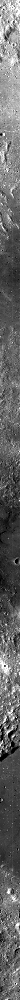
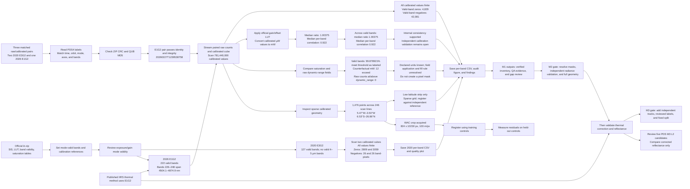

# Chandrayaan-2 IIRS: phase 1 research and baselines

This repository supports the first phase of **Cross-Domain Transfer of Hyperspectral Foundation Models for Lunar Mineral and Water-Ice Mapping**. The current scope is **M1 data acquisition and gap analysis, M2 calibration and preprocessing, and M3 classical and from-scratch baselines**. Earth-to-Moon foundation-model transfer starts only after these three modules pass their quality gates.

For tasks, deliverables, and pass criteria, see [the M1–M3 implementation plan](docs/m1_m3_plan.md). For the project workflow and Codex setup, read [SETUP.md](SETUP.md).

The complete execution roadmap is described below. The repository is currently working on M1. HyperFree and HyperSIGMA are planned comparison backbones for a later phase; they have not been trained or evaluated in this checkout.

## M1 results at a glance

M1 records which observations and products we have, checks their metadata and file integrity, and tests whether the data are ready for later physical processing. It does not create reflectance or detect minerals, hydration, or ice.

#### Decode the product names

| Term | Meaning in this project |
| --- | --- |
| **IIRS** | Imaging Infrared Spectrometer, a Chandrayaan-2 instrument that records a spectrum at each image location. |
| **E1G2** | Instrument operating mode from the XML label: exposure setting **E1** and gain setting **G2**. Exposure and gain affect the signal acquisition. The filename suffix `d18` is a receiving-station code. It does not mean E1G2. |
| **E3G2** | Exposure setting **E3** with gain setting **G2**. The two 2020 pilot pairs use this mode. |
| **NRI / NCI** | Filename product codes used here for IIRS raw (`nri`) and calibrated (`nci`) products. The XML label gives the authoritative processing level and units. |
| **Raw count** | The detector's recorded digital value before physical radiance calibration. A raw count is not radiance or reflectance. |
| **Calibrated radiance** | Instrument signal converted to a physical radiance unit. Our calibrated products are Level 1 radiance, not surface reflectance. |
| **LUT** | Look-up table. For this E1G2 product, the official table supplies gain and offset coefficients applied to raw counts. We compared that calculation with the paired calibrated cube as an internal consistency check. |
| **Band / band-pixel** | A spectral band is one wavelength channel. A band-pixel is one spatial sample in one band. Counts summed across bands are not counts of unique surface locations. |
| **PDS4 label, QUB, CRC, MD5** | The PDS4 XML label describes the product. QUB is the binary image cube. ZIP CRC and label MD5 checks test file integrity. They do not prove scientific calibration accuracy. |
| **Saturation / fill mask** | A per-pixel flag for measurements that cannot be trusted due to saturation or missing/invalid data. We have not created this mask because the table's declared units are clear but their operational application conflicts with the paired observations, and no cube fill value is declared. |

#### Work completed, output, and interpretation

| M1 work | What we did | Result | Supporting evidence and status |
| --- | --- | --- | --- |
| Inventory and product documentation | Reviewed three matched raw/calibrated pairs: two 2020 E3G2 observations and one 2026 E1G2 observation. Read their labels and the official IIRS archive/SIS. | The E1G2 pair has observation ID `20260227T1239538758`. Its labels report exposure E1, gain G2, orbit, dimensions, wavelengths, and radiance units. | [E1G2 record](results/phase-1/m1-e1g2-scene/summary.md), [data dictionary](results/phase-1/m1-inventory/data_dictionary.md). **Inventory recorded.** |
| File integrity and pair matching | Checked ZIP CRCs, compared raw/calibrated label fields, and streamed each QUB to check its label MD5. | The E1G2 pair matches on observation and instrument metadata. Both archive and cube integrity checks pass. These checks show that the files are intact and paired. They do not prove that calibration is scientifically accurate. | [E1G2 findings](results/phase-1/m1-e1g2-scene/findings.md). **Passed for this pair.** |
| Mode suitability | Read official band-validity flags and compared E3G2 with E1G2. | E3G2 valid bands stop at 3155.9 nm, so these strips lack valid 4–5 µm channels needed by the selected longwave thermal method. E1G2 bands 226–248 are valid from 4504.1 to 4874.9 nm. | [Band-validity figure](results/phase-1/m1-inventory/figures/band_validity_by_mode.svg), [source table](results/phase-1/m1-inventory/metrics/band_validity_by_mode.csv). E1G2 is a **candidate mode**, not yet an approved processing input. |
| 2020 calibrated-cube scan | Counted finite, zero, negative, and positive values in both E3G2 calibrated cubes. | All scanned values are finite. Across valid bands, `m65` has 2,809 zero and 26 negative band-pixels. `d18` has 3,059 zero and 26 negative band-pixels. Sampled median radiance ranges overlap after we apply each label's unit. The counts do not show whether zeros or negatives mean fill. | [2020 per-band CSV](results/phase-1/m1-inventory/metrics/pilot_radiance_quality_by_band.csv), [scan figure](results/phase-1/m1-inventory/figures/pilot_radiance_quality_by_band.png). **Quality scan complete. Pixel meanings remain open.** |
| E1G2 full-cube scan | Streamed all 256 calibrated bands and the matching raw-count cube from the ZIPs. | The calibrated cube has 781,440,000 finite values. On its 222 mode-valid bands, it has 4,829 exact zeros and 42,081 negative band-pixels. These are band-pixel counts. They do not count unique spatial pixels, and they are not classified as fill. | [E1G2 per-band CSV](results/phase-1/m1-e1g2-scene/metrics/e1g2_radiance_by_band.csv), [analysis script](scripts/analyze_iirs_e1g2_scene.py). **Scan complete.** |
| E1G2 radiance-scale cross-check | Applied the official E1G2 gain/offset LUT to sampled raw counts. Compared its output with calibrated values converted from µW to mW. | Across valid bands, median calibrated/LUT ratio is **1.00375** and median per-band correlation is **0.922**. For valid longwave bands 226–248, these values are **0.9952** and **0.899**. A ratio near 1 indicates internal agreement. This comparison is not an independent test of radiometric calibration. | [E1G2 plot, center panel](results/phase-1/m1-e1g2-scene/figures/e1g2_radiance_and_footprint.png), [per-band values](results/phase-1/m1-e1g2-scene/metrics/e1g2_radiance_by_band.csv). **Internal check supports consistency. Independent validation remains open.** |
| Saturation and fill rules | Compared calibrated radiance with the official saturation table and raw counts with its dynamic-range field. | The table XML explicitly declares µW for saturation radiance and counts for dynamic range. Under those declared units, **676,834,500 / 677,655,000** valid-band values (**99.878921%**) meet or exceed the threshold, while no raw count reaches `dynamic_range`. A counterfactual mW interpretation yields 12 radiance exceedances but is not supported by the table label. The mismatch and pixel-mask application remain unresolved. The calibrated cube label gives no fill constant. | [E1G2 per-band CSV](results/phase-1/m1-e1g2-scene/metrics/e1g2_radiance_by_band.csv), [detailed findings](results/phase-1/m1-e1g2-scene/findings.md). **Open gate. Do not apply these comparisons as a mask.** |
| Footprint check | Read the calibrated product's sparse geometry table and plotted its points by scan line. | The table has **1,476 points across 246 of 250 scan lines**, from about **5.47°W to 3.50°W** and **6.53°S to 26.86°N**. It includes image pixel and line indices but is not per-pixel geometry. Registration accuracy remains unvalidated. | [E1G2 geometry plot, right panel](results/phase-1/m1-e1g2-scene/figures/e1g2_radiance_and_footprint.png), [summary](results/phase-1/m1-e1g2-scene/summary.md). **Coarse coverage checked. Full-resolution geometry remains open.** |
| Literature and gap review | Reviewed IIRS thermal/reflectance papers and compared their needs with available modes and products. | E1G2 is the next thermal-pilot candidate because it has valid longwave bands. Temperature uncertainty matters to 3 µm interpretation, but no local temperature or reflectance result exists yet. | [Literature summary](results/phase-1/m1-literature/summary.md), [gap matrix](docs/gap_matrix.md). **Targeted review recorded. It is not systematic.** |

**M1 status:** The M1 records cover product inventory, pair checks, mode review, cube scans, and an initial literature gap review. M1 is still in progress. The saturation-table units are explicitly declared in the official XML, but the table fields do not agree with the paired raw/calibrated values; their pixel-mask use and the cube fill rule still need authoritative clarification. Independent radiance validation, geometry registration, and more geographically independent observations also remain open. M2 reflectance processing and M3 scoring have not started.

**Figure: E1G2 radiance, LUT comparison, and geometry audit.** Left: sampled positive median radiance and threshold as labeled in the official table. Center: median calibrated/LUT ratio by valid band after unit conversion. Right: sparse geometry points colored by scan line. The threshold mismatch does not provide a saturation mask. Geometry is coarse, not a full-resolution footprint. We did not compute reflectance or thermal correction.

## Current state (29 September 2026)

The repository contains two raw/calibrated pairs from 2020-02-08, a verified raw/calibrated E1G2 pair from 2026-02-27, and the official IIRS `iir.zip` archive under ignored `data/pradan/`. All seven ZIP archives pass integrity checks. The new pair's labels match on identity and both embedded cube MD5 values match. Its calibrated values agree closely with the official LUT after the SIS unit conversion, supporting the numeric scale internally. This is not independent calibration validation. The saturation-table unit fields are explicit, but their observed mismatch against paired values, pixel-mask use, cube fill semantics, and full-resolution geometry remain open. The earlier 2020 radiance scan supports those products' unit prefixes provisionally. Physical calibration, an analysis-ready reflectance dataset, reviewed labels, trained models, and measured baseline scores do not exist yet. The earlier four-scene raw inventory remains as a historical manifest in the M1 results directory, but those old products were removed from `data/` before this pilot selection.

| Initial 2020 pilot observation (UTC, archive suffix) | Raw and calibrated cube, lines × samples × bands | Approximate latitude range from label corners | Local state |
| --- | ---: | ---: | --- |
| 2020-02-08 00:57, `m65` | 10,925 × 250 × 256 | 31.4°S–1.5°S | ZIP and extracted; raw plus calibrated |
| 2020-02-08 12:45, `d18` | 10,927 × 250 × 256 | 31.6°S–1.7°S | ZIP and extracted; raw plus calibrated |

**E1G2 pair verified:** PRADAN provided `ch2_iir_nri_20260227T1239538758_d_img_d18.zip` and `ch2_iir_nci_20260227T1239538758_d_img_d18.zip`. Both labels confirm exposure `e1`, gain `g2`, the same observation time, job ID, orbit, dimensions, and wavelengths. ZIP CRC and embedded QUB MD5 checks pass. The calibrated label declares `µW/cm**2/sr/µm`. A fixed-grid comparison with the official LUT supports the numeric scale internally. Independent radiometric validation, geometry, and mask checks remain open. See the [E1G2 acquisition record](results/phase-1/m1-e1g2-scene/summary.md).

**Figure: E1G2 calibrated-product browse preview.** This is the product's subsampled band 40 browse image, included for visual orientation. It is not a georeferenced footprint map, a thermal band image, or reflectance evidence. The spectral analysis must use the calibrated cube after M1 unit, geometry, and mask gates pass.

### Pilot strip browse images

These previews show the two observations selected for analysis. Each uses the official PNG from its calibrated product's `browse/calibrated/` directory. The source label calls it a **count-calibrated, subsampled browse image**. Its checksum matches the label. The spectral analysis will use the corresponding calibrated `.qub` radiance cube after the M2 quality gate, not pixel values from these display images.

| `m65` observation, 00:57 UTC | `d18` observation, 12:45 UTC |
| --- | --- |
|  |  |

**Figure: complete browse coverage of the two 2020 E3G2 pilot strips.** Each narrow column shows one consecutive quarter of the original strip, with rows increasing downward and columns ordered left to right. Both axes were resized together within each quarter to preserve shape; the printed row ranges refer to the browse PNG, not the 10,925/10,927-line radiance cubes. These are visual orientation aids, not georeferenced maps, reflectance images, or mineral detections. The [preview generation script](scripts/build_iirs_strip_previews.py) and [M1 notes](results/phase-1/m1-inventory/notes.md) record how to reproduce them.

The labels list 256 band centers from **712.3 to 5009.7 nm** for the active pilot files. ISRO describes the nominal instrument range as approximately 0.8–5.0 µm; use each product's actual band centers and widths. Raw labels specify `UnsignedLSB2` detector counts. Calibrated labels specify `IEEE754LSBSingle` values, with units that must be read per product: `mW/cm**2/sr/µm` for the `m65` pilot and `µW/cm**2/sr/µm` for the `d18` pilot. The PDS4 XML label remains authoritative for type, axes, wavelength, units, size, and checksum. Both active pilot footprints are low latitude and are **not polar**. The previous four-scene raw inventory is retained as historical evidence in the M1 results directory.

### What the official IIRS archive established

The supplied `iir.zip` passed ZIP integrity checks. Its March 2026 SIS (V17) describes calibrated Level 1 **radiance** produced by dark subtraction, lookup-table correction, destriping, and later radiance adjustments. Thermal and photometric correction belong to the separate Level 2 reflectance process. The ZIP also contains lookup tables, saturation tables, solar flux, and a band-validity workbook; the separate guide PDF is not inside it, but the user supplied V6 guide text for review. The saturation XML declares its units, but neither the SIS nor supplied guide text resolves the observed threshold mismatch or cube fill rule. The archive SHA-256 and product details are in the [M1 data dictionary](results/phase-1/m1-inventory/data_dictionary.md).

**Figure: IIRS band validity by exposure and gain mode.** The horizontal axis is band number 1–256. Green marks bands tagged `VALID` in the official workbook; gray includes low-response, order-sorting-filter, and saturation regions. The two initial 2020 pilot scenes use `E3G2`, whose valid bands are 7–28, 35–68, and 76–146. Band 146 is centered at 3155.9 nm, so those scenes have no valid 4–5 µm bands for a thermal fit using that region. The newly verified 2026 E1G2 pair has valid bands 226–248, centered at 4504.1–4874.9 nm. The [source values](results/phase-1/m1-inventory/metrics/band_validity_by_mode.csv) and [generation script](scripts/plot_iirs_band_validity.py) reproduce the figure. This is instrument metadata, not a reflectance or model result.

### Pilot radiance quality scan

We scanned every value in both calibrated cubes across all 256 bands. The scan counted finite, zero, negative, and positive values exactly. It also compared the official E3G2 saturation thresholds under two unit interpretations. Positive-pixel quantiles use a fixed grid that samples every 32nd line and every fifth sample.

| Calibrated scene | Pixels per band | Valid E3G2 bands | Exact zeros across valid band-pixels | Negative values across valid band-pixels | Sampled median range after declared unit conversion (mW/cm²/sr/µm) |
| --- | ---: | ---: | ---: | ---: | ---: |
| `m65` | 2,731,250 | 127 | 2,809 | 26 | 0.115–1.547 |
| `d18` | 2,731,750 | 127 | 3,059 | 26 | 0.104–1.199 |

All cube values were finite. The zero and negative counts are summed across valid bands, so they are band-pixel counts, not counts of unique pixels. The scan does not establish that zero or negative values mean fill or saturation. The comparable sampled median ranges support the `mW` unit in the `m65` label and the `µW` unit in the `d18` label as a plausible conversion. This comparison does not independently validate radiometric calibration.

The saturation-table XML declares its threshold values in `µW/cm²/sr/µm`; its `Dynamic_Range` field is in counts. Applying these declared units to the paired calibrated data flags nearly all valid-band radiance values at or above threshold, while raw counts do not reach the dynamic-range values. The counterfactual mW comparison in the figure is diagnostic only and is not supported by the table XML. The unresolved issue is how these fields are intended to define saturation and a per-pixel mask. The comparisons are not masks.

**Figure: calibrated pilot radiance quality by band.** The top panel shows exact zeros and nonfinite values. The middle panel compares the two saturation-table unit interpretations. The bottom panel shows fixed-grid medians only on officially valid E3G2 bands. The figure reports Level 1 radiance quality checks. It does not show reflectance, confirmed saturation, or a mineral result. The [machine-readable values](results/phase-1/m1-inventory/metrics/pilot_radiance_quality_by_band.csv), [analysis script](scripts/analyze_iirs_radiance_pilot.py), and [M1 findings](results/phase-1/m1-inventory/findings.md) provide the method and limits.

### E1G2 radiance and footprint audit

The full 2026 E1G2 cube scan found finite values throughout the 781,440,000-value cube. The officially valid 222 bands have 4,829 exact zeros and 42,081 negative band-pixels; neither is classified as fill. Fixed-grid sampled positive medians range from 118.218 to 1,305.46 µW/cm²/sr/µm.

The official E1G2 lookup table (LUT) provides an internal radiance-scale check. The SIS says its LUT formula yields mW/cm²/sr/µm, while the product label declares µW/cm²/sr/µm. On a fixed grid, after converting the product values from µW to mW, the median calibrated/LUT ratio is **1.00375** and median per-band correlation is **0.922**. For valid bands 226–248, the median ratio is 0.9952 and median correlation is 0.899. This supports internal consistency, but it is not independent radiometric validation.

The calibrated label and saturation-table XML both declare µW/cm²/sr/µm. Applying the table thresholds as labeled puts **676,834,500 of 677,655,000 values (99.878921%)** on valid bands at or above threshold. The counterfactual mW calculation yields 12 exceedances, but it is not supported by the table label. No paired raw counts reach the table's `dynamic_range` field on valid bands. The mismatch and operational application remain unresolved, and none of these comparisons defines a mask. The cube label also contains no declared missing-value constant.

The calibrated geometry table declares 1,476 coordinate records with longitude, latitude, pixel, and line fields across 246 of 250 image lines. It spans about 5.47°W–3.50°W and 6.53°S–26.86°N. It confirms a low-latitude strip, not per-pixel geometry; registration accuracy remains unvalidated. The reproducible [per-band CSV](results/phase-1/m1-e1g2-scene/metrics/e1g2_radiance_by_band.csv) and [analysis script](scripts/analyze_iirs_e1g2_scene.py) preserve exact counts and sampled quantiles.

### M1 workflow, results, and remaining gates

The chart follows the M1 evidence from product selection to the decisions that control later processing. It shows the 2020 E3G2 scan and the separate 2026 E1G2 audit, with each numerical result tied to its interpretation and next gate.

The original E3G2 scan did not produce reflectance or a saturation mask, and those products remain unsuitable for thermal fitting that requires 4–5 µm. The matched E1G2 pair passes identity and checksum checks, and its LUT comparison supports the numeric radiance scale internally. The official table's units are explicit, but its threshold and raw dynamic-range values remain inconsistent with this observation, so no mask is assigned. Obtain authoritative clarification of field application and fill rules, validate the geometry against an independent lunar reference, and seek independent radiometric validation before thermal correction. The published Verma et al. method uses the extended IIRS spectrum for surface-temperature retrieval and thermal-emission removal, so E1G2 remains a candidate mode rather than an approved processing input ([paper](https://doi.org/10.1016/j.icarus.2022.115075)).

### Independent reference-data path

The E1G2 footprint has a spatial reference in the [LROC WAC global morphologic map](https://data.lroc.im-ldi.com/lroc/view_rdr_product/WAC_GLOBAL_O000N0000_100M), listed at 100 m/pixel. A footprint-sized crop has been assembled from 164 TIFF tiles using byte-range requests: 824 x 10,230 grayscale pixels with a 20 km margin. The acquisition transferred 10,747,904 raster bytes from the 1.62 GB pyramid. The ignored raster is `data/reference/lroc_wac_e1g2/e1g2_wac_crop.pgm`; its [source/version and georeferencing metadata](results/phase-1/m1-reference-data/wac_crop_metadata.json) and [acquisition script](scripts/fetch_wac_reference_crop.py) are recorded. The next geometry task is to register it using documented control points and report residuals on held-out points in metres and IIRS pixels. This tests geolocation only; it does not validate radiance calibration. No registration or residual has been computed. A recent SIFT registration preprint is a method lead, not independent validation evidence.

The [PDS M³ Level-2 archive](https://pds.nasa.gov/ds-view/pds/viewProfile.jsp?dsid=CH1-ORB-L-M3-4-L2-REFLECTANCE-V1.0) provides pixel-located reflectance products. A [PDS ODE REST footprint-intersection query](https://oderest.rsl.wustl.edu/) returned five candidate labels from orbit 1080, observed on 2009-02-05/06. Their labels report thermal correction applied, 85 bands, and a special-pixel value of -999.0. See the [candidate metadata](results/phase-1/m1-reference-data/m3_overlap_candidates.csv) and [label review](results/phase-1/m1-reference-data/m3_label_review.csv). A sparse-grid screen places 1,033 of 1,476 IIRS geometry points (69.99%) inside candidate `M3G20090206T010833_V01_L2`, the highest of the five. The [values](results/phase-1/m1-reference-data/metrics/m3_control_grid_overlap.csv) and [SVG figure](results/phase-1/m1-reference-data/figures/m3_control_grid_overlap.svg) are a candidate-ranking diagnostic, not a common valid-pixel fraction. The analysis is reproducible with [analyze_m3_control_grid_overlap.py](scripts/analyze_m3_control_grid_overlap.py); the ODE footprint query uses [query_m3_overlap.py](scripts/query_m3_overlap.py). Compare spectra only after IIRS masks, radiance validation, geometry, and reflectance correction pass. Account for wavelength response, spatial support, and observation geometry. No M³ image cube, registration residual, or reflectance comparison is available yet. See the [M1 reference-data record](results/phase-1/m1-reference-data/summary.md).

### What IIRS papers tell us to do next

| Paper | Evidence relevant to this project | Use and limit |
| --- | --- | --- |
| [Verma et al. (2022), Icarus](https://doi.org/10.1016/j.icarus.2022.115075) | The study used E1G2 Level 1 radiance and the 2.5–5 µm range for thermal correction. | Acquire an E1G2 pair. Audit its assumptions and masks before reproducing the method. |
| [Chauhan et al. (2025), Meteoritics & Planetary Science](https://doi.org/10.1111/maps.70037) | Describes thermal correction, apparent reflectance, empirical-line adjustment, standard geometry, an output range of 0.8–3.3 µm, and comparison with same-region M³. | Use as the main Level-2 processing reference. It does not remove the need to validate our own data and masks. |
| [Gou et al. (2026), Advances in Space Research](https://doi.org/10.1016/j.asr.2026.06.090) | Reports more stable temperature estimates at 4504–4875 nm. Its sensitivity example gives a 14.39% reflectance difference at 3156 nm for a 4 K temperature difference. | Preserve the E1G2 longwave bands and propagate temperature uncertainty into 3 µm reflectance. This result is from the paper, not our cubes. |
| [Bose et al. (2024), Advances in Space Research](https://doi.org/10.1016/j.asr.2023.12.019) | Studies IIRS photometric correction over 0.8–2.0 µm and compares the derived reflectance with M³. | Informs the shortwave photometric step. It does not validate thermal correction near 3 µm. |
| [Chauhan et al. (2021), Current Science](https://doi.org/10.18520/cs/v121/i3/391-401) | Reports a physics-based thermal correction using co-located temperature measurements. | A possible independent comparison. It does not show that E3G2 alone supports longwave temperature fitting. |

The live [PRADAN Browse and Download route](https://pradan.issdc.gov.in/ch2/protected/payload.xhtml) redirects unauthenticated visitors to sign-in; the scene table and IIRS filters require an authorized session. That session was used to select and verify the E1G2 pair listed above. Remaining M1 work is to resolve threshold and pixel-mask semantics, validate full-resolution geometry and radiance scale against an independent reference, and add independent tracks before thermal processing or M3 scoring. The [initial gap matrix](docs/gap_matrix.md), [literature findings](results/phase-1/m1-literature/findings.md), and [M1 task plan](tasks/task_plan.md) track these gates. The matrix is an initial targeted review, not a systematic review or a novelty claim.

## Scientific scope and constraints

- **M1:** Build a documented, diverse IIRS corpus. Obtain the matching calibrated product when available and record its processing level and units. Collect a small set of overlapping Chandrayaan-1 M³ Level-2 reflectance scenes and a geologic reference layer for comparison. Track observation, orbit, footprint, incidence/emission/phase geometry, product version, and checksums.
- **M2:** Turn calibrated radiance into validated reflectance. Follow the product guide and the published IIRS Level-2 processing chain: quality masking, thermal-emission correction beyond approximately 2.5 µm, solar normalization, and lunar photometric correction. Record every correction and its uncertainty. Compare with official calibrated/Level-2 products and overlapping M³ spectra where possible. A learned denoiser is optional and must be assessed against an untouched validation set.
- **M3:** Establish reproducible physical and machine-learning references on the **same held-out observations**: diagnostic mineral band parameters or spectral-library matching, a classical 3 µm continuum-depth index, unsupervised clustering, and a modest spectral-spatial CNN trained from random initialization. Report metrics only where independent labels exist; clustering and hydration-index maps without ground truth are descriptive, not accuracy results.

Two proposal assumptions need an explicit feasibility gate. First, the [USGS unified geologic map](https://astrogeology.usgs.gov/search/map/Moon/Geology/Unified_Geologic_Map_of_the_Moon_GIS_v2/) provides **geologic units at 1:5,000,000**, not pixel-level mineral abundances; unit polygons may supply coarse labels after boundary exclusion and manual review. Second, a 3 µm reflectance feature in a permanently shadowed region requires enough **indirect light** and signal to noise to measure it. M³ has demonstrated this under specific conditions, but the current IIRS scenes are not polar and do not establish IIRS feasibility there. A 3 µm absorption alone must not be called a water-ice detection.

## Full research roadmap

The project is deliberately staged. Each stage must pass its scientific gate before the next stage can produce a defensible result.

### Phase 1: IIRS foundations, M1–M3

This is the current phase.

**M1, acquisition and inventory** establishes exactly what each IIRS product contains. We parse the PDS4 labels, verify dimensions, byte counts, archive and extracted checksums, wavelengths, geometry, footprints, and processing levels. The active set now has two verified 2020 pairs and one verified 2026 E1G2 pair, plus the official archive/SIS, a data dictionary, and an initial literature gap matrix. Independent radiance-scale validation and mask validation, geometry review, a scene-coverage report, and independent tracks remain open. The current strips do not support a polar or independent generalization claim, so additional tracks and provinces must be selected before the final split is frozen.

**M2, calibration and preprocessing** converts an official calibrated product, or a documented raw-to-calibrated chain, into analysis-ready reflectance. It includes invalid and saturated-pixel masks, thermal-emission correction beyond approximately 2.5 µm, solar normalization, and lunar photometric correction. A pilot scene is validated first using representative spectra, quality fractions, correction residuals, and cross-instrument comparisons. Large-scale processing starts only after the pilot quality gate passes.

**M3, baselines and evaluation** freezes reviewed labels and orbit or province splits. It runs diagnostic mineral spectral methods, a thermally corrected 3 µm index where the signal supports it, unsupervised clustering, and a small CNN trained from random initialization. Held-out accuracy, macro-F1, balanced accuracy, IoU, class support, uncertainty, and failure cases are reported only when the labels support those metrics.

### Phase 2: Earth-to-Moon foundation-model transfer, M4

M4 begins only after M1–M3 pass. Its purpose is to measure how much general hyperspectral representation learned from Earth survives on lunar IIRS data.

The two planned comparison backbones are:

- **HyperFree:** the channel-adaptive Earth hyperspectral foundation model.
- **HyperSIGMA:** the two-stream spectral and spatial Earth hyperspectral foundation model.

For each backbone, the same corrected IIRS inputs, labels, masks, and held-out split are used in three conditions:

1. **Frozen zero-shot transfer:** use the released encoder without lunar training and classify against projected laboratory reference spectra or nearest-centroid prototypes.
2. **Linear probe:** keep the encoder frozen and train only a small lunar task head.
3. **Controlled fine-tuning:** allow encoder adaptation under a fixed training budget and the same evaluation protocol.

Because IIRS wavelengths and band spacing do not exactly match the Earth pretraining sensors, M4 first uses a continuous wavelength-aware adapter. It evaluates a comparable SWIR range before testing the extended 0.8–5.0 µm range. The backbone checkpoint, license, preprocessing, adapter version, split, seed, and code revision are recorded for every run.

M4 outputs a quantified Earth-to-Moon transfer gap, not a claim that either model is already lunar-ready.

### Phase 2: Lunar self-supervised adaptation, M5

M5 continues pretraining the selected backbone on unlabeled calibrated IIRS patches. The main objective masks spectral tokens and reconstructs them. Ablations test spectral derivative consistency and band-ratio consistency so that adaptation does not smooth away narrow mineral or hydration absorptions. The adapted encoder is then evaluated with the same few-shot and held-out protocol as M4.

### Phase 2: Downstream scientific tasks, M6

M6 applies the validated representations to reviewed mineral classes or abundance proxies and to a thermally corrected apparent hydroxyl or water-equivalent 3 µm absorption index. Polar water-ice interpretation remains conditional on indirect-light signal, thermal stability, independent references, and uncertainty checks. A 3 µm anomaly is not reported as definitive water ice without those checks.

### Phase 2: Reporting and release, M7

M7 consolidates ablations, limitations, reproducibility checks, checkpoints, processed products, figures, and code. It records which quality gates passed or failed and separates measured results from unresolved research questions.

## Research results and evidence storage

Every phase and module has a concise record under [`results/`](results/). Each module contains a summary, findings, and notes. When a metric or graph is computed, its source values are saved as CSV or JSON in `metrics/`, and the corresponding PNG or SVG is saved in `figures/`. The summary records the data version, split, units, code revision, generation command, and figure path. If no metric or graph exists, the result remains a text record and no artificial plot is created. See the [results protocol](docs/results_protocol.md).

## Data handling

1. Retain the original ZIP archives and XML labels as immutable inputs. Record SHA-256 for each ZIP and verify each extracted `.qub` against the label's MD5 and byte count.
2. Read the extracted `data/extracted/*/data/{raw,calibrated}/.../*.xml` label before opening a cube. The active pilot raw products are `(bands=256, lines=10925 or 10927, samples=250)` little-endian unsigned 16-bit; the calibrated products are IEEE 32-bit floating point. Stream or memory-map large cubes; do not load the whole archive into memory for a quick look.
3. Keep raw counts, calibrated radiance, corrected reflectance, masks, and model-ready tiles in distinct directories. Store wavelengths, units, coordinate convention, source product IDs, correction versions, and split IDs with every derived artifact.
4. Split by orbital track and geologic province before fitting normalization, selecting thresholds, or tuning models. The two low-latitude pilot strips are insufficient for a defensible independent transfer benchmark; acquire more distinct scenes before claiming generalization.

## Primary sources

- [ISRO PRADAN Chandrayaan-2 archive](https://pradan.issdc.gov.in/ch2/) and [IIRS product FAQ](https://pradan.issdc.gov.in/ch2/faq.xhtml): instrument overview, raw/calibrated product types, XML labels, and location of the IIRS archive and user guides (`Other Downloads` → `iir.zip`).
- [ISRO Chandrayaan-2 science page](https://www.isro.gov.in/Chandrayaan2_science.html): IIRS observation and hydration objectives.
- [Chauhan et al., 2025, Level-2 IIRS reflectance processing](https://onlinelibrary.wiley.com/doi/abs/10.1111/maps.70037): thermal correction, apparent reflectance, and spectral correction. Use the full paper and official product guide when implementing numerical details.
- [IIRS photometric correction study](https://www.sciencedirect.com/science/article/pii/S0273117723009754): lunar photometric normalization and comparison with M³.
- [NASA PDS M³ Level-2 reflectance archive](https://pds.nasa.gov/ds-view/pds/viewProfile.jsp?dsid=CH1-ORB-L-M3-4-L2-REFLECTANCE-V1.0): cross-instrument comparison data.
- [USGS Unified Geologic Map of the Moon](https://astrogeology.usgs.gov/search/map/Moon/Geology/Unified_Geologic_Map_of_the_Moon_GIS_v2/) and [USGS Spectral Library v7](https://www.usgs.gov/labs/spectroscopy-lab/usgs-spectral-library): coarse geologic context and candidate mineral reference spectra.
- [Li et al., 2018, polar surface ice from M³](https://pmc.ncbi.nlm.nih.gov/articles/PMC6130389/): demonstrates the need to account for indirect illumination in permanently shadowed terrain.

Research and inventory are documented here; the methods and results will be added as they are implemented and validated.
