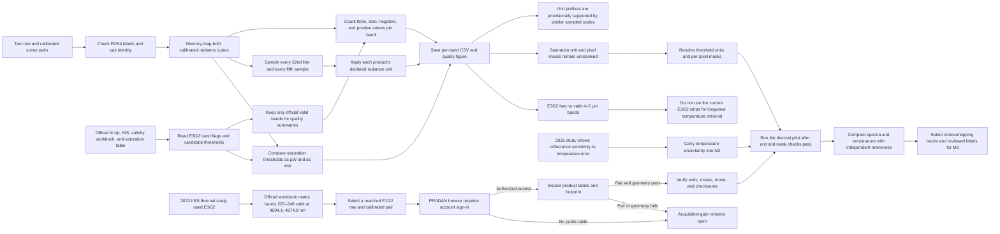

# Chandrayaan-2 IIRS: phase 1 research and baselines

This repository supports the first phase of **Cross-Domain Transfer of Hyperspectral Foundation Models for Lunar Mineral and Water-Ice Mapping**. The current scope is **M1 data acquisition and gap analysis, M2 calibration and preprocessing, and M3 classical and from-scratch baselines**. Earth-to-Moon foundation-model transfer starts only after these three modules pass their quality gates.

For tasks, deliverables, and pass criteria, see [the M1–M3 implementation plan](docs/m1_m3_plan.md). For the project workflow and Codex setup, read [SETUP.md](SETUP.md).

The complete execution roadmap is described below. The repository is currently working on M1. HyperFree and HyperSIGMA are planned comparison backbones for a later phase; they have not been trained or evaluated in this checkout.

## Current state (28 September 2026)

The repository currently contains four selected scene ZIP archives under ignored `data/pradan/`: two raw products and their two calibrated products for 2020-02-08. The official IIRS `iir.zip` archive is also local. All five ZIP files pass integrity checks; the scene products are extracted and XML-paired. A first numerical radiance scan now supports the product unit prefixes provisionally, but the saturation-table units and pixel masks remain unresolved. Physical calibration, an analysis-ready reflectance dataset, reviewed labels, trained models, and measured baseline scores do not exist yet. The earlier four-scene raw inventory remains as a historical manifest in the M1 results directory, but those old products were removed from `data/` before this pilot selection.

| Active pilot observation (UTC, archive suffix) | Raw and calibrated cube, lines × samples × bands | Approximate latitude range from label corners | Local state |
| --- | ---: | ---: | --- |
| 2020-02-08 00:57, `m65` | 10,925 × 250 × 256 | 31.4°S–1.5°S | ZIP and extracted; raw plus calibrated |
| 2020-02-08 12:45, `d18` | 10,927 × 250 × 256 | 31.6°S–1.7°S | ZIP and extracted; raw plus calibrated |

### Pilot strip browse images

These previews show the two observations selected for analysis. Each uses the official PNG from its calibrated product's `browse/calibrated/` directory. The source label calls it a **count-calibrated, subsampled browse image**. Its checksum matches the label. The spectral analysis will use the corresponding calibrated `.qub` radiance cube after the M2 quality gate, not pixel values from these display images.

| `m65` observation, 00:57 UTC | `d18` observation, 12:45 UTC |
| --- | --- |
|  |  |

**Figure: complete browse coverage of the two pilot strips.** Each narrow column shows one consecutive quarter of the original strip, with rows increasing downward and columns ordered left to right. Both axes were resized together within each quarter to preserve shape; the printed row ranges refer to the browse PNG, not the 10,925/10,927-line radiance cubes. These are visual orientation aids, not georeferenced maps, reflectance images, or mineral detections. The [preview generation script](scripts/build_iirs_strip_previews.py) and [M1 notes](results/phase-1/m1-inventory/notes.md) record how to reproduce them.

The labels list 256 band centers from **712.3 to 5009.7 nm** for the active pilot files. ISRO describes the nominal instrument range as approximately 0.8–5.0 µm; use each product's actual band centers and widths. Raw labels specify `UnsignedLSB2` detector counts. Calibrated labels specify `IEEE754LSBSingle` values, with units that must be read per product: `mW/cm**2/sr/µm` for the `m65` pilot and `µW/cm**2/sr/µm` for the `d18` pilot. The PDS4 XML label remains authoritative for type, axes, wavelength, units, size, and checksum. Both active pilot footprints are low latitude and are **not polar**. The previous four-scene raw inventory is retained as historical evidence in the M1 results directory.

### What the official IIRS archive established

The supplied `iir.zip` passed ZIP integrity checks. Its March 2026 SIS (V17) describes calibrated Level 1 **radiance** produced by dark subtraction, lookup-table correction, destriping, and later radiance adjustments. Thermal and photometric correction belong to the separate Level 2 reflectance process. The ZIP also contains lookup tables, saturation tables, solar flux, and a band-validity workbook; the separate IIRS user guide PDF is not included. The archive SHA-256 and product details are in the [M1 data dictionary](results/phase-1/m1-inventory/data_dictionary.md).

**Figure: IIRS band validity by exposure and gain mode.** The horizontal axis is band number 1–256. Green marks bands tagged `VALID` in the official workbook; gray includes low-response, order-sorting-filter, and saturation regions. Both active scenes use `E3G2`, whose valid bands are 7–28, 35–68, and 76–146. Band 146 is centered at 3155.9 nm, so these pilots have no valid 4–5 µm bands for a thermal fit using that region. The [source values](results/phase-1/m1-inventory/metrics/band_validity_by_mode.csv) and [generation script](scripts/plot_iirs_band_validity.py) reproduce the figure. This is instrument metadata, not a reflectance or model result.

### Pilot radiance quality scan

We scanned every value in both calibrated cubes across all 256 bands. The scan counted finite, zero, negative, and positive values exactly. It also compared the official E3G2 saturation thresholds under two unit interpretations. Positive-pixel quantiles use a fixed grid that samples every 32nd line and every fifth sample.

| Calibrated scene | Pixels per band | Valid E3G2 bands | Exact zeros across valid band-pixels | Negative values across valid band-pixels | Sampled median range after declared unit conversion (mW/cm²/sr/µm) |
| --- | ---: | ---: | ---: | ---: | ---: |
| `m65` | 2,731,250 | 127 | 2,809 | 26 | 0.115–1.547 |
| `d18` | 2,731,750 | 127 | 3,059 | 26 | 0.104–1.199 |

All cube values were finite. The zero and negative counts are summed across valid bands, so they are band-pixel counts, not counts of unique pixels. The scan does not establish that zero or negative values mean fill or saturation. The comparable sampled median ranges support the `mW` unit in the `m65` label and the `µW` unit in the `d18` label as a plausible conversion. This comparison does not independently validate radiometric calibration.

The saturation-table XML declares its threshold values in `µW/cm²/sr/µm`. The SIS describes Level 1 radiance generally in `mW/cm²/sr/µm`. Comparing the values as `µW` flags nearly all positive pixels at or above the thresholds. Comparing them as `mW` flags none. This conflict leaves the saturation unit and per-pixel mask unresolved. The table comparisons are candidates, not masks.

**Figure: calibrated pilot radiance quality by band.** The top panel shows exact zeros and nonfinite values. The middle panel compares the two saturation-table unit interpretations. The bottom panel shows fixed-grid medians only on officially valid E3G2 bands. The figure reports Level 1 radiance quality checks. It does not show reflectance, confirmed saturation, or a mineral result. The [machine-readable values](results/phase-1/m1-inventory/metrics/pilot_radiance_quality_by_band.csv), [analysis script](scripts/analyze_iirs_radiance_pilot.py), and [M1 findings](results/phase-1/m1-inventory/findings.md) provide the method and limits.

### What the pilot scan did

The scan did not produce reflectance or a saturation mask. The current E3G2 products remain unsuitable for thermal fitting that requires 4–5 µm. Published IIRS work gives a specific next acquisition target: E1G2. The official workbook marks bands 226–248, centered from 4504.1 to 4874.9 nm, valid in E1G2. This supports scene selection, but it does not resolve saturation units or validate a correction.

### What IIRS papers tell us to do next

| Paper | Evidence relevant to this project | Use and limit |
| --- | --- | --- |
| [Verma et al. (2022), Icarus](https://doi.org/10.1016/j.icarus.2022.115075) | The study used E1G2 Level 1 radiance and the 2.5–5 µm range for thermal correction. | Acquire an E1G2 pair. Audit its assumptions and masks before reproducing the method. |
| [Chauhan et al. (2025), Meteoritics & Planetary Science](https://doi.org/10.1111/maps.70037) | Describes thermal correction, apparent reflectance, empirical-line adjustment, standard geometry, an output range of 0.8–3.3 µm, and comparison with same-region M³. | Use as the main Level-2 processing reference. It does not remove the need to validate our own data and masks. |
| [Gou et al. (2026), Advances in Space Research](https://doi.org/10.1016/j.asr.2026.06.090) | Reports more stable temperature estimates at 4504–4875 nm. Its sensitivity example gives a 14.39% reflectance difference at 3156 nm for a 4 K temperature difference. | Preserve the E1G2 longwave bands and propagate temperature uncertainty into 3 µm reflectance. This result is from the paper, not our cubes. |
| [Bose et al. (2024), Advances in Space Research](https://doi.org/10.1016/j.asr.2023.12.019) | Studies IIRS photometric correction over 0.8–2.0 µm and compares the derived reflectance with M³. | Informs the shortwave photometric step. It does not validate thermal correction near 3 µm. |
| [Chauhan et al. (2021), Current Science](https://doi.org/10.18520/cs/v121/i3/391-401) | Reports a physics-based thermal correction using co-located temperature measurements. | A possible independent comparison. It does not show that E3G2 alone supports longwave temperature fitting. |

The live [PRADAN Browse and Download route](https://pradan.issdc.gov.in/ch2/protected/payload.xhtml) redirects to account sign-in; its scene table and IIRS filters are not public. The next step is to use authorized PRADAN access to select an E1G2 observation with both raw and calibrated products, then verify the XML pair, mode, units, validity, and footprint. No scene was downloaded in this check. After acquisition, resolve saturation units and pixel masks before running the thermal pilot. The [initial gap matrix](docs/gap_matrix.md), [literature findings](results/phase-1/m1-literature/findings.md), and [M1 task plan](tasks/task_plan.md) track this work. The matrix is an initial targeted review, not a systematic review or a novelty claim.

## Scientific scope and constraints

- **M1:** Build a documented, diverse IIRS corpus. Obtain the matching calibrated product when available and record its processing level and units. Collect a small set of overlapping Chandrayaan-1 M³ Level-2 reflectance scenes and a geologic reference layer for comparison. Track observation, orbit, footprint, incidence/emission/phase geometry, product version, and checksums.
- **M2:** Turn calibrated radiance into validated reflectance. Follow the product guide and the published IIRS Level-2 processing chain: quality masking, thermal-emission correction beyond approximately 2.5 µm, solar normalization, and lunar photometric correction. Record every correction and its uncertainty. Compare with official calibrated/Level-2 products and overlapping M³ spectra where possible. A learned denoiser is optional and must be assessed against an untouched validation set.
- **M3:** Establish reproducible physical and machine-learning references on the **same held-out observations**: diagnostic mineral band parameters or spectral-library matching, a classical 3 µm continuum-depth index, unsupervised clustering, and a modest spectral-spatial CNN trained from random initialization. Report metrics only where independent labels exist; clustering and hydration-index maps without ground truth are descriptive, not accuracy results.

Two proposal assumptions need an explicit feasibility gate. First, the [USGS unified geologic map](https://astrogeology.usgs.gov/search/map/Moon/Geology/Unified_Geologic_Map_of_the_Moon_GIS_v2/) provides **geologic units at 1:5,000,000**, not pixel-level mineral abundances; unit polygons may supply coarse labels after boundary exclusion and manual review. Second, a 3 µm reflectance feature in a permanently shadowed region requires enough **indirect light** and signal to noise to measure it. M³ has demonstrated this under specific conditions, but the current IIRS scenes are not polar and do not establish IIRS feasibility there. A 3 µm absorption alone must not be called a water-ice detection.

## Full research roadmap

The project is deliberately staged. Each stage must pass its scientific gate before the next stage can produce a defensible result.

### Phase 1: IIRS foundations, M1–M3

This is the current phase.

**M1, acquisition and inventory** establishes exactly what each IIRS product contains. We parse the PDS4 labels, verify dimensions, byte counts, archive and extracted checksums, wavelengths, geometry, footprints, and processing levels. The active two-scene pilot has verified raw/calibrated pairs, the official archive/SIS, a data dictionary, and an initial literature gap matrix. Numeric unit and mask validation, the separate user guide, a scene-coverage report, and a matched E1G2 pair remain open. These two low-latitude scenes are not enough for a polar or independent generalization claim, so additional tracks and provinces must be selected before the final split is frozen.

**M2, calibration and preprocessing** converts an official calibrated product, or a documented raw-to-calibrated chain, into analysis-ready reflectance. It includes invalid and saturated-pixel masks, thermal-emission correction beyond approximately 2.5 µm, solar normalization, and lunar photometric correction. A pilot scene is validated first using representative spectra, quality fractions, correction residuals, and cross-instrument comparisons. Large-scale processing starts only after the pilot quality gate passes.

**M3, baselines and evaluation** freezes reviewed labels and orbit or province splits. It runs diagnostic mineral spectral methods, a thermally corrected 3 µm index where the signal supports it, unsupervised clustering, and a small CNN trained from random initialization. Held-out accuracy, macro-F1, balanced accuracy, IoU, class support, uncertainty, and failure cases are reported only when the labels support those metrics.

### Phase 2: Earth-to-Moon foundation-model transfer, M4

M4 begins only after M1–M3 pass. Its purpose is to measure how much general hyperspectral representation learned from Earth survives on lunar IIRS data.

The two planned comparison backbones are:

- **HyperFree:** the channel-adaptive Earth hyperspectral foundation model.
- **HyperSIGMA:** the two-stream spectral and spatial Earth hyperspectral foundation model.

For each backbone, the same corrected IIRS inputs, labels, masks, and held-out split are used in three conditions:

1. **Frozen zero-shot transfer:** use the released encoder without lunar training and classify against projected laboratory reference spectra or nearest-centroid prototypes.
2. **Linear probe:** keep the encoder frozen and train only a small lunar task head.
3. **Controlled fine-tuning:** allow encoder adaptation under a fixed training budget and the same evaluation protocol.

Because IIRS wavelengths and band spacing do not exactly match the Earth pretraining sensors, M4 first uses a continuous wavelength-aware adapter. It evaluates a comparable SWIR range before testing the extended 0.8–5.0 µm range. The backbone checkpoint, license, preprocessing, adapter version, split, seed, and code revision are recorded for every run.

M4 outputs a quantified Earth-to-Moon transfer gap, not a claim that either model is already lunar-ready.

### Phase 2: Lunar self-supervised adaptation, M5

M5 continues pretraining the selected backbone on unlabeled calibrated IIRS patches. The main objective masks spectral tokens and reconstructs them. Ablations test spectral derivative consistency and band-ratio consistency so that adaptation does not smooth away narrow mineral or hydration absorptions. The adapted encoder is then evaluated with the same few-shot and held-out protocol as M4.

### Phase 2: Downstream scientific tasks, M6

M6 applies the validated representations to reviewed mineral classes or abundance proxies and to a thermally corrected apparent hydroxyl or water-equivalent 3 µm absorption index. Polar water-ice interpretation remains conditional on indirect-light signal, thermal stability, independent references, and uncertainty checks. A 3 µm anomaly is not reported as definitive water ice without those checks.

### Phase 2: Reporting and release, M7

M7 consolidates ablations, limitations, reproducibility checks, checkpoints, processed products, figures, and code. It records which quality gates passed or failed and separates measured results from unresolved research questions.

## Research results and evidence storage

Every phase and module has a concise record under [`results/`](results/). Each module contains a summary, findings, and notes. When a metric or graph is computed, its source values are saved as CSV or JSON in `metrics/`, and the corresponding PNG or SVG is saved in `figures/`. The summary records the data version, split, units, code revision, generation command, and figure path. If no metric or graph exists, the result remains a text record and no artificial plot is created. See the [results protocol](docs/results_protocol.md).

## Data handling

1. Retain the original ZIP archives and XML labels as immutable inputs. Record SHA-256 for each ZIP and verify each extracted `.qub` against the label's MD5 and byte count.
2. Read the extracted `data/extracted/*/data/{raw,calibrated}/.../*.xml` label before opening a cube. The active pilot raw products are `(bands=256, lines=10925 or 10927, samples=250)` little-endian unsigned 16-bit; the calibrated products are IEEE 32-bit floating point. Stream or memory-map large cubes; do not load the whole archive into memory for a quick look.
3. Keep raw counts, calibrated radiance, corrected reflectance, masks, and model-ready tiles in distinct directories. Store wavelengths, units, coordinate convention, source product IDs, correction versions, and split IDs with every derived artifact.
4. Split by orbital track and geologic province before fitting normalization, selecting thresholds, or tuning models. The two low-latitude pilot strips are insufficient for a defensible independent transfer benchmark; acquire more distinct scenes before claiming generalization.

## Primary sources

- [ISRO PRADAN Chandrayaan-2 archive](https://pradan.issdc.gov.in/ch2/) and [IIRS product FAQ](https://pradan.issdc.gov.in/ch2/faq.xhtml): instrument overview, raw/calibrated product types, XML labels, and location of the IIRS archive and user guides (`Other Downloads` → `iir.zip`).
- [ISRO Chandrayaan-2 science page](https://www.isro.gov.in/Chandrayaan2_science.html): IIRS observation and hydration objectives.
- [Chauhan et al., 2025, Level-2 IIRS reflectance processing](https://onlinelibrary.wiley.com/doi/abs/10.1111/maps.70037): thermal correction, apparent reflectance, and spectral correction. Use the full paper and official product guide when implementing numerical details.
- [IIRS photometric correction study](https://www.sciencedirect.com/science/article/pii/S0273117723009754): lunar photometric normalization and comparison with M³.
- [NASA PDS M³ Level-2 reflectance archive](https://pds.nasa.gov/ds-view/pds/viewProfile.jsp?dsid=CH1-ORB-L-M3-4-L2-REFLECTANCE-V1.0): cross-instrument comparison data.
- [USGS Unified Geologic Map of the Moon](https://astrogeology.usgs.gov/search/map/Moon/Geology/Unified_Geologic_Map_of_the_Moon_GIS_v2/) and [USGS Spectral Library v7](https://www.usgs.gov/labs/spectroscopy-lab/usgs-spectral-library): coarse geologic context and candidate mineral reference spectra.
- [Li et al., 2018, polar surface ice from M³](https://pmc.ncbi.nlm.nih.gov/articles/PMC6130389/): demonstrates the need to account for indirect illumination in permanently shadowed terrain.

Research and inventory are documented here; the methods and results will be added as they are implemented and validated.
