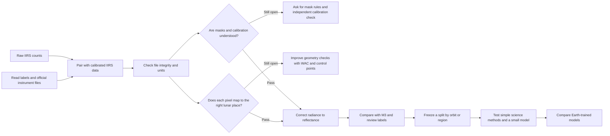
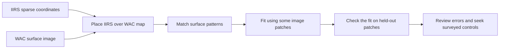

# The IIRS project, explained step by step

Start here, then read one lesson at a time. Technical records and commands are linked at the end of each lesson.

## The big question

Can a computer model that learned from Earth satellite images also help us understand the Moon?

We want to test this with data from Chandrayaan-2's Imaging Infrared Spectrometer, called **IIRS**. IIRS looks at a narrow strip of the Moon and records many wavelengths at each image location. The wavelengths help scientists study what the surface is made of.

But we cannot give the data straight to a model. First, we must make sure that the measurements mean what we think they mean. This project is building that trustworthy starting point.

## Imagine a special camera

A normal camera records a few colors at each pixel. IIRS records hundreds of wavelength measurements at each location. Imagine a stack of many black-and-white images, one for each wavelength. Together, they form a **spectral cube**.

```text
One image location  ->  a list of wavelength measurements
Many image locations ->  many lists side by side
All wavelengths      ->  a cube of measurements
```


*This is a quick-look image from one IIRS observation. It shows where the instrument saw surface texture. The science checks use the measured cube, not brightness values in this preview.*

## The project in one picture

The arrow diagram shows the whole plan. The diamond shapes are checks that still block later work. The later modeling steps have not started.



**Where we are:** the file checks, instrument-document review, and first reference-image checks are done. The mask, independent calibration, and location checks still need work. So reflectance and model tests have not started.

## Follow the work in five short lessons

### 1. First, check what each file contains

The archive has two important kinds of data:

- **Raw counts** are the detector's original numbers. They are not physical light measurements yet.
- **Calibrated radiance** expresses measured light in physical units. It still is not surface reflectance.

We read each product's XML label to check its observation time, instrument mode, dimensions, wavelengths, units, and checksum. We matched three raw and calibrated pairs. The 2026 E1G2 pair also passed archive and cube checksum checks. A checksum check shows that a file matches its label. It does not prove that its science is correct.

The two 2020 observations use E3G2 mode. The 2026 observation uses E1G2. Instrument mode matters because some wavelength bands are valid only in some modes.

[See the inventory record](../results/phase-1/m1-inventory/summary.md) · [See the E1G2 pair record](../results/phase-1/m1-e1g2-scene/summary.md)

### 2. Then, check which colors the instrument can use

Each thin row below represents one of the instrument's 256 wavelength bands. Green marks bands that the official table calls valid for that mode. The E1G2 observation has valid longwave bands. This makes it a candidate for a thermal-correction study. It does not mean that correction has been done or approved.


*The 2020 E3G2 pilots do not have valid 4–5 µm bands needed by the selected longwave thermal method. E1G2 has valid bands 226–248, from 4504.1 to 4874.9 nm.*

[Read the band table and inventory results](../results/phase-1/m1-inventory/summary.md)

### 3. Check whether the numbers agree with the calibration table

The official instrument look-up table, or **LUT**, gives a rule for converting E1G2 raw counts into radiance. We applied that rule to a fixed sample of the raw data and compared it with the matched calibrated product.

The median ratio was **1.00375**. The median correlation across bands was **0.922**. These values show that the two calculations agree closely with each other. They do not prove that both are correct, because they use the same instrument and matched observation. We still need a separate calibration reference.

There is also an unresolved mask question. The official saturation file gives threshold units, but applying its values as written conflicts with the paired data. The product label does not give a missing-data value. We have not guessed which pixels are invalid.


*The middle plot compares the calibrated data with the LUT. The right plot shows only a sparse set of lunar coordinates. Neither panel is a reflectance result.*

[Read the radiance and mask findings](../results/phase-1/m1-e1g2-scene/summary.md)

### 4. Check whether the image lines up with the Moon

To compare IIRS with other lunar maps, we need to know where its pixels are. We used NASA's Lunar Reconnaissance Orbiter **WAC** imagery as a map reference and matched visible surface patterns.



We held some matching patches aside while fitting. At full image resolution, 12 held-out patches in three parts of the strip had an average alignment error measure, called RMSE, of **2.757 IIRS pixels**. The browse image gave a smaller error, but it is lower resolution. The full-resolution result is the more demanding check.

These matching patches are not surveyed locations. They show how well two images line up with each other, but they do not prove the exact lunar location of every IIRS pixel. The location check remains open.


*Each point shows a held-out image match. Some errors are large, so more review and better-spread controls are needed.*

[Read the WAC and M3 reference-data record](../results/phase-1/m1-reference-data/summary.md)

### 5. Only after the checks, compare science results

We found five possible **M³** observations. M³ is another lunar instrument. Its products contain reflectance values that could help us compare observations of the same place.

So far, we checked the product labels and counted how many sparse IIRS coordinates fall inside each M³ footprint. One candidate ranked highest. This is only a shortlist. We have not checked all shared pixels, downloaded an M³ image cube, or compared spectra.

When the data checks pass, the team will:

1. Correct IIRS radiance to reflectance and check the correction.
2. Find locations where IIRS and M³ both have valid data.
3. Review map labels and decide which scientific question they can support.
4. Keep whole orbits or regions separate for training and testing.
5. Compare simple physical methods and a small model.
6. Test Earth-trained models only after these earlier steps work.

Keeping whole regions separate is like saving a chapter of a textbook for the final exam. If nearby pixels appear in both training and testing, the model may see almost the same surface twice. The test score would then look better than its real ability to transfer.

## What we can say today

- We have three matched raw and calibrated IIRS pairs.
- The E1G2 pair passes file integrity checks. Its LUT comparison supports internal agreement.
- We have a WAC image crop and preliminary alignment checks.
- We have five M³ candidates, but shared valid-pixel coverage is not known.
- We have **not** made validated IIRS reflectance, mineral maps, hydration results, ice detections, or model scores.

## Pick your next page

- [Workflow and reproducibility](workflow.md): what was run, where the evidence is saved, and how to repeat the image-alignment checks.
- [Terms](terms.md): plain definitions for words such as radiance, reflectance, and image tie.
- [Detailed M1 evidence flowchart](../README.md#m1-workflow-results-and-remaining-gates): the project README Mermaid diagram with current evidence and gates.
- [Full scientific plan](../docs/m1_m3_plan.md): detailed pass conditions for M1, M2, and M3.
- [All phase-one records](../results/phase-1/): methods, findings, notes, data tables, and figures.
