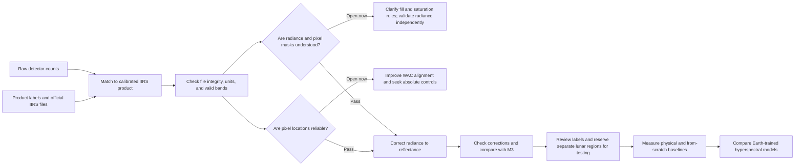
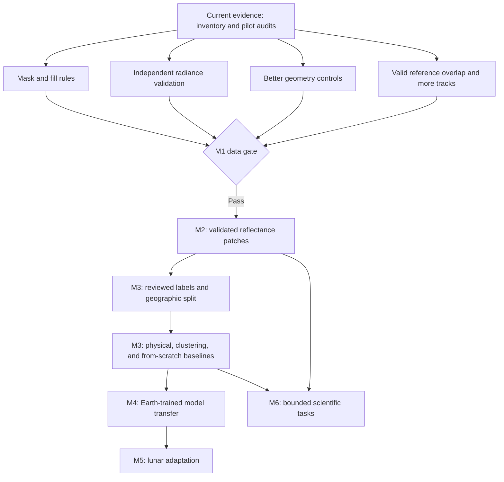
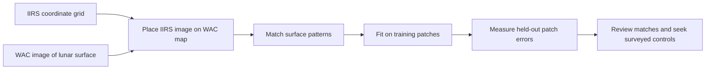

# IIRS lunar research: purpose, approach, and current status

This page is the complete plain-language snapshot of the project. It explains the research question, the plan, the evidence collected so far, the open checks, and what comes next. Technical details link to the research records in the repository.

## The question we want to answer

Can a hyperspectral model trained on Earth data help us understand the Moon from observations made by Chandrayaan-2's Imaging Infrared Spectrometer (**IIRS**)?

IIRS records a narrow strip of the Moon. At each image location, it measures light at many wavelengths. Some materials reflect light differently at different wavelengths. Those patterns can help scientists study lunar surface materials.

The project is not ready to test the model question yet. First, we must show that the measurements are trustworthy, know where each pixel is on the Moon, and prepare fair comparisons. This guide explains why those steps come first.

## A simple way to picture IIRS data

A regular camera records a few colors at each pixel. IIRS records hundreds of wavelength measurements. Imagine a stack of black-and-white images, with one image for each wavelength. That stack is a **spectral cube**.

```text
One place on the Moon  -> measurements at many wavelengths
Many places on the Moon -> many wavelength lists side by side
All places and wavelengths -> a spectral cube
```


*This quick-look image shows surface texture along one IIRS observation. The science checks use values in the measured cube, not brightness values from this preview.*

## The approach: build trust, then test models

The project follows a sequence. Each stage checks an assumption needed by the next stage. If an early check fails, later scores could look precise but answer the wrong question.



The diamonds are quality gates. Both must pass before reflectance processing can support a defensible comparison. Model transfer comes last because it depends on every stage before it.

### Why this order matters

1. **Correct files:** Pairing the wrong observations would invalidate comparisons.
2. **Correct measurements:** Raw counts are not physical radiance. Radiance is not surface reflectance.
3. **Correct locations:** If pixels are placed at the wrong lunar coordinates, reference maps and labels will refer to the wrong ground.
4. **Fair comparison:** Training and test areas must be geographically separate. Otherwise, nearby and similar pixels can appear on both sides, making a model seem better than it is.
5. **Useful model test:** Compare an Earth-trained model with simple physical methods and a small model trained from scratch. This shows whether transfer adds value.

## Where we are now

**Current stage: M1, data and coverage checks.** The inventory and several supporting checks are recorded. M1 is still open because calibration, masks, geometry, and geographic coverage need more evidence. M2 reflectance processing and M3 baseline scoring have not started.

| Stage | Goal | Status | Why it helps |
| --- | --- | --- | --- |
| **M1: data and coverage** | Identify products, check files and units, understand valid bands, and select useful independent observations. | **In progress.** Three matched raw/calibrated pairs are documented. File checks and initial radiance and image-alignment checks are recorded. Mask rules, independent radiance validation, absolute geometry, and broader coverage remain open. | Stops bad units, missing data, or location errors from entering the science pipeline. |
| **M2: calibrated reflectance** | Correct radiance for illumination, thermal emission, and lunar viewing geometry. Export traceable image patches and masks. | **Not started.** Gated by M1 evidence. | Produces a physical input that can support spectral and material comparisons. |
| **M3: labels and baselines** | Review labels, freeze geographic train/validation/test areas, and measure simple methods and a model trained from scratch. | **Not started.** Five possible M³ products have been screened, but shared valid pixels are not known. | Establishes a fair score that an Earth-trained model must improve on. |
| **M4: Earth-to-Moon model transfer** | Test selected Earth-trained hyperspectral models on the same lunar task and split. | **Future.** Starts only after M1–M3 pass. | Answers the main transfer question using a tested dataset and fair baseline. |
| **M5: lunar self-supervised adaptation** | Adapt a selected model using unlabeled lunar data and compare controlled learning choices. | **Future.** Depends on reproducible M4 results and enough calibrated data. | Tests whether learning from lunar observations improves transfer. |
| **M6: downstream science** | Assess supported mineral tasks and thermally corrected 3 µm hydration signals with uncertainty. | **Future.** Depends on validated corrections, labels, and model evidence. | Connects model results to carefully bounded scientific questions. |

The three current observations cover low latitudes. They do not yet provide a geographically independent evaluation set or polar coverage. Any polar ice question would need its own coverage and validation plan.

## Research agenda tracker

This table is the working agenda. “Done” means the named check has evidence in the repository. It does not mean the entire research stage has passed. “Open” means work or evidence is still needed. “Gated” means the work must wait for an earlier quality check.

| Order | Work item | Status now | Next action | Evidence needed to close it |
| --- | --- | --- | --- | --- |
| 1 | Inventory and pair the pilot products | **Done for the three current pairs** | Add future scenes to the same verified manifest. | Product labels, pair fields, file sizes, and checksums recorded for each selected scene. |
| 2 | Interpret units, calibration, fill, and saturation | **Open** | Get authoritative guidance for the saturation and dynamic-range fields. Establish documented fill and invalid-pixel rules. Validate radiance against a reference independent of the paired LUT calculation. | A reviewed per-band/per-pixel mask method, radiance validation report, and recorded limits. |
| 3 | Validate IIRS pixel locations | **In progress** | Review poor WAC matches, improve spatial coverage of controls, and seek absolute lunar controls. | Registration residuals on well-distributed holdouts plus independent location evidence sufficient for the intended comparison. |
| 4 | Review literature gaps, reference coverage, and scene selection | **In progress.** A targeted, cited literature matrix exists. M³ labels have been reviewed, but common valid coverage is unknown. | Keep the cited gap matrix current. Inspect the leading M³ candidate's pixel locations and valid-pixel flags. Estimate common valid area. Find additional non-overlapping IIRS tracks and suitable regions. | An updated [gap matrix](../docs/gap_matrix.md), an overlap report based on valid pixels, a scene-selection table, and a fixed orbit/province split. |
| 5 | Pass the M1 gate | **Not passed** | Close the applicable measurement, mask, geometry, and coverage checks above. | A documented decision that the selected inputs support physical processing and independent evaluation. |
| 6 | Build an M2 reflectance pilot | **Gated by M1** | Convert calibrated radiance to apparent reflectance. Validate thermal correction and lunar photometry. Preserve uncertainty, input masks, and pre/post-correction spectra. | A one-scene quality report with validated units, correction residuals, representative spectra, mask fractions, and independent comparisons. |
| 7 | Export analysis-ready patches | **Gated by M2** | Save wavelength metadata, valid-band and pixel masks, location, orbit, processing version, split, and quality flags with each patch. | Reproducible patches and a manifest that traces each output to its source and correction. |
| 8 | Prepare M3 labels and evaluation | **Gated by M2 and coverage** | Review a limited label task, flag uncertain areas, exclude uncertain map boundaries, and freeze geographically separate train/validation/test regions before tuning. | A label record, fixed split manifest, class support, and leakage checks. |
| 9 | Measure M3 baselines | **Gated by labels and split** | Run physical spectral methods, clustering, and a small CNN trained from random initialization. | Held-out scores with the same inputs and split, uncertainty by region or track, saved values, figures, configurations, and failure cases. |
| 10 | Test M4 Earth-to-Moon transfer | **Future, gated by M3** | Freeze HyperFree and HyperSIGMA versions and licenses. Test zero-shot prototypes, a frozen-encoder linear probe, then controlled fine-tuning. | Reproducible comparisons on the M3 task and test regions, alongside the physical and from-scratch baselines. |
| 11 | Test M5 lunar adaptation | **Future, gated by M4** | Adapt a selected model on unlabeled calibrated lunar patches. Compare reconstruction and spectral constraints in controlled experiments. | Reproducible adaptation runs evaluated with the same split and task as M4. |
| 12 | Evaluate M6 science tasks | **Future, gated by M2 corrections, M3 labels, and M4/M5 model validation** | Assess reviewed mineral tasks and thermally corrected 3 µm hydration signals. Keep any water-ice claim separate and require independent ice evidence. | Uncertainty-aware maps and evaluations tied to reviewed labels and independent references. |

### What the agenda says to do now

The immediate agenda has four parallel M1 threads: resolve the pixel-mask rules, validate radiance independently, improve geometry controls, and determine real IIRS/M³ coverage while selecting more independent scenes. They meet at the M1 decision gate. Reflectance code can be prototyped, but it must not produce scientific reflectance outputs until the source units, masks, and geometry meet the required checks.



The M1 threads can make progress at the same time. M2 cannot pass its gate until the relevant M1 evidence is ready. M4 cannot start until the M3 baselines use reviewed labels and a defensible test split.

## What we have done so far

### 1. Matched IIRS observations and checked the files

We matched two 2020 **E3G2** raw/calibrated pairs and one 2026 **E1G2** raw/calibrated pair. The product labels match on key observation details. The E1G2 ZIP archives and their data cubes pass checksum checks.

Think of the checksum as a seal on a package. It helps show that the file matches its label. It does not show that the measurement or calibration is scientifically correct.

[Inventory record](../results/phase-1/m1-inventory/summary.md) · [E1G2 pair record](../results/phase-1/m1-e1g2-scene/summary.md)

### 2. Checked which wavelengths each instrument mode can use

The official IIRS table marks which wavelength bands are valid in each mode. The 2020 E3G2 scenes do not have valid 4–5 µm bands needed by the selected longwave thermal method. E1G2 has valid bands 226–248, from 4504.1 to 4874.9 nm. This makes E1G2 a candidate for thermal-method testing. It does not prove that the method works on our scene.


*Green shows bands the official workbook marks valid. E1G2 has the longwave bands needed for the selected method. E3G2 does not.*

[Band table and inventory evidence](../results/phase-1/m1-inventory/summary.md)

### 3. Compared E1G2 radiance with the official look-up table

The calibrated E1G2 product contains **radiance**, a physical measure of light arriving from the Moon. It is not reflectance. The official look-up table (**LUT**) provides gain and offset values to convert raw counts into radiance.

We applied that table to a fixed sample of raw counts and compared the result with the paired calibrated product. The median calibrated-to-LUT ratio was **1.00375**. The median correlation across bands was **0.922**. This supports internal agreement between the matched product and the table. It does not independently validate the radiance scale because the comparison uses the same observation and instrument data.


*The middle panel compares radiance with the LUT calculation. The right panel shows a sparse set of lunar coordinates. Neither panel shows reflectance.*

[Radiance, mask, and geometry findings](../results/phase-1/m1-e1g2-scene/summary.md) · [Per-band values](../results/phase-1/m1-e1g2-scene/metrics/e1g2_radiance_by_band.csv)

### 4. Found an unresolved rule for missing and saturated pixels

The official saturation table labels its radiance threshold in µW/cm²/sr/µm and its dynamic-range field in counts. Applied as labeled, **99.878921%** of valid-band calibrated values meet or exceed the saturation threshold, while no raw counts reach the dynamic-range values. This conflicts with the paired observations. The calibrated cube label gives no missing-value constant.

We do not know how to turn these fields into a reliable pixel mask. We have not guessed. The next step is to get authoritative guidance on how to apply these fields and how to identify invalid pixels. Until then, the threshold comparisons are observations, not a mask.

### 5. Compared IIRS image patterns with the WAC lunar map

Before comparing a pixel with another map, we need to know where that pixel is. We acquired a local crop from NASA's Lunar Reconnaissance Orbiter **WAC** map and compared surface patterns with IIRS. Some image patches helped fit the alignment. Other patches were held aside to check it.



The full-resolution band-40 check had **12 held-out image ties in three along-track regions**. Its root mean square error (**RMSE**) was **2.757 IIRS pixels**. RMSE summarizes position differences and gives more weight to large errors. The browse-image check had a smaller residual, but the browse image has lower resolution. The larger full-resolution error is a reason to keep checking.

Image ties are matching patterns, not surveyed lunar locations. They test whether two images line up with each other. They do not prove the exact lunar location of each IIRS pixel. WAC can help check geometry, but it cannot validate radiance calibration.


*The plot shows the errors for held-out image matches. Some errors are large, and the matches cover only three parts of one observation.*

[WAC alignment methods and limits](../results/phase-1/m1-reference-data/summary.md) · [Per-match values](../results/phase-1/m1-reference-data/metrics/iirs_wac_registration_band040_1369nm_ties.csv)

### 6. Shortlisted possible M³ comparison data

The **Moon Mineralogy Mapper (M³)** flew on Chandrayaan-1 and produced lunar reflectance images. A PDS search found five M³ products whose mapped footprints may overlap the E1G2 scene. We reviewed their labels and counted how many of the 1,476 sparse IIRS coordinate points fell inside each M³ footprint. One product ranked highest.

This is only a shortlist. Point counts do not tell us how much image area overlaps or whether those pixels contain valid data. We have not downloaded an M³ cube or compared spectra. We must check pixel locations and invalid-pixel flags before selecting a product.

[M³ candidate and WAC reference record](../results/phase-1/m1-reference-data/summary.md) · [Candidate point counts](../results/phase-1/m1-reference-data/metrics/m3_control_grid_overlap.csv)

## Reproduce the main completed checks

Run commands from the repository root. Several commands need source archives or derived images from ignored `data/`. The research records list source versions, software, outputs, and limits. Do not commit raw archives or large intermediate cubes.

**E1G2 radiance and LUT audit:**

```sh
uv run --no-project --with numpy --with matplotlib python scripts/analyze_iirs_e1g2_scene.py
```

This streams the paired raw and calibrated cubes from their archives and recreates the per-band CSV and audit figure.

**Official band-validity figure and values:**

```sh
uv run --no-project --with xlrd python scripts/plot_iirs_band_validity.py
```

This reads the official workbook under ignored `data/` and recreates the CSV and SVG.

**Browse-scale WAC registration:**

```sh
uv run --python 3.11 --with numpy --with opencv-python-headless --with matplotlib python scripts/register_iirs_to_wac.py
```

**Full-resolution WAC registration:** this requires the ignored band-40 PNG and metadata described in the [reference-data notes](../results/phase-1/m1-reference-data/notes.md).

```sh
uv run --python 3.11 --with numpy --with opencv-python-headless --with matplotlib python scripts/register_iirs_to_wac.py --iirs-image data/reference/lroc_wac_e1g2/e1g2_band040_1369nm.png --iirs-image-metadata data/reference/lroc_wac_e1g2/e1g2_band040_1369nm.json --image-description 'E1G2 calibrated band 40, 1369.6 nm, 1-99 percentile display stretch' --artifact-suffix band040_1369nm --search-radius 16
```

The per-tie source values and output figure are linked in the WAC record above. Re-running a command is useful only when its input version and code match the record.

## How the current stage moves us toward the goal

The current checks reduce uncertainty before it can contaminate later results:

- **Pair and checksum checks** show which files belong together and whether they match their labels.
- **Mode and wavelength checks** prevent us from using bands that the instrument table marks invalid.
- **The LUT comparison** supports the E1G2 radiance scale internally and gives us a concrete independent-validation question.
- **The saturation and fill review** prevents us from making up a mask that could hide bad data or remove good data.
- **The WAC image comparison** measures preliminary alignment and shows that geometry still needs work.
- **The M³ screen** narrows the search for a comparison scene without claiming that usable overlap is proven.

These checks do not yet answer whether Earth-trained models transfer to lunar data. They tell us what must be fixed before that answer can be trusted.

## What happens next

The next work should close the M1 blockers in a controlled order:

1. Get authoritative rules for E1G2 fill values, saturation, and dynamic-range fields. Define the pixel mask from documented rules.
2. Validate radiance against an independent reference. The LUT comparison alone is not enough.
3. Review low-confidence WAC matches, add better-spread controls, and seek absolute location controls. Keep the geometry gate open until the evidence supports closure.
4. Check M³ pixel locations and valid-pixel rules for the leading candidate. Estimate actual shared valid coverage before acquiring or comparing large cubes.
5. Select additional non-overlapping IIRS observations and plan geographic train, validation, and test regions.

When those M1 checks pass, test thermal and photometric correction on E1G2. Compare corrected spectra with suitable independent references and carry temperature and measurement uncertainty forward. Only then produce analysis-ready reflectance patches.

After M2 passes, review labels and freeze the M3 geographic split before model tuning. Measure physical methods, clustering, and a small model trained from scratch. Save scores with their labels, split, units, uncertainty, code version, values, and figures.

After M3 passes, compare Earth-trained models on the same task and held-out regions. This lets us ask whether transfer helps beyond the baseline. Later adaptation and science tasks remain gated by those results.

## The main limits to remember

- Raw counts are not radiance. Radiance is not reflectance.
- A close LUT match is internal consistency, not independent calibration validation.
- The saturation and fill comparisons do not define a validated mask.
- WAC image ties do not establish absolute geolocation accuracy.
- M³ footprint-point counts do not establish valid-pixel overlap.
- Geologic map units are broad hints, not proof of each pixel's mineral makeup.
- No validated IIRS reflectance, mineral map, hydration result, water-ice detection, or model score exists yet.
- Keep entire orbits or regions separate for training and testing. Neighboring pixels can be so similar that a pixel-random split gives an unrealistically high score.

## A short explanation to share

We are testing whether models trained on Earth hyperspectral data can help analyze lunar spectra from Chandrayaan-2. First, we need to prove that the IIRS measurements are calibrated, correctly located, and compared fairly. We have matched three raw and calibrated scenes, checked an E1G2 scene against the official calibration table, tested image alignment against LROC WAC imagery, and shortlisted possible M³ reference data. The calibration check is internal, the alignment is preliminary, and the valid overlap is unknown. We are still in the data-quality stage. Reflectance processing and model scoring wait until those gates pass.

## Technical trail and key records

This README is the single entry point for the guide. Reproducible evidence remains in the research records:

- [M1–M3 plan and quality gates](../docs/m1_m3_plan.md)
- [Current task plan](../tasks/task_plan.md)
- [Inventory and mode-validity record](../results/phase-1/m1-inventory/summary.md)
- [E1G2 radiance and mask record](../results/phase-1/m1-e1g2-scene/summary.md)
- [WAC geometry and M³ record](../results/phase-1/m1-reference-data/summary.md)
- [Detailed M1 evidence flowchart](../README.md#m1-workflow-results-and-remaining-gates)

Each results module also contains findings and notes. Metric records include CSV or JSON values and figures where applicable. Original data remain under ignored `data/` and are not stored in this guide.
