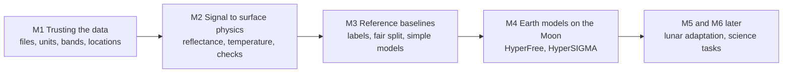

# IIRS lunar research: a module-by-module guide

This guide explains the whole project in plain language: the question, the data, each module from start to current state, the methods and algorithms used, what each figure shows, and what comes next. It is written to be read in full before a presentation. A shorter version can be cut from it for slides. Every number links back to saved values and figures in the [`results/`](../results/) records, and the full technical record is the [main README](../README.md).

**Status on 10 October 2026:** M1 (trusting the data) is mostly complete. M2 (from signal to surface physics) has a one-scene pilot with independent checks. M3 (reference baselines) has exploratory results on proxy labels. M4 (Earth models on the Moon) has an exploratory first test.

## Contents

1. [The research question](#1-the-research-question)
2. [Understanding the data](#2-understanding-the-data)
3. [The plan: build trust, then test models](#3-the-plan-build-trust-then-test-models)
4. [Progress at a glance](#4-progress-at-a-glance)
5. [M1: Trusting the data](#5-m1-trusting-the-data)
6. [M2: From signal to surface physics](#6-m2-from-signal-to-surface-physics)
7. [M3: Reference baselines](#7-m3-reference-baselines)
8. [M4: Earth models on the Moon](#8-m4-earth-models-on-the-moon)
9. [What it all means](#9-what-it-all-means)
10. [Limits to keep in mind](#10-limits-to-keep-in-mind)
11. [Glossary](#11-glossary)
12. [A short explanation to share](#12-a-short-explanation-to-share)
13. [Records and where to find them](#13-records-and-where-to-find-them)

## 1. The research question

Can a hyperspectral model trained on Earth data help us understand the Moon from observations made by Chandrayaan-2's Imaging Infrared Spectrometer (**IIRS**)?

Large "foundation models" now exist for Earth hyperspectral images. They were trained on huge numbers of airborne and satellite images. If what they learned also works for lunar spectra, they could speed up lunar mineral and water studies, where labelled training data are scarce. To test that fairly, we first need trustworthy lunar data, a fair test setup, and simple reference methods to compare against. That is why the project is built in stages.

## 2. Understanding the data

### What IIRS measures

A normal camera records three colours (red, green, blue) at each pixel. IIRS records **256 wavelength channels** (called **bands**) at each pixel, from about 0.7 to 5.0 micrometres (µm). This is infrared light, beyond what the eye sees. The result is a **spectral cube**: a stack of 256 images of the same ground, one per wavelength.

```text
One pixel        -> a spectrum: 256 brightness values, one per wavelength
One image line   -> 250 pixels side by side across the strip
Whole observation -> 12,210 lines x 250 pixels x 256 bands  (a spectral cube)
```

IIRS images a narrow strip as the spacecraft moves. Our main scene (observed on 27 February 2026) is about 18 km wide and about 1,000 km long. It runs from 6.5°S to 26.9°N near 4°W, close to the centre of the Moon's near side. Each pixel covers roughly 80 m of ground. The scene was recorded in the lunar morning (about 08:10 local time), with the Sun about 57 to 62 degrees from overhead.

### What the light contains

Two kinds of light reach the instrument:

- **Reflected sunlight** dominates below about 2.5 µm. How strongly the surface reflects at each wavelength depends on its minerals. For example, iron-bearing minerals such as pyroxene and olivine absorb light near 1 µm and 2 µm, which creates "dips" in the spectrum.
- **Heat (thermal emission)** dominates beyond about 3 µm. The sunlit lunar surface is about 330 K (57 °C) here, and it glows in the infrared. This heat signal is useful for measuring temperature. It also gets in the way of studying the 3 µm water and hydroxyl absorption, so it must be removed first.

### Three product levels

The same observation exists at different processing levels, and they must not be confused:

1. **Raw counts:** the numbers the detector recorded. They have no physical unit.
2. **Calibrated radiance:** the counts converted to physical light intensity, in µW or mW per cm² per steradian per µm. This is what ISRO distributes as "calibrated" (Level 1).
3. **Reflectance:** radiance divided by the incoming sunlight, so it describes the surface itself. A value of 0.1 means the surface reflects 10% of the light. We compute this in M2.

### Instrument modes

IIRS records in different **exposure and gain modes**. The mode name comes from the product label:

- **E1G2:** 1 ms exposure. Keeps valid bands out to 4.9 µm, which is needed for temperature.
- **E3G2:** 10 ms exposure. Valid bands stop at 3.16 µm.

Only bands marked `VALID` for a mode may be used. File suffixes such as `d18` or `m65` name the receiving ground station, not the mode.

### Our data

- **Main scene:** 2026-02-27, mode E1G2. Raw and calibrated versions.
- **Two older scenes:** 2020-02-08, mode E3G2. Raw and calibrated versions, used for checks.
- **Reference data from other missions,** used for independent checks:
  - SLDEM2015: a lunar elevation model from LRO laser altimetry and Kaguya stereo images.
  - LROC WAC: an image mosaic from the LRO Wide Angle Camera.
  - Diviner: LRO's thermal radiometer, which measures surface temperature.
  - M³: Moon Mineralogy Mapper reflectance from Chandrayaan-1.
  - The USGS Unified Geologic Map of the Moon.
  - A standard solar spectrum (ASTM G173).

## 3. The plan: build trust, then test models

Each module checks an assumption the next module needs. If an early check is skipped, later scores could look precise but answer the wrong question.



Why this order matters:

1. **Correct files:** pairing the wrong observations would invalidate every comparison.
2. **Correct measurements:** raw counts are not radiance, and radiance is not reflectance.
3. **Correct locations:** if pixels sit at the wrong place, reference maps and labels describe the wrong ground.
4. **Fair comparison:** training and test areas must be geographically separate. Otherwise neighbouring, near-identical pixels appear on both sides and a model looks better than it is.
5. **Meaningful model test:** an Earth model is only interesting if it beats simple physical methods and a small model trained from scratch.

## 4. Progress at a glance

- **M1, trusting the data:** mostly complete.
  - All files are verified, and the usable bands are known.
  - Pixel locations are aligned to an elevation model to within a fraction of a pixel.
  - The calibration lookup tables are understood.
  - Open: a documented rule for saturated and missing pixels, and access to the M³ comparison data.
- **M2, from signal to surface physics:** a one-scene pilot is complete.
  - The radiance units are confirmed by physics.
  - Reflectance and temperature are computed.
  - Temperature agrees with two independent references: terrain illumination and the Diviner instrument.
  - Open: absolute reflectance calibration, photometric correction, and the 3 µm water signal.
- **M3, reference baselines:** exploratory results.
  - Proxy labels come from a geologic map.
  - Unsupervised spectral units are mapped.
  - Five baseline classifiers are scored on a fixed geographic split.
  - Open: reviewed labels and more scenes.
- **M4, Earth models on the Moon:** exploratory first test.
  - Two Earth foundation models run on lunar data.
  - Their features are scored with the same split, alongside careful controls.
  - Open: zero-shot and fine-tuning experiments, after M3 is complete.

## 5. M1: Trusting the data

### Where we started

We had raw IIRS archives and a user guide, but no proof of three things: which raw and calibrated files belong together, which bands are usable, and where each pixel lies on the Moon. The guide also said calibrated values are in mW, while some product labels said µW, a factor of 1000 apart.

### What we did

**Step 1. Matched files and checked integrity.** For three observations we paired each raw product with its calibrated product. We confirmed that their labels agree on time, orbit, mode, image size and wavelengths. We then verified **checksums**. A checksum is a fingerprint of a file (MD5, SHA-256 or a ZIP CRC): if one byte changes, the fingerprint changes. Matching checksums prove the files are complete and unaltered. They do not prove the science is right.

**Step 2. Identified the usable bands.** The IIRS archive document (the SIS, Appendix H) lists, for each mode, which bands are `VALID` and which are invalid, low-confidence (order-sorting filter, OSF) or saturated. E1G2 keeps 222 of 256 bands, including 4.5 to 4.9 µm, which is needed for temperature. E3G2 keeps 127 bands and has no valid band beyond 3.16 µm.


*What it shows:* which of the 256 bands may be used in each mode. *How to read it:* each row is a mode, and the horizontal axis is band number 1 to 256. Green cells are valid bands and grey cells are not. Only E1G2 has green cells near bands 226 to 248 (4.5 to 4.9 µm), which is why E1G2 is the mode for temperature and heat-removal work.

**Step 3. Checked the calibration lookup table (LUT).** A **LUT** stores, for every band and detector pixel, a **gain** and an **offset**. Radiance is computed as raw count × gain + offset. We applied the E1G2 LUT to a fixed sample of raw counts and compared the result with the calibrated product. The median ratio was **1.004** and the median correlation per band was **0.922**, so the calibrated product follows the LUT closely.

For the 2020 E3G2 scenes, applying the LUT literally gave values about 5,000 times too large. We found the reason: the E3G2 table holds relative factors near 1, not absolute gains. E3G2 also uses a 10 ms exposure against 1 ms for E1G2. The calibrated E3G2 values equal the E3G2 table output times the E1G2 gain divided by 10, with a median match of **0.944**.


*What it shows:* three checks on the E1G2 calibrated product. *How to read it:* the left panel is the median radiance per wavelength. The middle panel is the ratio of calibrated values to the LUT prediction per band; values near 1 mean agreement. The right panel shows where the strip lies on the Moon (longitude against latitude, coloured by scan line).

**Step 4. Reviewed saturation and missing-pixel rules.** A **saturation mask** flags pixels where the detector hit its maximum, and a **fill value** marks missing data. The supplied saturation table, read in its stated unit, would flag 99.88% of the E1G2 data as saturated. Yet no raw count reaches the detector limit. The table and the data therefore do not agree, and the product label declares no fill value. We did not invent a mask. Instead we use a simple data-driven mask (keep pixels whose values are finite and positive), which keeps 99.61% of pixels.

**Step 5. Located every pixel on the Moon (geometry registration).** The product gives coordinates only for a sparse grid of 1,476 points. To check and refine them we matched IIRS images to independent lunar maps:

- **Image matching with normalized cross-correlation (NCC).** We take a small IIRS image patch and slide it over the reference image. At each shift we compute NCC, a similarity score from -1 to 1 that ignores overall brightness and contrast differences. The shift with the highest score is the best alignment. Each matched patch is a **tie point**.
- **First reference: the LROC WAC mosaic.** Matches were too uncertain at full resolution (median error 2.24 pixels), because the two images were taken under different lighting.
- **Second reference: a hillshade from SLDEM2015.** A **hillshade** is a shaded-relief image computed from an elevation model by simulating sunlight from a chosen direction. We rendered it with the same Sun direction as the IIRS observation, so shadows and bright slopes match.
- **Fitting and testing.** Tie points were split into a **training set** (116 ties), used to fit the correction, and a **held-out set** (34 ties in separate line blocks), used only to test it. The correction is an **affine offset field**: a smooth model in which the offset changes linearly across the image. It was fitted with **Huber weighting**, which reduces the influence of outlier matches.


*What it shows:* IIRS band 40 matched to the SLDEM hillshade, and the remaining errors on held-out ties. *How to read it:* the image panels show IIRS and the hillshade side by side; similar shadows mean the comparison is meaningful. The tie map colours each held-out tie by its leftover error. The histogram compares errors with the 1-pixel median and 2-pixel p95 limits. Most errors are well below 1 pixel.

**Step 6. Searched for M³ comparison data.** M³ (Chandrayaan-1) produced lunar reflectance maps that can check our reflectance scale. Five M³ observations overlap our strip, and one covers 1,033 of the 1,476 IIRS grid points. Its files are on a server whose security certificate fails validation from our machine, so the download is pending.

### Where we reached

- All files are verified.
- The usable bands are known for each mode.
- Both lookup tables are understood.
- Pixel locations agree with an independent elevation model to a median of **0.375 pixels** (about 30 m), with 95% of held-out ties within **1.49 pixels**. This is a relative alignment: it shows that IIRS and the elevation model line up with each other.

### What comes next

- Obtain a documented saturation and fill rule.
- Download the M³ files through another route.
- Add more IIRS observations from other regions.

## 6. M2: From signal to surface physics

### Where we started

We had trusted radiance files, but there was a factor-of-1000 doubt about their unit (µW or mW). We had no reflectance and no temperature yet.

### What we did

**Step 1. Settled the unit question with physics.** The product label and the guide disagree. Rather than wait for a reply, we asked which reading gives physically possible values. Two quantities test this:

- **I/F (radiance factor):** I/F = π × radiance ÷ (solar irradiance at the Moon). Solar irradiance is the sunlight arriving per wavelength. We took it from the ASTM G173 standard solar spectrum, corrected for the Sun–Moon distance on the observation date. Real lunar surfaces have I/F of roughly 0.02 to 0.5. A value above 1 is impossible, because the surface would be reflecting more light than it receives.
- **Brightness temperature:** the temperature a perfect emitter would need to produce the observed heat signal (explained in Step 3).

Read with the label unit (µW), E1G2 gives I/F = **0.052** and a temperature of **328 K**, both realistic. Read as mW, it gives I/F = 51.5 and 1,207 K, both impossible. The same test on the two 2020 products shows `m65` is in mW and `d18` in µW. **The label unit is correct for every product, and the stored scale differs between products.**


*What it shows:* the two possible unit readings tested against physics. *How to read it:* in the left panel, each line is median I/F per wavelength for one reading. The green band is the realistic lunar range and the dashed line at 1 is a perfect reflector. In the right panel, each line is temperature by latitude, and the dashed line is the temperature physics predicts. Only the blue µW reading falls in the realistic range in both panels.

**Step 2. Computed apparent reflectance.** **Apparent reflectance** = I/F ÷ cos(i), where *i* is the solar incidence angle (how far the Sun is from overhead, taken for each image line from the spacecraft orbit file). Dividing by cos(i) corrects for the Sun being low in the sky. "Apparent" means no correction yet for viewing geometry (photometric correction) or local slopes.


*What it shows:* the first reflectance product along the whole strip. *How to read it:* latitude runs left to right, and the 18 km strip width is stretched vertically. The top strip shows reflectance at 1.5 µm: dark areas are mare basalt and volcanic ash deposits, and bright areas are highlands and sunlit slopes. The middle strip is a false-colour composite (red 2.1 µm, green 1.5 µm, blue 1.0 µm). Colour differences mean spectral differences, not mineral names. The bottom strip is a ratio that mostly shows spectral slope; its thin horizontal lines are detector stripes.


*What it shows:* typical spectra of the darkest and brightest 10% of pixels. *How to read it:* the left panel (0.8 to 2.6 µm) shows that bright terrain reflects about twice as much as dark terrain. Both rise toward longer wavelengths, which is the usual lunar "reddening" caused by space weathering. In the right panel, on a log scale, the steep rise after 3 µm is heat, not reflected light.

The median reflectance at 1.5 µm is **0.098**, and bright terrain is about **1.9 times** brighter than dark terrain. This matches the contrast between lunar highlands and maria.

**Step 3. Measured surface temperature.** Every warm object emits infrared light according to **Planck's law**, which gives the radiance emitted at each wavelength for a given temperature. Running the law backwards (**Planck inversion**) turns measured radiance into a temperature. We used the 4.5 to 4.9 µm bands, the method used by the ISRO IIRS team. We first subtracted the small reflected-sunlight part (about 6% of the signal), and assumed an **emissivity** of 0.95, meaning the surface emits 95% as efficiently as a perfect emitter. The median temperature is **327.8 K**.

For comparison we used a **radiative equilibrium** model: absorbed sunlight equals emitted heat, which gives T = [(1 − A) × S × cos(i) ÷ (ε × σ)]^¼. Here A is the albedo (the fraction of sunlight reflected), S is the solar constant, ε is emissivity and σ is the Stefan–Boltzmann constant. IIRS agrees with this model within about 15 K, depending on which albedo law is assumed.


*What it shows:* the temperature map and an attempt to remove heat near 3 µm. *How to read it:* in the top strip, yellow is hot (sun-facing slopes) and purple is cool (slopes facing away). The lower-left panel compares the median temperature per degree of latitude with the equilibrium model (dashed). The dip at 18°N is the steep Montes Apenninus range. The lower-right panel shows reflectance from 2.5 to 3.6 µm before (orange) and after (blue) removing the heat signal. A flat blue line means the heat was largely removed.

**Step 4. Checked temperature against the terrain.** If the temperature is real, slopes facing the Sun must be warmer. From SLDEM2015 we computed each pixel's slope and its **local incidence angle** (the angle between the Sun and the ground's surface normal). We then compared temperature with cos(local incidence). Two statistics summarize the result:

- **Pearson correlation (r):** how closely two quantities rise and fall together, from -1 to 1.
- **R² on held-out data:** the fraction of temperature variation that a straight-line fit, learned on half of the strip, explains on the other half.

The result is **r = 0.877** across 3 million pixels, with a held-out **R² = 0.78**.


*What it shows:* the independent elevation model predicts where IIRS sees hot and cold ground. *How to read it:* the top strip is sunlight on each slope computed from SLDEM2015, and the second strip is IIRS temperature; the patterns match. The lower-left panel plots temperature against slope illumination, and the rising line shows warmer temperatures on better-lit slopes. The lower-right panel shows that correcting reflectance for slope separates dark and bright terrain into two clear peaks.

**Step 5. Checked temperature against another instrument.** **Diviner**, on NASA's Lunar Reconnaissance Orbiter, has mapped lunar temperatures since 2009. Its **Global Cumulative Product** gives average temperature for each 0.5° cell at each quarter hour of lunar local time. We took Diviner values at the same place and the same local time as IIRS (about 08:10). IIRS reads a median **5.0 K warmer** than Diviner. The two latitude profiles correlate at **r = 0.81**. A small warm offset is expected, because a rough surface seen from above shows its hottest sunlit facets more strongly at 4.7 µm.


*What it shows:* IIRS and Diviner temperatures along the strip at matched local time. *How to read it:* in the left panel, latitude runs up the vertical axis. The red line is IIRS and the blue lines are Diviner; lines that move together mean both instruments see the same pattern. The right panel shows the difference per degree of latitude. Points right of zero mean IIRS is warmer, typically by about 5 K.

**Step 6. Explored the 3 µm water region.** Water and hydroxyl absorb near 2.9 to 3.0 µm, where heat also dominates. We subtracted the modelled heat, using the measured temperature, and measured the **band depth** at 2.9 µm. Band depth is the fractional dip below a straight-line "continuum" drawn across the feature. At single-pixel level this measurement is still dominated by noise. It is kept as an exploratory step, and no water result is reported.

### Where we reached

The radiance scale is confirmed. The first IIRS reflectance and temperature products exist for the whole strip. Temperature is supported by two independent references: terrain illumination from an elevation model, and the Diviner instrument. Together these also confirm that the pixel locations are accurate enough to put each pixel on the right slope.

### What comes next

- **Photometric correction:** adjust for viewing and illumination angles using a lunar light-scattering model (Lommel–Seeliger or Hapke).
- **Absolute reflectance check:** compare with M³, or with an IIRS scene over the Apollo 16 landing site, whose returned soil samples have known laboratory spectra.
- **3 µm signal:** average pixels into larger areas and propagate the temperature uncertainty.

## 7. M3: Reference baselines

### Where we started

We had reflectance, but no labels saying what each area is, no fair way to split the strip into training and test areas, and no reference scores.

### What we did

**Step 1. Prepared the spectra.** Four clean-up steps were applied before any model:

- **Slope correction:** reflectance is divided by the local illumination from SLDEM.
- **Column flat field (destriping):** each detector column is scaled so its median matches the others. This removes vertical stripes caused by small detector differences.
- **Polishing:** a smooth curve is fitted to the scene-average spectrum. Every spectrum is divided by the ratio between the average and that curve, which removes small steps that appear identically in every pixel.
- **Despiking:** a band value that jumps far from its neighbouring bands (more than 6 robust standard deviations) is replaced with the neighbours' median. This affected 1.6% of values.

**Step 2. Measured mineral-sensitive parameters.** **Integrated band depth (IBD)** is the average depth of an absorption dip below a straight-line continuum across a wavelength window. We computed it near 1 µm (0.85 to 1.58 µm) and near 2 µm (1.58 to 2.45 µm). Higher IBD near 1 µm suggests more iron-bearing minerals or volcanic glass.

**Step 3. Found natural spectral groups without labels (unsupervised).**

- **PCA (principal component analysis)** compresses each 83-value spectrum into a few numbers that capture most of the variation between pixels.
- **k-means clustering** then splits the pixels into k groups, assigning each pixel to the nearest group centre and moving the centres until they settle.
- We checked stability in two ways, using the **adjusted Rand index (ARI)**, a 0 to 1 score of agreement between two groupings:
  - repeating the clustering with different random starts;
  - training separately on alternate halves of the strip.
- We also used the **silhouette score**, which measures how well separated the groups are.

Six spectral units were stable across random starts (ARI 0.95 or more). The darkest unit, with the strongest 1 µm absorption, falls on the **Rimae Bode dark mantle deposit**, a known field of iron-rich volcanic glass.


*What it shows:* mineral-sensitive maps and the average spectrum of each unit. *How to read it:* the top three strips (latitude left to right) are albedo, 1 µm band depth, and 2 µm band depth. Brighter yellow in the band-depth strips means a stronger absorption. Red dotted lines mark named lunar features. The lower-left panel shows each unit's average spectrum shape. The lower-right panel shows how the stability scores change with the number of units; the red dotted line is the 0.8 target.


*What it shows:* where each spectral unit lies along the strip. *How to read it:* each colour is one unit, numbered from darkest (1) to brightest (6). Unit 1 (blue) clusters at the Rimae Bode deposit near 10 to 13°N and near Sinus Medii. Units are spectral groups, not mineral names.

**Step 4. Built proxy labels from a geologic map.** The **USGS Unified Geologic Map of the Moon** (1:5,000,000 scale) divides the surface into mapped units such as mare basalt and basin deposits. We **rasterized** it: for every IIRS pixel we looked up which map polygon contains it. This gives 14 units in our strip, grouped into five classes:

- basin material: 47.5% of pixels;
- mare basalt: 27.5%;
- highland or terra: 13.9%;
- dark mantle: 6.1%;
- crater material: 5.0%.

At this map scale, shifting the map by 2 km changes 21% of labels. We therefore dropped every pixel within 2 km of a unit boundary (a **contact buffer**). These are **proxy labels**: useful for a first benchmark, but not reviewed ground truth.


*What it shows:* the geologic map transferred onto the IIRS strip. *How to read it:* latitude runs left to right. The top strip shows the 14 map units, and the bottom strip shows the five classes used for training and testing. The black dark-mantle area near 9 to 13°N is the same place where the darkest spectral unit appears, which is an independent agreement.

**Step 5. Fixed a fair test split.** Neighbouring pixels are nearly identical, so a random split would leak information. We cut the strip into blocks of 250 lines (about 20 km) and assigned them in a repeating pattern: train, train, validation, test. We also dropped 25 lines at each block edge as **guard bands**. The split was fixed before any model was scored. The validation blocks were used only to decide when to stop training the neural network.

**Step 6. Scored five baseline methods.**

- **Majority class:** always predicts the most common class. This is the floor.
- **Band parameters with nearest centroid:** a physical method. Each pixel is described by four numbers (albedo, IBD at 1 µm, IBD at 2 µm, and a slope ratio) and assigned to the class with the closest average.
- **Logistic regression:** a linear classifier, applied after PCA reduces each spectrum to 20 numbers.
- **Random forest:** 300 decision trees, each asking a series of yes-or-no questions about the spectrum. The trees vote on the class.
- **1D convolutional neural network (CNN), trained from scratch:** small learned filters slide along the spectrum to detect shapes such as dips and slopes. Trained on the GPU.

Two scores were used, both on the held-out test blocks:

- **Macro F1:** for each class, F1 balances precision (how many predicted pixels are right) and recall (how many true pixels are found). Macro F1 averages over classes, so small classes count equally.
- **Balanced accuracy:** the average recall over classes.

The 95% confidence intervals come from **bootstrap resampling of test blocks**: the scoring is repeated 1,000 times on randomly redrawn sets of blocks.

We also ran a **context control**: the same methods on spectra averaged over a 64 × 64 pixel window (about 5 km). This tests how much the surrounding area helps.

### Where we reached

Macro F1 on the held-out test blocks:

- Majority class: 0.10
- Physical band parameters: 0.40
- Logistic regression: 0.46
- Random forest: 0.50
- 1D CNN from scratch: 0.49
- Random forest with 64-pixel context: **0.63**

Every method learns the map units far better than chance. Adding spatial context gives the largest improvement, because the map units are large regions and single-pixel spectra are noisy. The from-scratch CNN performs like the random forest. A wider 64-line guard changed no score by more than 0.04, which shows the split is not leaking.

### What comes next

- Review the labels with a domain expert.
- Add observations from other lunar regions so tests can use entirely separate scenes.
- Re-run on photometrically corrected reflectance.

## 8. M4: Earth models on the Moon

### Where we started

The plan was to test Earth foundation models after M3. For the October review we ran an early, exploratory version on the same labels and split, so the results can be compared directly with M3.

### Key ideas

- **Foundation model:** a large neural network pretrained on a very large collection of unlabelled data. What it learns can be reused for new tasks.
- **Vision Transformer (ViT):** a network that cuts an image into small patches and learns how the patches relate to each other.
- **Masked autoencoder (MAE) pretraining:** the model learns by hiding parts of the input and predicting them back. No labels are needed.
- **Frozen encoder and embeddings:** we do not change the model. We pass each IIRS tile through it and keep its output, a list of 768 numbers per pixel called an **embedding**.
- **Linear probe:** a single linear layer trained on the embeddings to predict the classes. If a simple probe works well, the embeddings already contain the useful information.

### The two models

- **HyperFree** (Li et al., CVPR 2025):
  - Pretrained on AVIRIS airborne images covering 0.4 to 2.5 µm.
  - Its key feature is **wavelength awareness**: it builds its input layer from the actual band wavelengths. We could therefore feed it all 83 IIRS bands from 0.85 to 2.46 µm directly.
- **HyperSIGMA** (Wang et al., IEEE TPAMI 2025):
  - Pretrained with MAE on Hyperion satellite radiance and GF-5 images.
  - It has a **spatial encoder**, which looks at 64 × 64 pixel tiles, and a **spectral encoder**, which looks at the band sequence.
  - It requires exactly 100 bands, so we **interpolated** the IIRS spectrum onto 100 evenly spaced wavelengths over the same range.

Both models were downloaded from the authors' Hugging Face pages and run on an NVIDIA H100 GPU. Each one processed the whole strip in one to two minutes.

### What we did

1. Extracted frozen embeddings for every pixel from HyperFree, the HyperSIGMA spatial encoder, and the HyperSIGMA spectral encoder.
2. Trained a linear probe on exactly the same training blocks, and scored it on the same test blocks with the same metrics as M3.
3. Ran two controls:
   - **Context control:** HyperSIGMA sees 64-pixel tiles, so we compared it with the M3 random forest using the same 64-pixel context, but no pretraining.
   - **Leakage control:** we widened the guard bands to 64 lines (larger than a tile) and re-ran everything.


*What it shows:* every method's score on the same held-out test blocks. *How to read it:* each row is a method, coloured by family (orange rows are the Earth foundation models). The dot is the score and the bar is its 95% confidence interval; further right is better. If two bars overlap, the methods are not reliably different.

### Where we reached

Macro F1 on the same held-out test blocks:

- HyperFree, frozen with a linear probe: 0.54
- HyperSIGMA spatial, frozen with a linear probe: **0.67** (the highest score)
- HyperSIGMA spectral, frozen with a linear probe: 0.57
- For comparison, the context random forest with no pretraining: 0.63

The Earth models produce useful lunar features: all three beat the per-pixel baselines, and HyperSIGMA scores highest. The context control shows that much of HyperSIGMA's lead comes from seeing the surrounding area. A classical method with the same context scores within its confidence interval. Results did not change with wider guard bands. The honest summary for this stage: Earth models transfer and are competitive, and showing a clear benefit from their Earth pretraining needs the next experiments.

### What we understand by these scores of HyperSIGMA & HyperFree

**What the task is.** For every pixel in the held-out test blocks, the model must say which of the five geologic classes it belongs to: mare basalt, dark mantle, highland or terra, crater material, or basin material. The answer is checked against the USGS geologic map. The model never saw these test areas during training, and the Earth model itself was never changed (frozen). Only one linear layer was trained on top of it.

**What the score means.** Macro F1 is not "percent correct". It scores each class separately (balancing correct finds against false alarms) and then averages the five classes equally. A small, difficult class therefore counts as much as a large, easy one. That makes macro F1 a strict score, lower than plain accuracy. For reference, always guessing the most common class gives macro F1 0.10, and a perfect model gives 1.0.

**HyperSIGMA spatial: macro F1 0.67, overall accuracy 87%.** It labels 87 of every 100 test pixels correctly. Per class (F1):

| Class | Test pixels | F1 | What it means |
| --- | ---: | ---: | --- |
| Mare basalt | 144,974 | 0.97 | Dark volcanic plains are almost perfectly recognised. |
| Basin material | 236,387 | 0.89 | Impact basin deposits are reliably separated from mare. |
| Highland or terra | 60,514 | 0.77 | A large improvement over the per-pixel random forest (0.47). |
| Dark mantle (volcanic ash) | 10,209 | 0.56 | It finds 82% of the true dark-mantle pixels, but also calls some neighbouring dark mare "dark mantle". Both are dark and iron-rich, so this confusion is physically reasonable. |
| Crater material | 10,790 | 0.18 | The weak class, and the main reason the average is 0.67 rather than about 0.8. In this map, "crater material" is ejecta of a certain age. It looks spectrally like its surroundings and forms small patches at 1:5,000,000 scale, and every method struggles with it. |
| **Average (macro F1)** | | **0.67** | |

**HyperFree: macro F1 0.54, overall accuracy 73%.** It labels 73 of every 100 test pixels correctly, about the same as the per-pixel random forest (72%). Per class (F1):

- **Mare basalt: 0.82** and **basin material: 0.78.** Good, though a little below HyperSIGMA.
- **Highland or terra: 0.61.** Better than the per-pixel random forest (0.47).
- **Dark mantle: 0.44.** It finds 91% of the true dark-mantle pixels, the highest of any method, but with many false alarms.
- **Crater material: 0.07.** Weak, like the per-pixel methods.

**Why the two models differ.** HyperFree looks at each pixel's spectrum on its own, using the real IIRS wavelengths. Its result is therefore close to the best per-pixel classical method, with a gain on highlands and on finding dark mantle. HyperSIGMA's spatial encoder looks at a 64 × 64 pixel neighbourhood (about 5 km), so it also uses texture and surrounding terrain. Because the map classes are large regions, that context helps a lot.

**How this compares with the context control.** The classical random forest given the same 64-pixel neighbourhood also reaches 87% overall accuracy, the same as HyperSIGMA, with a macro F1 of 0.63. The two agree on the large classes: mare 0.96 against 0.97, and basin 0.90 against 0.89. HyperSIGMA's extra 0.04 in macro F1 comes from highlands (0.77 against 0.66) and crater material (0.18 against 0.01). So most of HyperSIGMA's lead over per-pixel methods comes from spatial context. Its pretrained features add a smaller improvement on the harder classes, which is within the confidence interval for now.

**How to say it in one sentence.** "With the Earth model frozen and a single linear layer trained, HyperSIGMA classifies 87% of held-out lunar pixels correctly and almost perfectly separates mare from basin material. HyperFree performs like the best per-pixel classical method. Most of HyperSIGMA's advantage comes from seeing the surrounding terrain, and the pretraining adds a smaller gain on the harder highland and crater classes, which our next experiments will test."

*Values: [per-class scores for every method](../results/phase-2/m4-transfer/metrics/e1g2_benchmark_per_class.csv), [overall scores](../results/phase-2/m4-transfer/metrics/e1g2_benchmark_m4.csv).*

### What comes next

- **Zero-shot test:** compare embeddings with laboratory mineral spectra, without any lunar training.
- **Controlled fine-tuning:** allow the model to adapt with a fixed training budget.
- **Matched spatial baseline:** a spatial model trained from scratch at the same capacity.
- **Better labels and data:** reviewed labels, more scenes, and corrected reflectance.

## 9. What it all means

- **The data can be trusted for physical analysis.** Files, bands, units and pixel locations are verified, and two independent references agree with the derived temperatures.
- **IIRS sees real lunar geology.** Reflectance contrast, temperature patterns, spectral units and the geologic map all line up. The Rimae Bode volcanic deposit stands out in every view.
- **There is now a fair benchmark.** Simple and learned methods are scored on a fixed geographic split with confidence intervals, and the Earth foundation models were tested on exactly the same setup.
- **Earth models transfer to lunar data and are competitive.** The next step is to isolate how much their pretraining adds beyond spatial context.

## 10. Limits to keep in mind

- **One scene:** all M2 to M4 results come from one low-latitude strip, so they show feasibility, not general performance across the Moon.
- **Provisional reflectance:** there is no photometric correction or absolute calibration yet, and a few small spectral steps remain from the instrument.
- **Proxy labels:** the geologic map is coarse (1:5,000,000), so labels describe broad units, not exact minerals at each pixel.
- **Relative geometry:** pixel locations agree with an elevation model, not with surveyed ground points.
- **No water claim:** the 3 µm signal needs more processing and uncertainty analysis before any statement about water or hydroxyl. A 3 µm absorption alone would not show water ice.
- **Saturation rule:** the saturation and missing-pixel rule still needs documentation from the data provider.

## 11. Glossary

- **Band:** one wavelength channel of the instrument.
- **Spectrum:** the list of values across all bands for one pixel.
- **Spectral cube:** the full data set: lines × pixels × bands.
- **Raw count, radiance, reflectance:** detector number, physical light intensity, and fraction of sunlight reflected. These are three separate products.
- **I/F:** π × radiance ÷ solar irradiance, a standard way to express reflected light.
- **Incidence angle (i):** the angle between the Sun direction and the vertical (or the slope's surface normal, for local incidence).
- **LUT:** a lookup table of gain and offset that converts raw counts to radiance.
- **Saturation:** when the detector reaches its maximum value and stops recording increases.
- **Planck's law and brightness temperature:** how warm objects emit infrared light, and the temperature that explains a measured emission.
- **Emissivity:** how efficiently a surface emits heat compared with a perfect emitter (1.0).
- **Radiative equilibrium:** the temperature at which absorbed sunlight equals emitted heat.
- **Albedo:** the fraction of sunlight a surface reflects.
- **Hillshade:** a shaded-relief image computed from elevation for a chosen Sun direction.
- **Tie point:** a feature matched in two images, used to align them.
- **Normalized cross-correlation (NCC):** a similarity score between image patches that ignores brightness and contrast differences.
- **Held-out data:** data kept aside and used only for testing.
- **Integrated band depth (IBD):** the average depth of an absorption below a straight-line continuum.
- **PCA:** principal component analysis, which compresses many correlated values into a few that keep most of the variation.
- **k-means:** clustering into k groups by distance to group centres.
- **Adjusted Rand index (ARI):** agreement between two groupings, adjusted for chance (1 = identical).
- **Macro F1 and balanced accuracy:** class-averaged scores, so small classes count as much as large ones.
- **Confidence interval (bootstrap):** a range of plausible scores, from re-scoring on many resampled test sets.
- **Foundation model, embedding, linear probe:** a large pretrained network, its numeric description of an input, and a single trained layer on top of it.
- **Rasterize:** convert map polygons into a per-pixel label image.
- **Contact buffer and guard band:** pixels removed near map-unit boundaries and near train/test block edges.

## 12. A short explanation to share

We are testing whether hyperspectral models trained on Earth can help analyse lunar spectra from Chandrayaan-2's IIRS instrument. First, we verified the data: matched files, usable bands, calibration tables, and pixel locations aligned to a lunar elevation model within a fraction of a pixel. A physics test settled the radiance units. We then produced the first reflectance and temperature maps for a 1,000 km strip, and confirmed the temperatures with two independent references: terrain illumination (r = 0.88) and NASA's Diviner instrument (within about 5 K). Using a USGS geologic map as proxy labels and a fixed geographic split, simple classifiers reach 0.50 macro F1, and 0.63 with spatial context. Earth foundation models reach up to 0.67. They transfer well, and our next experiments will isolate how much their Earth pretraining adds, using more scenes and reviewed labels.

## 13. Records and where to find them

- [Main README with all figures and methods](../README.md)
- [M1–M3 plan and quality gates](../docs/m1_m3_plan.md) · [Current task plan](../tasks/task_plan.md)
- M1: [inventory](../results/phase-1/m1-inventory/summary.md), [E1G2 scene](../results/phase-1/m1-e1g2-scene/summary.md), [E3G2 lookup tables](../results/phase-1/m1-e3g2-lineage-check/summary.md), [saturation review](../results/phase-1/m1-saturation-sample/summary.md), [SLDEM registration](../results/phase-1/m1-sldem-hillshade/summary.md), [reference data](../results/phase-1/m1-reference-data/summary.md)
- M2: [unit test](../results/phase-1/m2-radiance-unit-physics/summary.md), [reflectance](../results/phase-1/m2-apparent-reflectance/summary.md), [temperature](../results/phase-1/m2-thermal-brightness/summary.md), [terrain check](../results/phase-1/m2-topographic-validation/summary.md), [Diviner check](../results/phase-1/m2-diviner-temperature/summary.md)
- M3: [geologic labels](../results/phase-1/m3-geologic-labels/notes.md), [spectral units](../results/phase-1/m3-spectral-units/summary.md), [supervised baselines](../results/phase-1/m3-supervised-baselines/summary.md)
- M4: [model inventory](../results/phase-2/m4-transfer/model_inventory.md), [transfer results](../results/phase-2/m4-transfer/summary.md)

Each module folder also contains findings and notes, the saved values (CSV or JSON), and the figures. Original data stay in the ignored `data/` folder.
