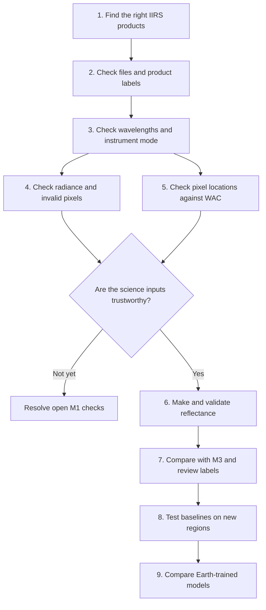

# Workflow and how to repeat key checks

Use this page like a lab notebook. It says what each check answers, what it does not answer, and where to find the record.

## The order of the work



We are working through steps 1 to 5. Steps 6 to 9 must wait for the checks in the diamond.

## Step 1: Find matching products

**Question:** Do the raw and calibrated files describe the same observation?

**What we checked:** We read each XML label and compared time, orbit, mode, image dimensions, and wavelengths. We matched two 2020 E3G2 pairs and one 2026 E1G2 pair.

**Why it matters:** A wrong pair would make every later comparison unreliable.

**Evidence:** [Inventory summary](../results/phase-1/m1-inventory/summary.md) and [E1G2 record](../results/phase-1/m1-e1g2-scene/summary.md).

## Step 2: Check the files

**Question:** Did we read the files that the labels describe?

**What we checked:** Archive CRC checks and cube MD5 checks match. File sizes and dimensions also match the labels for the E1G2 pair.

**What this does not prove:** A file can be intact and still have a scientific calibration problem. These are file checks, not science checks.

## Step 3: Check usable wavelengths

**Question:** Does this instrument mode record the wavelengths needed for our method?

**What we checked:** We compared the official band-validity table with the wavelengths in each product. E3G2 does not have valid 4–5 µm bands for the selected thermal method. E1G2 has valid bands 226–248 in that range.

**What this does not prove:** Having the right wavelength range does not prove that our thermal correction will work.

**Evidence:** [Band validity CSV and figure](../results/phase-1/m1-inventory/).

## Step 4: Check radiance and invalid pixels

**Question:** Do raw counts and calibrated radiance agree with the official conversion? Which pixels are missing or saturated?

**What we checked:** We applied the official E1G2 gain and offset table to a fixed sample of raw counts. After converting the calibrated values from microwatts to milliwatts, the median ratio was 1.00375 and the median per-band correlation was 0.922.

**How to explain the result:** The two calculations agree closely. Since they use the same observation and the official table, this is an internal cross-check. A separate reference is still needed to validate the calibration independently.

The saturation table declares radiance and count units. Applying its values as written produces a mismatch with the paired observation. The label gives no fill constant. We do not yet know which values should be marked invalid, so no pixel mask has been made.

**Evidence:** [E1G2 summary](../results/phase-1/m1-e1g2-scene/summary.md), [source values](../results/phase-1/m1-e1g2-scene/metrics/e1g2_radiance_by_band.csv), and [analysis script](../scripts/analyze_iirs_e1g2_scene.py).

## Step 5: Check pixel locations

**Question:** Does each IIRS pixel line up with the right place on the Moon?

**What we did:** We used the LROC WAC map as a visual reference. We matched surface patterns in IIRS and WAC images. We used some patches to fit the alignment and held other patches back to check it.

**Full-resolution result:** Twelve held-out image matches in three parts of the strip had an RMSE of 2.757 IIRS pixels. RMSE means root mean square error. It summarizes the size of the location differences and gives more weight to large errors.

**How to explain the limit:** These are matching image patches, not locations surveyed on the lunar surface. Some errors are large. The check does not yet prove the absolute location of the pixels.

### Repeat the browse-image check

Run from the project folder:

```sh
uv run --python 3.11 --with numpy --with opencv-python-headless --with matplotlib python scripts/register_iirs_to_wac.py
```

### Repeat the full-resolution check

This command needs the local band-40 image and metadata. Those files are under ignored `data/`, so Git does not contain them. The [reference-data notes](../results/phase-1/m1-reference-data/notes.md) explain how to create or retrieve them.

```sh
uv run --python 3.11 --with numpy --with opencv-python-headless --with matplotlib python scripts/register_iirs_to_wac.py --iirs-image data/reference/lroc_wac_e1g2/e1g2_band040_1369nm.png --iirs-image-metadata data/reference/lroc_wac_e1g2/e1g2_band040_1369nm.json --image-description 'E1G2 calibrated band 40, 1369.6 nm, 1-99 percentile display stretch' --artifact-suffix band040_1369nm --search-radius 16
```

**Evidence:** [Method and limits](../results/phase-1/m1-reference-data/summary.md), [per-match CSV](../results/phase-1/m1-reference-data/metrics/iirs_wac_registration_band040_1369nm_ties.csv), [summary JSON](../results/phase-1/m1-reference-data/metrics/iirs_wac_registration_band040_1369nm_summary.json), and [plot](../results/phase-1/m1-reference-data/figures/iirs_wac_registration_band040_1369nm_residuals.svg).

## Step 6: Make reflectance

**Status:** Not started.

After radiance, masks, and pixel locations pass review, convert the measured light into reflectance. The team must also check thermal emission and the Moon's viewing and lighting angles. Save the original radiance and each correction so another researcher can compare them.

**Why this matters:** Near 3 µm, heat from the Moon can look like a change in reflected light. A wrong temperature estimate can change the apparent spectral feature.

**Gate details:** [M2 section of the scientific plan](../docs/m1_m3_plan.md).

## Step 7: Compare with M³ and review labels

**Status:** Candidate search and label review are done. A spectral comparison has not started.

We found five M³ products whose footprints may overlap the E1G2 scene. We checked their labels and used the sparse IIRS coordinates to rank them. That ranking does not tell us how many image pixels overlap or have valid measurements. We must check the pixel-location data and invalid-pixel flags before selecting a comparison.

**Evidence:** [M³ and WAC summary](../results/phase-1/m1-reference-data/summary.md).

## Step 8: Test simple baselines fairly

**Status:** Not started.

Choose labels that a human has reviewed. Then keep whole lunar regions or orbits separate. Use one part to build a method and another part to test it. Do not put neighboring pixels in both parts, because they may show nearly identical ground.

Compare simple physical calculations and a small model first. Save the test split, label support, scores, uncertainty, and failure examples.

**Gate details:** [M3 section of the scientific plan](../docs/m1_m3_plan.md).

## Step 9: Compare Earth-trained models

**Status:** Future work.

Only after the earlier steps pass can we test whether Earth-trained models help on lunar data. Use the same images, labels, and geographic test regions as the baseline comparisons. This makes the comparison fair.

## How research evidence is stored

Each work area has a folder under [`results/phase-1/`](../results/phase-1/). Start with `summary.md` for the main result. Open `findings.md` for checks and unresolved questions. Open `notes.md` for commands and choices. If a number is reported, its CSV or JSON values and figure should also be present.
