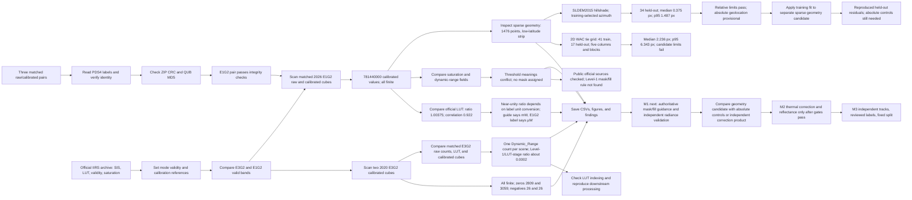

# Research results

Organize results by phase and module. Each module stores a summary, findings, notes, and supporting evidence. This index reports the current M1 results and links to the detailed [project README](../README.md#M1-results-at-a-glance).

## Current status

The M1 modules record the product inventory and initial quality checks. M1 is still in progress. The project has not produced reflectance, a model baseline, or a mineral, hydration, or ice detection. M2 and M3 remain gated by the unresolved items below.

## M1 results

| Work | Result | Evidence and status |
| --- | --- | --- |
| Product inventory | Three matched raw/calibrated pairs: two 2020 E3G2 observations and one 2026 E1G2 observation. | [E1G2 record](phase-1/m1-e1g2-scene/summary.md), [inventory findings](phase-1/m1-inventory/findings.md). |
| Product integrity | The E1G2 pair matches on product metadata. Both ZIP CRC and embedded QUB MD5 checks pass. | [E1G2 findings](phase-1/m1-e1g2-scene/findings.md). |
| Mode validity | SIS Appendix H directs users to retain only bands tagged `VALID`; `SATURATION`, `OSF`, and `INVALID` are band-level exclusions. E3G2 has no valid 4–5 µm bands. E1G2 bands 226–248 are valid from 4504.1 to 4874.9 nm. | [Band-validity CSV](phase-1/m1-inventory/metrics/band_validity_by_mode.csv), [mode figure](phase-1/m1-inventory/figures/band_validity_by_mode.svg). |
| SIS and public processing-code audit | Appendix H confirms band-level validity semantics; inspected public thermal routines do not implement an explicit per-pixel fill/saturation mask. | [Audit record](phase-1/m1-processing-code-audit/summary.md). This does not establish that no provider mask exists. |
| 2020 E3G2 scans | All values are finite. The `m65` cube has 2,809 zeros and 26 negative band-pixels across valid bands. The `d18` cube has 3,059 zeros and 26 negative band-pixels. | [Per-band CSV](phase-1/m1-inventory/metrics/pilot_radiance_quality_by_band.csv), [quality figure](phase-1/m1-inventory/figures/pilot_radiance_quality_by_band.png). We have not classified zero or negative values as fill. |
| 2020 E3G2 raw/LUT/calibrated audit | Only one raw count per scene reaches `Dynamic_Range`. Declared-µW saturation thresholds flag about 99.9988% of valid band-pixels. LUT-stage and archived Level-1 values covary, with median Level-1/LUT-stage ratios about 0.0002 after applying product units. The comparison omits documented downstream processing. | [Audit record](phase-1/m1-e3g2-lineage-check/summary.md), [per-band CSV](phase-1/m1-e3g2-lineage-check/metrics/e3g2_raw_lut_calibrated_by_band.csv), [figure](phase-1/m1-e3g2-lineage-check/figures/e3g2_raw_lut_calibrated_diagnostics.png). The stage difference and mask rules remain unresolved. |
| 2026 E1G2 scan and LUT-stage comparison | The calibrated cube has 781,440,000 finite values. Its 222 valid bands contain 4,829 zeros and 42,081 negative band-pixels. Median Level-1/LUT-stage ratio is 1.00375 and median per-band correlation is 0.922. | [Per-band CSV](phase-1/m1-e1g2-scene/metrics/e1g2_radiance_by_band.csv), [audit script](../scripts/analyze_iirs_e1g2_scene.py). Appendix F documents later pipeline steps; this is not independent calibration validation. |
| Saturation and fill gate | 99.878921% of valid-band values meet the threshold under the table's declared unit. Under the alternate mW interpretation, 12 values exceed. No valid-band raw count reaches `dynamic_range`. | [E1G2 findings](phase-1/m1-e1g2-scene/findings.md). The interpretations conflict. We did not create a pixel mask. |
| Geometry | 1,476 sparse points across 246 scan lines cover about 5.47°W–3.50°W and 6.53°S–26.86°N. | [Audit figure](phase-1/m1-e1g2-scene/figures/e1g2_radiance_and_footprint.png). This is coarse low-latitude coverage, not full-resolution geometry. |
| Full-resolution relative registration | The WAC grid fails the candidate limits. A later SLDEM2015 hillshade grid retained 116 training and 34 held-out ties after excluding DEM nodata patches. Held-out median residual is 0.375 IIRS px and p95 is 1.487 px across five columns and four blocks. | [WAC record](phase-1/m1-wac-2d-grid/summary.md), [hillshade record](phase-1/m1-sldem-hillshade/summary.md), [tie CSV](phase-1/m1-sldem-hillshade/metrics/iirs_sldem_hillshade_ties.csv), [summary JSON](phase-1/m1-sldem-hillshade/metrics/iirs_sldem_hillshade_summary.json), [figure](phase-1/m1-sldem-hillshade/figures/iirs_sldem_hillshade_tie_residuals.svg). The hillshade run passes the relative-registration candidate limits. Absolute geolocation remains provisional; tie residuals are not surveyed position errors. |
| SLDEM relative correction candidate | Applied the training-fitted offset field to a separate 1,476-node sparse geometry copy. Recomputed and reproduced all 34 held-out tie residuals without refitting. Median absolute east and north shifts are about 98.8 m and 37.3 m. | [Module summary](phase-1/m1-sldem-correction-candidate/summary.md), [coordinate CSV and shift values](phase-1/m1-sldem-correction-candidate/metrics/iirs_sldem_relative_geometry_candidate.csv), [JSON](phase-1/m1-sldem-correction-candidate/metrics/iirs_sldem_relative_geometry_candidate_summary.json), [figure](phase-1/m1-sldem-correction-candidate/figures/iirs_sldem_relative_geometry_candidate.svg). Relative correction candidate only; absolute accuracy remains unvalidated. |
| 2026-10-10 M1 gate follow-up | Exa review identified published comparison routes. ODE retrieved the selected M³ candidate label and listed the 2,700,001 KiB image and source location file. Binary retrieval is blocked: JPL strict TLS validation fails, and the documented USGS PDS4 path returns 404. | [Follow-up summary](phase-1/m1-gate-followup-20261010/summary.md), [ODE metadata and file inventory](phase-1/m1-gate-followup-20261010/m3_candidate_ode_metadata.json). No valid-pixel overlap has been computed; unit and pixel-mask gates remain open. |

### E1G2 audit figure

This figure compares calibrated radiance with the official lookup table and displays the product's sparse geometry. The threshold comparison does not provide a valid saturation mask.

### M1 workflow and gates

## Current plan

- `phase-1/m1-inventory`: record product metadata, dimensions, checksums, mode validity, coverage, and acquisition gaps.
- `phase-1/m1-e1g2-scene`: audit the matched E1G2 pair, LUT consistency, threshold semantics, and coarse geometry.
- `phase-1/m1-e3g2-lineage-check`: compare matched 2020 E3G2 raw counts, LUT-stage predictions, and Level-1 products; the V6 guide attributes cross-stage differences to downstream processing, but the local ratios have not been reproduced and coefficients are not in the archive.
- `phase-1/m1-sldem-hillshade`: test full-resolution E1G2 band-40 relative registration against illumination-matched lunar terrain; candidate limits pass, but absolute geolocation remains provisional.
- `phase-1/m1-sldem-correction-candidate`: apply the training-fitted offset model to separate sparse geometry coordinates and reproduce held-out residuals; absolute accuracy remains unvalidated.
- `phase-1/m2-calibration`: establish calibrated units, corrections, masks, and analysis-ready patches after M1 gates pass.
- `phase-1/m3-baselines`: freeze labels and splits, then run physical, clustering, and from-scratch baselines after M2 passes.

Quantitative results must include machine-readable values in `metrics/` and a PNG or SVG figure in `figures/`. Find the M1 audit values and figures in their module directories. No M2 reflectance result or M3 model score exists yet.
